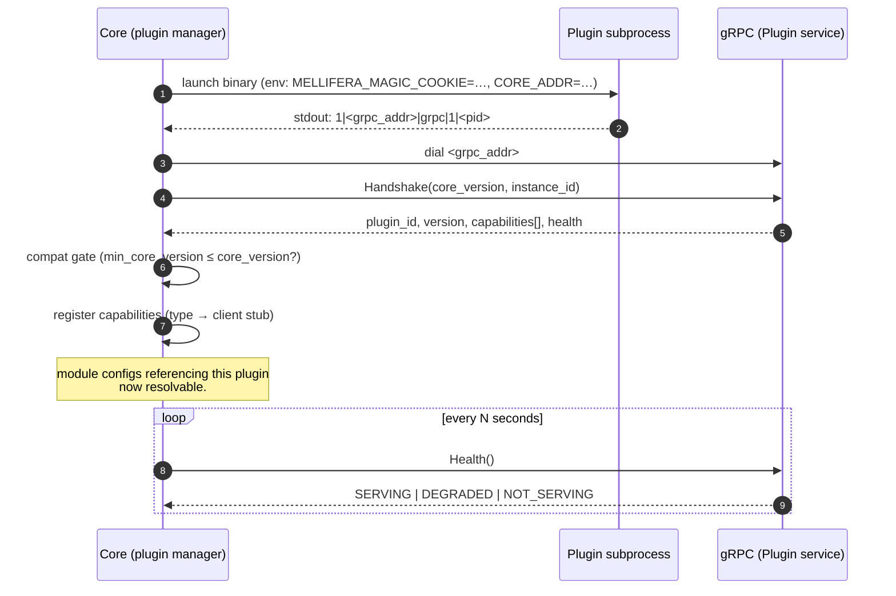
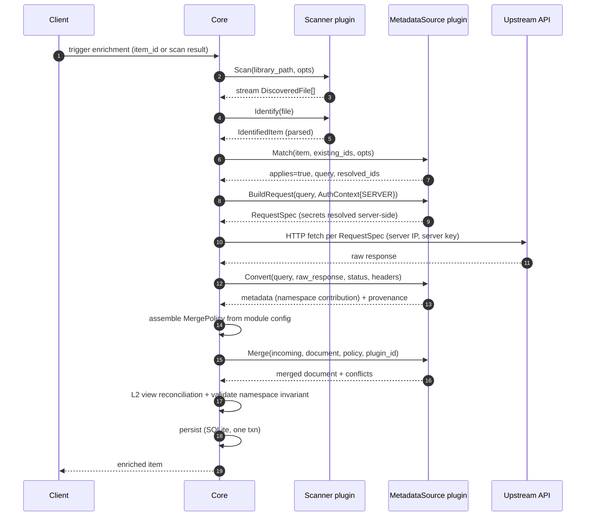
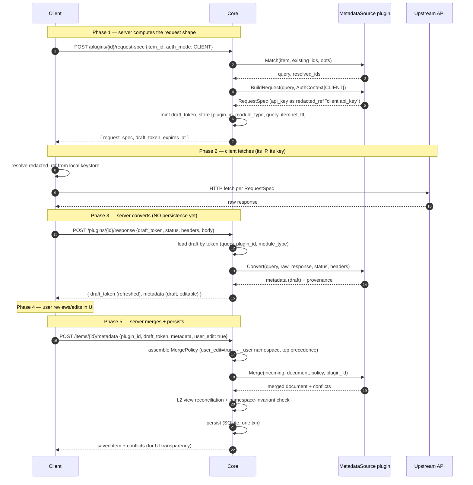

# Mellifera — Architecture Document

**Status:** Draft v0.1 — for review
**Scope:** Deliverable #1 (Architecture Document) + Deliverable #2 (gRPC protobuf contracts, inlined) from the architect brief.
**Out of scope this pass:** Implementation code, Go package scaffolding, proto compilation, prototype, frontend. Those follow once these contracts are reviewed and frozen.

> Name origin: *Apis mellifera* — the Western honeybee; *mellifera* is Latin for "honey-bearing."
> Metaphor: gather raw files as **nectar** (Scanner), refine into enriched metadata as **honey** (MetadataSource), store in the library as a **hive** (SQLite document store). Binary name: `mellifera`.

---

## 0. How to read this document

The brief is explicit: *"Once these four contracts are defined, the plugin manager, the module registry, the API surface, and the client integration all fall out naturally."* This document defines those four foundational contracts first (Section 2), in concrete protobuf-level detail, then derives everything else from them.

Section order is dependency order. Read top to bottom; later sections reference earlier ones. Proto blocks are **authoritative** — at implementation time they become the `.proto` files under a `proto/` package; no proto compilation is performed in this pass, by constraint.

**Design principles (load-bearing, referenced throughout):**

1. **Core is an orchestrator, not a domain engine.** It knows about *capability types* (gRPC service interfaces), never about specific media types or plugins. The strings `"movie"`, `"tv"`, `"tmdb"` appear in **config**, not in core code.
2. **Plugins are stateless subprocesses.** All session state lives in the core. A plugin crash must never lose an in-flight enrichment; the core can replay from stored context.
3. **Dynamic JSON, not typed DTOs.** Media documents are `google.protobuf.Struct` / `json.RawMessage`. We do not model BaseItemDto. The wire contract carries arbitrary JSON; the *module* declares (lightly) what shape it expects.
4. **Precision over collapse.** Per-source values are namespaced and preserved exactly; a separate, recomputable *view* layer picks which to surface. No source's data is ever destroyed by another source's merge.
5. **All plugin logic is server-side.** The client never executes plugin code — it is a dumb fetcher (Mode B) and an editor. This is what makes plugins Go-only and the client runtime-agnostic.
6. **Deprecate, don't delete.** Contract evolution favors reserved fields, additive changes, and deprecation markers over breaking removals.

---

## 1. System overview

### 1.1 Goals (from the brief)

A minimal, modular, self-hostable media server (Jellyfin/Plex class in scope, deliberately not a clone) whose differentiator is **modular media types + runtime-loadable plugins + dual-mode enrichment**. The MVP proves that architecture end to end on one module (TV Series) with two metadata plugins (TMDB + a regional source).

### 1.2 Hard constraints (do not revisit without justification)

| Constraint | Decision | Rationale |
|---|---|---|
| Core deployment | Single Go binary | Low RAM, fast startup, single-file install |
| Storage | SQLite + JSON columns (`json_extract`, generated columns) | Embedded, no DB process; document-style payload + relational control tables. Navidrome-proven. |
| External runtime deps (core) | `ffmpeg`/`ffprobe` via `os/exec` only | No other host binaries required by the core |
| Plugin transport | `hashicorp/go-plugin` (gRPC subprocess) | Cross-platform, crash-isolated, cross-language, Terraform-proven |
| Media payload model | Dynamic JSON (`map[string]interface{}` / `json.RawMessage`) | Explicitly *not* 357 typed structs; ffprobe blob + metadata stored as one document |
| Russian-language data/UI | First-class | Kinopoisk/Shikimori are core to the use case, not extras |
| Data precision | Preserve exact source values | No over-rounding; merge namespaces per source |

### 1.3 Component map (logical)

```
                ┌──────────────────────────────────────────────────────────┐
                │                       CORE BINARY                         │
                │                                                          │
   HTTP ──────► │  api/   (chi router, JSON, SSE)                          │
   (client)     │   │                                                      │
                │   ├─ module/   (module registry: config-driven)          │
                │   ├─ enrich/   (orchestrates Match→Build→Convert→Merge)  │
                │   ├─ plugin/   (subprocess lifecycle, gRPC clients, health)│
                │   ├─ store/    (SQLite, JSON cols, generated indexes)    │
                │   └─ stream/   (range-request file serving)              │
                │              │ gRPC (subprocess)                          │
                └──────────────┼───────────────────────────────────────────┘
                               │
            ┌──────────────────┼──────────────────────────┐
            ▼                  ▼                          ▼
   ┌────────────────┐  ┌────────────────┐      ┌────────────────────┐
   │ base-scanner   │  │ tmdb           │      │ kinopoisk          │
   │ (Scanner)      │  │ (MetadataSrc)  │      │ (MetadataSrc)      │
   │ subprocess     │  │ subprocess     │      │ subprocess         │
   └────────────────┘  └────────────────┘      └────────────────────┘
            │                  │                          │
            ▼                  ▼                          ▼
       filesystem         api.themoviedb.org        api.kinopoisk.*
       (ffprobe)
```

Everything inside the dashed box ships as one binary (`mellifera`); everything below the line is a separate binary loaded at runtime.

### 1.4 Capability type system (summary)

A plugin implements one or more **capabilities**. Each capability is a gRPC service. The core knows capability *types*; it routes by type, not by plugin identity.

| Capability | gRPC service | MVP plugins |
|---|---|---|
| `scanner` | `mellifera.scanner.v1.Scanner` | base-scanner (bundled) |
| `metadata_source` | `mellifera.metadata.v1.MetadataSource` | tmdb (bundled), kinopoisk (bundled) |
| `image_provider` | *(future — reserved)* | — |
| `subtitle_provider` | *(future — reserved)* | — |
| `transcoder` | *(future — reserved)* | — |

Future capabilities reuse the identical handshake + routing mechanism. Reserving them now (empty services, field numbers held) costs nothing and prevents renumbering later.

---

## 2. The four foundational contracts

> **These four are defined first because everything else composes from them.**
> Each is given as: (a) intent, (b) authoritative proto/contract, (c) semantics, (d) non-goals.

### 2.1 Contract 1 — gRPC service definitions per capability

Proto package versioning: `mellifera.<capability>.v1`. All types shared across capabilities live in `mellifera.common.v1`. v1 is the MVP contract; future revisions are `v2`, `v3` and coexist on the wire.

#### 2.1.1 Common types (`mellifera/common/v1/common.proto`)

```proto
syntax = "proto3";

package mellifera.common.v1;

import "google/protobuf/struct.proto";
import "google/protobuf/timestamp.proto";

// A media document is dynamic JSON. We never model it as typed fields.
// Struct is the protobuf idiom for "arbitrary JSON object"; it is what
// the core persists (as TEXT json) and what plugins read/write.
message MediaDocument {
  // Opaque document body. Conforms to the module's document_schema
  // (declared in module config), but the core does not enforce a
  // typed shape — it validates against a JSON Schema if the module provides one.
  google.protobuf.Struct data = 1;

  // Schema version of THIS document's shape (module-defined).
  // Bumped by the module owner when the document shape changes.
  string schema_version = 2;
}

// Provenance entry: who wrote a field, when, with what confidence.
// Stored under document["_provenance"][field_path].
message Provenance {
  string plugin_id = 1;
  string plugin_version = 2;
  google.protobuf.Timestamp fetched_at = 3;
  double confidence = 4;         // 0.0-1.0, informational
  string source_url = 5;         // the upstream URL this came from (audit)
}

// Result of a view computation: which source currently surfaces for a field.
message ViewBinding {
  string field_path = 1;         // e.g. "titles.display"
  string source = 2;             // "kinopoisk" | "tmdb" | "_user"
  string reason = 3;             // "priority" | "language_match" | "user_override"
}

// Merge conflict record (informational — see §3.3).
message MergeConflict {
  string field_path = 1;
  string previous_source = 2;
  string new_source = 3;
  string resolution = 4;         // "namespace_replaced" | "view_repointed" | "user_overrode"
  string reason = 5;
}

// Authentication context handed to BuildRequest. Tells the plugin whose
// credentials to use and how to express them in the RequestSpec.
message AuthContext {
  enum Mode {
    AUTH_MODE_UNSPECIFIED = 0;
    SERVER = 1;                  // use server-configured credentials (resolved in-spec)
    CLIENT = 2;                  // client holds credentials (returned as redacted_ref)
  }
  Mode mode = 1;

  // When mode=SERVER, the core injects resolved secret values here, keyed by
  // the plugin's declared secret names (e.g. "api_key" -> "actual_key").
  // The plugin MUST NOT echo these into RequestSpec.variables as plaintext
  // when mode=CLIENT — see §6.2.
  google.protobuf.Struct server_secrets = 2;
}
```

#### 2.1.2 Scanner capability (`mellifera/scanner/v1/scanner.proto`)

```proto
syntax = "proto3";

package mellifera.scanner.v1;

import "mellifera/common/v1/common.proto";
import "google/protobuf/struct.proto";

service Scanner {
  // Walk a library root and emit discovered files. Streaming because
  // libraries can be large; the core persists incrementally and can
  // show live progress to the UI.
  rpc Scan(ScanRequest) returns (stream DiscoveredFile);

  // Parse one discovered file into a structured guess (title/season/episode/...).
  // Pure function: no I/O beyond what Scan already did.
  rpc Identify(IdentifyRequest) returns (IdentifyResult);
}

message ScanRequest {
  // Absolute or library-root-relative path to scan.
  string library_path = 1;

  // Module type id (e.g. "tv"). Guides the scanner's parsing heuristics.
  // The scanner MAY ignore it; it MUST NOT reject an unknown value
  // (forward-compat with module types the scanner predates).
  string module_type = 2;

  // Module-supplied scanner options, verbatim from module config (§2.4).
  // Well-known keys (advisory, not required): include_patterns, exclude_patterns,
  // filename_format, follow_symlinks, min_size_bytes.
  google.protobuf.Struct options = 3;

  // Core-supplied resume cursor (opaque to the core). If non-empty, the
  // scanner resumes from where it left off (crash recovery / incremental).
  string resume_cursor = 4;
}

message DiscoveredFile {
  // Stable id derived from path (deterministic hash); used as the join key
  // to the items table before a full item id is minted.
  string file_id = 1;

  // Library-root-relative path. Absolute path is reconstructed by the core.
  string relative_path = 2;

  int64 size_bytes = 3;

  // MIME type guessed from extension; the scanner MAY refine via ffprobe.
  string mime_type = 4;

  // Raw ffprobe JSON output (verbatim, UTF-8). Carried as bytes rather than
  // google.protobuf.Struct: (a) it is stored verbatim in the document anyway,
  // (b) ffprobe output is large/deeply-nested and Struct is wire-verbose,
  // (c) the core does not structurally inspect ffprobe fields — only plugins
  // and the storage layer (via json_extract generated columns) read them.
  // Empty if the scanner could not probe (non-fatal; Identify still runs).
  bytes ffprobe_json = 5;

  // Scanner-resume cursor (opaque). The core persists the latest value per
  // scan job; on crash, it restarts Scan with the last cursor.
  string resume_cursor = 6;

  // Soft errors per file (e.g. "ffprobe timed out"). Non-fatal; core logs.
  repeated string warnings = 7;
}

message IdentifyRequest {
  DiscoveredFile file = 1;
  string module_type = 2;
}

message IdentifyResult {
  string file_id = 1;

  // Best-effort media type guess. May differ from the request's module_type
  // (e.g. scanner detects a movie inside a "tv" root). The core treats this
  // as advisory; module routing is authoritative.
  string media_type = 2;

  // Structured parse of the filename/path. Free-form JSON whose keys are
  // module-interpreted (different modules parse different things).
  // Well-known keys (advisory): title, year, season, episode, episode_end,
  // release_group, crc32, resolution, source, audio_channels.
  // Missing keys are simply absent; consumers must not assume presence.
  google.protobuf.Struct parsed = 3;

  // Confidence of the parse (0.0-1.0). Below a module-configurable threshold
  // the UI flags the item for manual identification.
  double confidence = 4;

  // What was parsed, for debugging / UI display.
  string parser_name = 5;
}
```

**Why streaming Scan:** a 10k-file library should not block on a single response. Streaming lets the core persist rows incrementally, surface progress via SSE, and survive a mid-scan crash via `resume_cursor`.

**Why `bytes ffprobe_json` over `Struct`:** explicitly honors the dynamic-JSON constraint. ffprobe output is the canonical example of "data we store verbatim and never fully type-model." Using `Struct` here would imply we inspect it structurally on the wire — we don't. (See §3.1 for how the storage layer indexes into it.)

#### 2.1.3 MetadataSource capability (`mellifera/metadata/v1/metadata.proto`)

```proto
syntax = "proto3";

package mellifera.metadata.v1;

import "mellifera/common/v1/common.proto";
import "mellifera/scanner/v1/scanner.proto";
import "google/protobuf/struct.proto";

service MetadataSource {
  // MATCH: does this plugin apply to the item, and what query will it use?
  rpc Match(MatchRequest) returns (MatchResult);

  // BUILD_REQUEST: turn a query into a concrete, serializable HTTP request spec.
  // This is the dual-mode pivot: the spec is pure data and can be executed
  // by EITHER the server (Mode A) or the client (Mode B).
  rpc BuildRequest(BuildRequestRequest) returns (BuildRequestResponse);

  // CONVERT: transform a raw upstream response into normalized metadata.
  // Pure server-side function. Runs identically whether the response came
  // from a server-side fetch (Mode A) or a client POST (Mode B).
  rpc Convert(ConvertRequest) returns (ConvertResult);

  // MERGE: integrate this plugin's metadata into the aggregate document.
  // Two invariants the plugin MUST honor (core validates post-call, §3.3):
  //   (a) only write into its OWN source namespace
  //   (b) update the _view layer per the supplied MergePolicy
  rpc Merge(MergeRequest) returns (MergeResult);
}

// --- Match ---

message MatchRequest {
  // The scanned item (parsed fields available for fuzzy title matching).
  mellifera.scanner.v1.IdentifyResult item = 1;

  string module_type = 2;

  // Existing identifiers on the current document (for re-enrichment /
  // ID-anchored match, e.g. {"tmdb_id": 1396}). Empty on first enrichment.
  google.protobuf.Struct existing_ids = 3;

  // Module-supplied plugin options (verbatim from module config §2.4).
  google.protobuf.Struct options = 4;
}

message MatchResult {
  // False => this plugin has nothing to contribute; core skips subsequent RPCs.
  bool applies = 1;

  // The logical query this plugin will use. Opaque to the core; passed back
  // to BuildRequest. Example: {"title":"Breaking Bad","year":2008,"language":"ru"}.
  google.protobuf.Struct query = 2;

  // How confident the match is. Used by the UI to flag low-confidence items
  // for review; NOT used by the core to short-circuit (priority is policy).
  double confidence = 3;

  // Human-readable reason (debug/UI). e.g. "matched by tmdb_id 1396" or
  // "fuzzy title match 0.86, year mismatch".
  string reason = 4;

  // If non-empty, the plugin claims a stable upstream id for this item
  // (e.g. {"kinopoisk_id": 270365}). The core writes these into document.identifiers
  // so future matches are ID-anchored, not fuzzy.
  google.protobuf.Struct resolved_ids = 5;
}

// --- BuildRequest ---

message BuildRequestRequest {
  google.protobuf.Struct query = 1;     // from MatchResult.query
  string module_type = 2;
  mellifera.common.v1.AuthContext auth = 3;                  // whose credentials, §6
  google.protobuf.Struct options = 4;
}

message BuildRequestResponse {
  RequestSpec spec = 1;
}

// --- Convert ---

message ConvertRequest {
  // The original query, so the plugin can interpret response fields whose
  // meaning depends on what was asked (e.g. multi-search vs id-lookup).
  google.protobuf.Struct query = 1;

  // Raw HTTP response body (verbatim bytes). The plugin parses its own format.
  bytes raw_response = 2;

  int32 http_status = 3;
  map<string, string> response_headers = 4;

  string module_type = 5;
  google.protobuf.Struct options = 6;
}

message ConvertResult {
  // Normalized metadata in the plugin's namespace shape. Plugin returns
  // ONLY its own contribution; cross-source reconciliation is Merge's job.
  //
  // Convention (§3): top-level keys are the plugin's contribution fields,
  // e.g. {"titles":{"ru":"Во все тяжкие"},"ratings":{"score":8.9,"votes":215000}}.
  // The core wraps this into document["sources"][plugin_id] during Merge.
  google.protobuf.Struct metadata = 1;

  // Per-field provenance (informational; core also stamps at merge time).
  map<string, mellifera.common.v1.Provenance> provenance = 2;

  // Soft warnings (e.g. "response truncated", "rate limit header observed").
  repeated string warnings = 3;

  // If Convert could not run (http 404, parse failure), set error and leave
  // metadata empty. The core records this; the document is not corrupted.
  Error error = 4;
}

message Error {
  string code = 1;            // "upstream_404" | "parse_error" | "rate_limited" | ...
  string message = 2;
  bool retryable = 3;         // core may retry with backoff if true
}

// --- Merge ---

message MergeRequest {
  // Incoming metadata (from Convert, possibly user-edited in Mode B).
  // For Mode B user edits, this carries a "_user" namespace marker.
  google.protobuf.Struct incoming = 1;

  // Current document state (the core passes the full document; the plugin
  // is expected to only touch its own namespace — see §3.3 for the invariant).
  mellifera.common.v1.MediaDocument document = 2;

  string module_type = 3;
  string plugin_id = 4;       // which source namespace to write

  // Policy derived from module config (§2.4, §3.2): source priority order,
  // language preference, per-field source overrides.
  MergePolicy policy = 5;
}

message MergePolicy {
  // Ordered source ids, highest precedence first. Drives view computation.
  // Example for a Russian-first TV module: ["kinopoisk","tmdb"].
  repeated string source_priority = 1;

  // Ordered language preference for string fields (titles, overview).
  // Example: ["ru","en"].
  repeated string language_preference = 2;

  // Per-field source pin. e.g. {"images.poster": "tmdb"} — always use TMDB
  // for posters regardless of source_priority.
  map<string, string> field_source_overrides = 3;

  // If true, incoming is treated as user-authored and pinned to the "_user"
  // namespace with highest view precedence (over all sources).
  bool user_edit = 4;
}

message MergeResult {
  mellifera.common.v1.MediaDocument document = 1;
  repeated mellifera.common.v1.MergeConflict conflicts = 2;
  repeated mellifera.common.v1.ViewBinding view = 3;   // the recomputed view bindings
  repeated string warnings = 4;
}
```

> **Error model (Q19/D17):** the `Error` message above is the **domain-error** channel — it rides inside a gRPC `OK` response when the RPC succeeded but the enrichment operation failed (upstream 404, parse error, rate limited). Transport/protocol failures (plugin down, RPC timeout, auth) use **gRPC status codes** instead, never this message. The core translates gRPC codes → HTTP and maps domain `Error` → HTTP 422 with `{error:{code,message,retryable}}`. Full mapping in §11.6.

**Why Match and BuildRequest are separate RPCs:** Match is the expensive, heuristic-heavy step (fuzzy title matching, ID lookup). BuildRequest is cheap and is where credential handling happens. Splitting them lets the core (a) cache Match results, (b) re-issue BuildRequest with a different `AuthContext` (server vs client) without re-running Match, and (c) surface "which plugin applies, with what query" to the UI before committing to a fetch.

**Why Convert takes the original query:** upstream response shapes differ between a search-by-title call and a get-by-id call. The plugin needs to know which it ran to interpret fields. The query is the cheapest way to carry that context.

**Why Merge takes the full document and a policy:** the brief specifies `Merge(metadata, document) -> document`. We honor that signature and add the policy explicitly (it was implicit in "per-field priority, source preference"). The post-call validation (§3.3) makes the "plugin only touches its namespace" invariant enforceable.

#### 2.1.4 RequestSpec (`mellifera/metadata/v1/request_spec.proto`) — Contract 3

This is the contract that makes dual-mode possible. It is pure data — no code, no callbacks. Either the server or the client can execute it.

```proto
package mellifera.metadata.v1;

import "google/protobuf/struct.proto";

message RequestSpec {
  // HTTP method. "GET" or "POST" in MVP; validated by the core.
  string method = 1;

  // URL template with {variable} placeholders. Substitution is the minimal
  // "{name}" replacement (NOT full RFC 6570) — every variable referenced
  // MUST appear in `variables`. The core percent-encodes substituted values.
  // Example:
  //   "https://api.themoviedb.org/3/search/tv?query={title}&year={year}&api_key={api_key}"
  string url_template = 2;

  // Static headers (Accept, User-Agent, ...). Auth headers resolved per §6:
  //   - SERVER mode: header value is the resolved secret (server has it).
  //   - CLIENT mode: header value is a redacted_ref token the client replaces
  //     (e.g. "Authorization: Bearer {client:api_key}") — see VariableValue.redacted_ref.
  map<string, string> headers = 3;

  // Variables for {placeholder} substitution in url_template, headers, body.
  map<string, VariableValue> variables = 4;

  // Request body for POST (raw bytes; empty for GET). May itself contain
  // {placeholder} substrings substituted from `variables`.
  bytes body = 5;

  // Suggested client/server timeout for the fetch.
  int32 timeout_seconds = 6;

  // Hint: response may be non-UTF-8 (image, gzip). Client must not utf-8-validate.
  bool binary_safe = 7;

  // Advisory rate-limit the executor SHOULD honor (protects upstream APIs).
  // The core enforces this server-side; the client SHOULD honor it client-side.
  int32 min_interval_ms = 8;
}

message VariableValue {
  oneof kind {
    string string_value = 1;
    int64 int_value = 2;
    double double_value = 3;
    bool bool_value = 4;

    // Reference to a secret the executor must supply. Format: "<scope>:<name>".
    //   "server:api_key"  -> core resolves from server_secrets (Mode A)
    //   "client:api_key"  -> client supplies from its own keystore (Mode B)
    // When the core builds the spec for the client (Mode B, CLIENT auth),
    // it leaves redacted_ref values intact so the secret never crosses to
    // the client. See §6.2.
    string redacted_ref = 5;
  }
}
```

**Substitution semantics (normative):**

1. Scan `url_template`, `headers` values, and `body` (as UTF-8) for `{name}` tokens.
2. Every token MUST have a matching entry in `variables`. Unknown token ⇒ spec is invalid; the executor rejects it before any network call.
3. Substitute the variable's resolved value. Strings are percent-encoded for URL placement; for header/body placement they are inserted verbatim.
4. `redacted_ref` variables: the executor resolves them from its own credential store. If unresolved, the executor aborts with a clear error naming the missing ref.

**Why template + variables (not a pre-built URL):**

- The server can log/audit the request *shape* without logging secrets.
- The client can inject its own secret without the server ever seeing it (Mode B, client auth) — this is the security property that makes region-locked + rate-limited services work from the user's location.
- Debugging and replay: the template + resolved (non-secret) variables fully describe what was asked.

### 2.2 Contract 2 — Plugin handshake protocol

Built on `hashicorp/go-plugin`'s substrate (env-cookie magic, negotiated gRPC address). Mellifera adds a domain-level handshake on top.

#### 2.2.1 go-plugin substrate (standard, unchanged)

- Core sets `MELLIFERA_MAGIC_COOKIE` env var to an agreed value before launching the plugin subprocess. The plugin refuses to serve unless the cookie matches — this prevents the gRPC port from being driven by a stray binary the user happens to run.
- The plugin writes `core-address | protocol | protocol-version | pid` to stdout on startup; the core dials the gRPC server at that address.
- Plugin binary advertises which gRPC services it serves via go-plugin's `GRPCServer`/`GRPCClient` plugin mapping. Mellifera registers: `Plugin` (handshake/health) plus any capability services the plugin implements.

#### 2.2.2 Domain handshake (`mellifera/plugin/v1/plugin.proto`)

```proto
syntax = "proto3";

package mellifera.plugin.v1;

import "google/protobuf/struct.proto";
import "google/protobuf/timestamp.proto";

// Every plugin MUST serve this service, in addition to its capability services.
service Plugin {
  rpc Handshake(HandshakeRequest) returns (HandshakeResponse);
  rpc Health(HealthRequest) returns (HealthResponse);
  // Graceful shutdown hook. Core calls before SIGTERMing the subprocess.
  rpc Shutdown(ShutdownRequest) returns (ShutdownResponse);
}

message HandshakeRequest {
  string core_version = 1;       // semver, for compat gating
  string core_instance_id = 2;   // unique per core process; lets a stateful
                                 // plugin (if any) scope its state per core
  google.protobuf.Struct core_capabilities = 3; // reserved: future core-side features
}

message HandshakeResponse {
  string plugin_id = 1;           // globally unique, matches repo manifest id
  string plugin_version = 2;      // semver
  string sdk_version = 3;         // Mellifera plugin SDK contract version (== proto vN)

  // Compatibility floor: refuse to load below this core version.
  string min_core_version = 4;

  // Human-readable, localized (ru/en) for the UI.
  LocalizedString display_name = 5;
  LocalizedString description = 6;

  // What this plugin provides. Core uses this to populate the capability
  // registry and to validate module configs that reference this plugin.
  repeated CapabilityDeclaration capabilities = 7;

  // Initial health snapshot (core will poll Health thereafter).
  HealthResponse health = 8;
}

message CapabilityDeclaration {
  // Capability type id. Well-known MVP values: "scanner", "metadata_source".
  // Future: "image_provider", "subtitle_provider", "transcoder".
  string type = 1;

  // Instance id within the plugin (a plugin MAY serve >1 capability of the
  // same type, e.g. two scanners with different heuristics). Defaults to "default".
  string id = 2;

  // Fully-qualified gRPC service name the core should bind this capability to.
  // e.g. "mellifera.scanner.v1.Scanner" or "mellifera.metadata.v1.MetadataSource".
  // Lets the core cast its gRPC client to the right stub without guessing.
  string proto_service = 3;

  // JSON Schema describing the config this plugin accepts (validated by the
  // core when a module references this plugin). Empty = no config expected.
  google.protobuf.Struct config_schema = 4;

  // Which module media_types this plugin CLAIMS to handle. Informational only;
  // module config is authoritative (a module MAY bind a plugin that didn't
  // list its media_type — the plugin then receives module_type in each RPC
  // and decides whether to handle it).
  repeated string claimed_media_types = 5;

  // Secret names this plugin needs (e.g. ["api_key"]). Drives AuthContext.
  // If empty and mode=SERVER, no secrets are injected; if mode=CLIENT,
  // no redacted_ref appears.
  repeated string required_secrets = 6;
}

message HealthRequest {}

message HealthResponse {
  enum Status {
    STATUS_UNSPECIFIED = 0;
    SERVING = 1;          // fully operational
    DEGRADED = 2;         // serving but with issues (e.g. rate-limited, quota low)
    NOT_SERVING = 3;      // cannot handle requests
  }
  Status status = 1;
  LocalizedString message = 2;
  // Free-form details: quota_remaining, last_error, upstream_latency_ms, ...
  google.protobuf.Struct details = 3;
}

message ShutdownRequest {
  string reason = 1;
}
message ShutdownResponse {}

message LocalizedString {
  map<string, string> values = 1;  // {"ru":"Кинопоиск","en":"Kinopoisk"}
}
```

#### 2.2.3 Handshake sequence



#### 2.2.4 Compatibility & versioning rules

- **Capability coexistence via versioned FQN (Q12/D16).** The capability registry keys on `(plugin_id, capability_id, proto_service_fqn)` — the FQN carries the proto major (`mellifera.metadata.v1.MetadataSource` vs `.v2.`), so plugins targeting different majors coexist on one core. The core supports the current and previous SDK major (N and N−1) simultaneously; a plugin built against `mellifera-plugin-sdk` v1 speaks `*.v1` protos. **No compatible major registered:** the `Plugin` service is versioned separately (always v1-stable), so a plugin whose *capability* targets an unsupported major (e.g. plugin speaks v3, core supports v1+v2) still **handshakes successfully**, but that capability declaration is **skipped with a warning** and not registered — module configs referencing it go `degraded`, exactly like a missing plugin (§2.4.2). The UI surfaces "plugin X requires a newer core."
- **`min_core_version`** is the floor. Core refuses to activate a plugin whose floor exceeds its own version; the plugin is marked `installed_incompatible`.
- **Proto evolution:** additive only within a major. New fields get fresh numbers and default values. Removed fields are `reserved`. A capability RPC signature never changes shape within v1 — new behavior is opt-in via `options` Structs.
- **Deprecation over deletion (constraint §6):** a field or RPC marked deprecated stays on the wire for one major cycle, emits a warning in handshake logs, and is removed only at a major bump documented in the changelog.

### 2.3 Contract 3 — RequestSpec

Defined in §2.1.4. Summary of its role: it is the **single serializable artifact** that dual-mode hinges on. The plugin produces it (server-side, in Go, via BuildRequest); either the server or the client executes it; the executor returns a raw response that the same plugin's Convert (again, server-side) normalizes. The contract is intentionally minimal — method, url_template, headers, variables, body, timeout, two hints — so that any HTTP client in any language can execute it.

### 2.4 Contract 4 — Module definition model

A module is a **configuration entity**, not code. It declares: a media type, which scanner capability fills its discovery slot, which metadata capabilities fill its enrichment slots (and in what priority), a document schema, and a display policy. The core has zero hardcoded media types.

#### 2.4.1 Module config (YAML; stored verbatim as JSON in SQLite `modules` table)

```yaml
# /data/modules/tv.yaml  — or rows in the modules table with this JSON
id: tv
schema_version: 1
display_name: {ru: "Сериалы", en: "TV Series"}
media_type: tv

scanner:
  plugin_id: base-scanner
  capability_id: default
  options:
    filename_format: SxxExx
    exclude_patterns: ["*.nfo", "*.jpg", "*.srt"]
    follow_symlinks: false

metadata_sources:
  - plugin_id: kinopoisk
    capability_id: default
    # prefer_proto_version: "v1"   # OPTIONAL (Q12/D16): pin a proto major when a plugin speaks several.
                                   # Absent = core uses the plugin's latest stable major it supports.
    priority: 1                    # 1 = highest precedence for the view
    enabled: true
    auth_mode: CLIENT              # use the user's KP credentials (region + rate-limit friendly)
    options:
      language: ru
  - plugin_id: tmdb
    capability_id: default
    priority: 2
    enabled: true
    auth_mode: SERVER              # use server-configured TMDB key
    options:
      language: en-US
      include_image_types: [poster, backdrop, logo]

# Document schema: a JSON Schema the core validates documents against on write.
# Light: declares required structural keys, not 357 typed fields.
document_schema:
  type: object
  required: [identifiers, titles, sources]
  properties:
    identifiers: {type: object}
    titles:      {type: object}
    ratings:     {type: object}
    overview:    {type: object}
    images:      {type: object}
    episodes:    {type: array}
    sources:     {type: object}    # per-plugin namespace
    _view:       {type: object}
    _provenance: {type: object}

# Display policy: how the UI surfaces fields. Drives MergePolicy (§3.2) and
# the _view computation.
display:
  language_preference: [ru, en]
  title_source_priority: [kinopoisk, tmdb]   # fall back across sources
  rating_source_priority: [kinopoisk, tmdb]
  default_image_source: tmdb
  fields:
    - {path: titles,       label: {ru: "Названия",  en: "Titles"},    editable: true}
    - {path: ratings,      label: {ru: "Оценки",     en: "Ratings"},   editable: true}
    - {path: overview,     label: {ru: "Описание",   en: "Overview"},  editable: true}
    - {path: images,       label: {ru: "Изображения", en: "Images"},   editable: true}
    - {path: episodes,     label: {ru: "Эпизоды",    en: "Episodes"},  editable: true}
```

#### 2.4.2 Binding semantics (normative)

1. **Reference by capability slot, not by type.** A module names `plugin_id` + `capability_id`. The core resolves the live plugin that declared that capability at handshake. If the plugin is missing or disabled, the slot is **empty** and the module is *degraded* (that capability unavailable), not broken.
2. **`media_type` is a string, not an enum.** The core never interprets it; it is passed through to plugins and used as a storage partition key. Anyone can define `"anime"`, `"audiobook"` without core changes.
3. **`priority` is module-local.** Lower number = higher precedence for *view* computation only (§3.3). It does NOT affect data persistence — every enabled source's data is always stored.
4. **`auth_mode` per source.** SERVER = core injects secrets from config; CLIENT = the RequestSpec carries `redacted_ref` placeholders for the user's own credentials (§6). This lets a module mix server-backed (TMDB) and user-backed (Kinopoisk) sources.
5. **`options` are opaque pass-through.** The core does not interpret them; it validates them against the plugin's `config_schema` (declared at handshake) and forwards them to every RPC. This is how a module customizes a plugin without the core learning the plugin's knobs.
6. **Schema is light and JSON-Schema-shaped.** The core validates the document's top-level structural keys on write; it does NOT model fields typed in Go — with ONE exception (display-naming, 2026-10): the module registry decodes the display block's `item_name` verbatim into `Module.ItemName` (config data, never core logic); every other display key remains SPA-consumed config. The serial module's seed ships at `schema_version` 3 with `"item_name": "{title} · S{season}E{episode}"`; pre-v3 serial rows are promoted by a schema-guarded UPDATE on Open (idempotent, scoped to the serial row, chained after the v1→v2 upgrade). A module owner evolves the schema by bumping `schema_version`; old documents are migrated lazily (or flagged) per the deprecation policy.
7. **Proto-version resolution (Q12/D16).** A module source binds by `(plugin_id, capability_id)`; the core resolves the live capability stub by FQN, preferring the plugin's latest stable proto major that the core supports. A module MAY set optional `prefer_proto_version` (e.g. `"v1"`) to pin a specific major when a plugin speaks several; if the preference is unavailable, the core falls back to the latest supported major and warns — it never hard-fails. If no compatible major is registered (capability skipped at handshake, §2.2.4), the source is `degraded`.

#### 2.4.3 Module resolution at runtime

```
module "tv" needs to enrich item I:
  1. look up module config for media_type=I.media_type
  2. for each enabled metadata_source S in priority order:
       resolve S.plugin_id + S.capability_id → live gRPC stub (from handshake registry)
       if stub missing → mark source "unavailable", continue (do not fail the enrichment)
       else → enqueue (Match → BuildRequest → …) for S
  3. merge results per §3
```

The core never branches on `if media_type == "tv"`. Any module-specific behavior lives in the module config and in the plugins it binds.

---

## 3. Document & merge model

This section defines how multi-source metadata is stored and reconciled. It is the section that most directly serves the **precision** requirement: *"Plugin merge logic must preserve source-specific values, not collapse them into a generic field."*

### 3.1 Document shape (dynamic JSON, namespaced by source)

A media document is one JSON object. Top-level keys fall into three tiers:

```jsonc
{
  // ── Tier 1: converged identifiers (cross-source, ID-anchored) ──
  "identifiers": {
    "tmdb_id": 1396,
    "kinopoisk_id": 270365,
    "imdb_id": "tt0903747"
  },

  // ── Tier 2: per-source namespaces (LOSSLESS — every source keeps its own values) ──
  "sources": {
    "tmdb": {
      "titles":      { "en": "Breaking Bad", "original": "Breaking Bad" },
      "ratings":     { "score": 9.5, "votes": 1700000 },
      "overview":    { "en": "…" },
      "images":      { "poster": "https://image.tmdb.org/…/poster.jpg",
                       "backdrop": "https://image.tmdb.org/…/bg.jpg" },
      "episodes":    [ { "season": 1, "episode": 1, "title": "Pilot", "air_date": "2008-01-20" } ]
    },
    "kinopoisk": {
      "titles":      { "ru": "Во все тяжкие", "original": "Breaking Bad" },
      "ratings":     { "score": 8.9, "votes": 215000 },   // EXACT, not averaged with TMDB
      "overview":    { "ru": "…" },
      "images":      { "poster": "https://…/kp_poster.jpg" },
      "episodes":    [ { "season": 1, "episode": 1, "title": "Пилот", "air_date": "2008-01-20" } ]
    }
  },

  // ── Tier 3: computed view (recomputable, lossless, drives default UI display) ──
  "_view": {
    "title":    { "value": "Во все тяжкие", "source": "kinopoisk", "lang": "ru", "reason": "language_match" },
    "rating":   { "value": 8.9,              "source": "kinopoisk", "reason": "priority" },
    "poster":   { "value": "https://…/kp_poster.jpg", "source": "kinopoisk", "reason": "priority" },
    "backdrop": { "value": "https://image.tmdb.org/…/bg.jpg", "source": "tmdb", "reason": "field_source_override" }
  },

  // ── Provenance audit trail (per field_path) ──
  "_provenance": {
    "sources.kinopoisk.ratings.score": {
      "plugin_id": "kinopoisk", "plugin_version": "1.0.0",
      "fetched_at": "2026-07-20T12:00:00Z", "confidence": 0.98,
      "source_url": "https://api.kinopoisk.dev/v1.4/movie/270365"
    }
  },

  // ── Raw ffprobe blob (from scanner), stored verbatim ──
  "ffprobe": { /* …the full ffprobe JSON… */ },

  // ── Core-managed metadata (not source data) ──
  "file_id": "01HXYZ…",
  "module_type": "tv",
  "schema_version": 1,
  "created_at": "2026-07-20T11:00:00Z",
  "updated_at": "2026-07-20T12:00:00Z"
}
```

**Key properties:**

- **Tier 2 is lossless.** `sources.tmdb.ratings.score` and `sources.kinopoisk.ratings.score` coexist forever. Nothing averages them. The user can see, edit, and pin either.
- **Tier 3 is a cache.** `_view` is always recomputable from Tier 2 + the module's display policy. If policy changes (user reorders source priority), the core recomputes `_view` without touching Tier 2.
- **`_user` is a reserved source name.** User edits (Mode B step 9, or manual edits) write into `sources._user` and the view gives `_user` unconditional precedence. The user always wins the default display, and the original source values are still preserved underneath.
- **Simple by default, extended by plugins.** A freshly scanned item carries only Tier 1 identifiers (parsed from the filename) + the `ffprobe` blob + core-managed fields. `sources` and `_view` populate *only* as metadata plugins enrich it. A library with zero metadata plugins is fully functional — just lean. This is what keeps the API and the default document minimal; plugins extend, they do not bloat the baseline.
- **Composition changes are safe by construction.** Disabling a plugin leaves its namespace *dormant* (retained, excluded from `_view`); re-enabling restores it instantly with zero data loss. Adding a plugin writes a new namespace; mixing plugins arbitrates the view by policy (§3.3). Removing a plugin *quarantines* then *prunes* its namespace via the janitor (§7.5). The document is always correctly parseable from whatever sources are currently present, because each namespace is self-describing and the view is recomputed — never stored as the truth.

### 3.2 Merge strategy — two layers

The brief says Merge is a plugin RPC. We split the *responsibility* into two layers while keeping the brief's RPC signature:

| Layer | Who | Job |
|---|---|---|
| **L1: Namespace write** | Plugin (`Merge` RPC) | Write its own `sources.<plugin_id>` subtree; stamp `_provenance` for its fields; suggest `_view` updates per the supplied `MergePolicy`. |
| **L2: View reconciliation** | Core (post-call) | Validate the plugin only touched its own namespace (§3.3); recompute `_view` from all sources × the module's display policy; record `MergeConflict` entries for view repoints. |

Concretely, the plugin's `Merge` receives the current document + the `MergePolicy` (derived from module config by the core) and returns the new document. The plugin's algorithm is:

```
1. write document["sources"][plugin_id] = incoming.metadata   # write ONLY here
2. for each field_path in incoming.metadata (flattened):
     stamp document["_provenance"][field_path] = {plugin_id, version, ts, confidence, source_url}
3. propose document["_view"] updates per MergePolicy:
     for each view field (title, rating, poster, ...):
        pick source by: user_edit? _user
                        : field_source_overrides[path]? that source
                        : first source in source_priority having the field in a preferred language
     attach the chosen source + reason to each _view entry
4. return document + the list of view bindings you changed (as MergeConflict entries)
```

The core then:
- validates diff step 1 (the plugin touched nothing outside `sources.<plugin_id>` and `_provenance` for its own paths; touching `_view` is allowed because L2 recomputes it anyway),
- runs L2 itself as the authoritative view computation (it does not trust the plugin's `_view` proposal beyond using it as a hint — the core recomputes deterministically from policy),
- persists atomically (single SQLite transaction).

> **Why this split?** It gives the plugin expressive control over its own field structure and provenance, while keeping cross-source arbitration in the core where the module policy lives. A buggy or third-party plugin cannot corrupt another source's data. The brief's `Merge(metadata, document) -> document` signature is preserved exactly.

### 3.3 Conflict resolution & invariants

**There is no cross-source data conflict**, by construction: each source owns its namespace. The only "conflicts" are *view repoints* (which source the display surfaces) — and those are deterministic from policy:

| Situation | Resolution | Conflict log |
|---|---|---|
| New source writes a field the view currently takes from another source, and new source is higher priority | View repoints to new source | `view_repointed` (previous_source, new_source) |
| New source writes a field the view currently takes from a higher-priority source | View unchanged; new data stored in namespace only | `namespace_replaced` (informational) |
| User edits a field (Mode B save) | View repoints to `_user` unconditionally | `user_overrode` (previous_source → `_user`) |
| Plugin's Convert returned an error | Namespace untouched; no view change; warning recorded | `convert_failed` (in warnings, not conflicts) |

**Namespace-write invariant (enforced by core post-call):**

1. The diff between incoming and outgoing `document["sources"][plugin_id]` is unconstrained (the plugin owns this subtree).
2. The diff to any OTHER `document["sources"][<other>]` MUST be empty. If not, the core **rejects the merge** (reverts to the pre-call document), records a `severity: high` plugin-misbehavior event, and marks the plugin `DEGRADED`. The document is not corrupted.
3. `document["_provenance"]` may only gain or update entries whose `plugin_id` matches. Stripping another source's provenance is a rejection.
4. `document["_view"]` is recomputed by the core; the plugin's proposal is a hint, not authoritative.

This is the safety net that lets us trust third-party plugins (Phase 2 distribution) with the document.

### 3.4 Precision guarantees (mapped to the requirement)

| Requirement (brief) | How the model satisfies it |
|---|---|
| "exact titles, exact ratings, no over-rounding" | Ratings stored per-source as-is (`8.9`, not `9`); titles per-source per-language. No averaging, no rounding. |
| "preserve source-specific values, not collapse them into a generic field" | Tier 2 namespaces — `sources.tmdb.*` and `sources.kinopoisk.*` never overwrite each other. |
| Merge priority / source preference | `MergePolicy.source_priority` + `language_preference` + per-field overrides drive ONLY the view, not the stored data. |
| Russian-language first-class | `language_preference: [ru, en]` is a normal module config; Kinopoisk/Shikimori write into their namespaces like any source. No special-casing in the core. |

---

## 4. Dual-mode enrichment flow

All plugin logic runs server-side in both modes. The only difference is *who performs the HTTP fetch*.

### 4.1 Mode A — server-driven (sequence)



**Notes:** every arrow from Core to a plugin is a normal gRPC call to whichever subprocess serves that capability. The server holds the upstream API key (from config) and makes the fetch itself. This is the "classic" path; Mode B reuses steps 1–3 (Match → BuildRequest) and steps 5–8 (Convert → Merge), differing only at the fetch step.

### 4.2 Mode B — client-driven (sequence)



**Why this works:**

- The plugin stays stateless. The `draft_token` is core-minted and core-stored; if the plugin subprocess crashes between phase 1 and phase 3, the core still has the draft and can restart the plugin and replay Convert.
- The client never executes plugin logic. It performs an HTTP fetch using pure-data instructions and a user review/edit UI.
- The user's API key (e.g. Kinopoisk) never reaches the server — it stays as `redacted_ref` in the spec and is substituted client-side. Region-locked and rate-limited services see the user's IP and the user's quota.
- All conversion logic stays on the server (single source of truth).
- The draft is explicitly *not persisted* until the user reviews and POSTs the save. Precision requirement honored.

### 4.3 Mode selection

| Trigger | Mode |
|---|---|
| Background / scheduled scan enrichment | A (server) |
| Module config `auth_mode: SERVER` for a source | A |
| User-initiated enrichment from the UI | B (client) — lets the user review before save |
| Module config `auth_mode: CLIENT` for a source | B (the server *cannot* fetch — it has no key) |
| Region-locked upstream (Kinopoisk/Shikimori) | B preferred |
| Rate-limit-sensitive upstream shared across users | B preferred (each user's quota) |

**No hybrid mode (Q4, decided).** Multi-source enrichment is purely queue-driven, not a Mode A+B blend within one action. The user enables sources per module/collection and sets their priority (§2.4); the queue (§4.4) then dispatches each `(item, plugin)` — **SERVER** sources run Mode A automatically in the background, **CLIENT** sources enrich via Mode B when the user acts. That priority governs both queue ordering and the resolved view (§3.2). There is no "fetch everything, review once" flow in the MVP.

A source configured `auth_mode: CLIENT` cannot be used in Mode A — the server has no credential, and the core surfaces this clearly (the source is "manual / client-fetch only"). **For MVP (Q5, decided), Mode B is CLIENT-only** — SERVER sources always run Mode A. Letting a SERVER source take the Mode B path (review-before-save via server pre-fetch or a single-use proxy token) is a Phase 2 option, not MVP.

### 4.4 Enrichment work queue (derived, in-memory dispatch, loop-safe)

Enrichment is driven by an **in-process work queue**, not ad-hoc plugin calls and not a dedicated per-task database table. This delivers the dispatch invariant — *once a plugin picks an item, that item is not available to other plugins until released; if the plugin fails or finds no data, the item returns to the queue* — while staying light and **loop-safe**: a chronically-failing entity is retried on a bounded, decaying schedule, never forever.

**Single source of truth — no per-task queue table.** The `items` table already records what work exists, and each document's written `sources.<plugin_id>` namespaces record what's *done*. So pending work is **derived**, not stored as a queue: a task `(item_id, plugin_id)` is pending iff the plugin is applicable to the item's module AND its namespace is absent from the document AND it is not held back by a terminal-failure record (see loop-safety below) **AND the source's `auth_mode` is `SERVER`**. CLIENT-auth sources are **excluded from the background queue** — the server holds no credential, so they cannot be auto-fetched; they surface for user-initiated Mode B instead (§6.3, Q27). Deriving eliminates a second source of truth and the write amplification of a queue table (writes per enqueue/claim/complete/lease-refresh). No external broker (Redis/NATS); the single-binary constraint holds.

**Dispatch — Go channels + worker pool.** The derived pending set feeds a bounded channel; a worker pool drains it. The set is (re)derived on startup, on scan completion, and on plugin enable. The live queue is purely in-process.

**Per-item claim / lease (the "not available to others" property).**

- An in-memory lease map `item_id → { plugin_id, owner, expires_at }`. At most **one** lease per `item_id`: while plugin A holds item X, no task for X is dispatched to plugin B (or a second A-worker). We **parallelize across items**, **serialize within an item**.
- **Intra-item ordering = module priority.** While the lease is held, the worker drains the item's applicable SERVER sources in ascending `metadata_sources[].priority` order (§2.4). A *terminal* outcome on source A (success / `no_data` / `exhausted`) releases the lease immediately so source B can proceed; only the bounded in-memory retry window (seconds, capped by the per-RPC timeouts in §7.6) holds the lease. So "other plugins for the item are not blocked" means: terminal failures never stall siblings — only the short retry backoff does.
- Leases expire **lazily** (checked on every dispatch tick) — no DB writes for acquire / refresh / expire.
- The lease owner is the *core worker* (the plugin subprocess is stateless, §4.2); a plugin crash is observed as a failed RPC and the core releases / requeues the item.

**Outcomes:**

| Plugin outcome | Effect |
|---|---|
| Success (namespace written) | `(item,plugin)` done — its namespace now exists, so derivation naturally drops it from pending. Item continues with remaining applicable plugins. |
| No data (no match / 404 / empty) | Recorded as terminal **`no_data`** in the failure ledger with a long cooldown (default 30d). Not re-picked constantly; re-attempted once when the cooldown expires (upstream data may have appeared). Other plugins for the item proceed unaffected. |
| Failure (RPC error / crash / timeout / Convert error) | Requeued **in-memory** with exponential backoff, up to `max_attempts` (default 3) per session. On exhaustion → terminal **`exhausted`** in the ledger with a cooldown (default 7d). Other plugins for the item are not blocked. |
| Lease expired (worker died) | Lease dropped lazily; item re-dispatched. |

**Loop-safety (the requirement: "avoid enrichment loops for a failing entity").** A tiny durable ledger — `enrichment_failures(item_id, plugin_id, status, reason, attempts, failed_at, next_eligible_at)` (§9.1) — records every terminal outcome. The derivation **excludes** any `(item, plugin)` whose ledger row is within its cooldown, so a failing entity is *not* re-picked on every restart / scan / plugin-enable. The schedule is bounded and decaying:

```
attempt fails → in-memory backoff retry → … → max_attempts reached
            → write enrichment_failures(exhausted, next_eligible_at = now + 7d)
            → derivation skips it until next_eligible_at
            → on cooldown expiry: ONE re-attempt cycle
            → if it fails again: cooldown doubles (7d → 14d → 28d, capped)   ← no infinite loop
```

The ledger is written **only on terminal failure** (rare) — never per-claim, never on success. **Reset-on-success:** when a `(item,plugin)` that had a ledger row eventually succeeds (after a cooldown re-attempt or a manual clear), the core **deletes** the row — the pair is no longer terminally-failed and must not be excluded again after a future namespace purge (§7.5). The hot path therefore stays at zero queue writes on success (only the document write, which happens anyway) plus a one-row delete on recovery.

**Cooldown cap:** the doubling schedule (7d → 14d → 28d → …) caps at **365d**; beyond that the pair is effectively permanent until manually cleared. The cap bounds the loop without growing the ledger without limit.

**Admin observability & escape hatch (Q22):** an admin can list terminally-failed pairs and clear a row ("retry enrichment for this item / plugin") to force an immediate re-attempt. Endpoint shapes are in Q22; the §4.4 contract is simply that *clearing a row makes the pair immediately derivable into pending again*.

**Crash-safety.** On core restart, the in-memory queue and leases are gone, but no work is lost: pending work is re-derived from `items`, and the durable failure ledger ensures already-exhausted entities are *not* re-derived into a loop. Only per-session in-memory retry counters reset — a failing entity simply resumes from its last ledger state.

**"Always findable."** An entity's enrichment state is always queryable: **pending** (derived from `items`), **done** (namespaces present in the document), or **terminally-failed** (the ledger). Nothing is invisible — "what was not processed" is always answerable.

**Interaction with the two modes.**

- **Mode A (background / scheduled scan):** the canonical queue client. Scan discovers items → derivation enqueues the new pending tasks → workers drain them.
- **Mode B (user-initiated):** direct request / response with a draft (§4.2 / §5); does not take the queue during review. Only the final save (`POST /items/{id}/metadata`) acquires the item lease for the Merge write.

**Scope assumption.** In-memory leases assume a **single core instance** (MVP). Multi-instance would require moving leases (and possibly the ledger) to the DB — Phase 2+.

**Trade-off (resolves Open Question Q13).** We trade per-item plugin concurrency and cross-restart in-memory retry counters for simplicity, a single source of truth, and near-zero queue-write overhead — while the failure ledger guarantees loop-safety. Phase 2 levers: per-`(item,plugin)` lease narrowing for concurrent multi-plugin enrichment; DB-backed leases for multi-instance.

---

## 5. Mode B API surface (exact shapes)

All endpoints are JSON over HTTP. `{pluginId}` and `{itemId}` are URL path segments. Draft tokens are opaque strings (core-generated, random, single-use per phase, TTL-bounded). All request/response bodies are `application/json`; binary response bodies from the client's fetch are base64-encoded in the `body` field.

**Errors follow the split model in §11.6** (gRPC status codes → HTTP status for transport; domain `Error` → HTTP 422 with body `{error:{code,message,retryable}}` for enrichment failures). The per-endpoint error notes below are instances of that rule, not exceptions to it.

### 5.1 `POST /api/v1/plugins/{pluginId}/request-spec`

Begin a Mode B session. The server runs Match + BuildRequest and returns the fetch instructions.

**Request:**
```json
{
  "item_id": "01HXYZ…",                 // (1) existing item, OR
  "search": {                           // (2) ad-hoc search (item not yet scanned)
    "module_type": "tv",
    "title": "Breaking Bad",
    "year": 2008
  },
  "auth_mode": "CLIENT"                 // "SERVER" | "CLIENT"; overrides module default for this call
}
```
Exactly one of `item_id` / `search` must be present.

**Response `200 OK`:**
```json
{
  "draft_token": "dt_0a1b…",            // opaque, TTL-bounded; pass to /response
  "request_spec": {
    "method": "GET",
    "url_template": "https://api.kinopoisk.dev/v1.4/movie/search?query={title}&year={year}",
    "headers": {
      "Accept": "application/json",
      "X-API-KEY": "{client:api_key}"
    },
    "variables": {
      "title": { "string_value": "Breaking Bad" },
      "year":  { "int_value": 2008 },
      "api_key": { "redacted_ref": "client:api_key" }
    },
    "body": "",
    "timeout_seconds": 15,
    "binary_safe": false,
    "min_interval_ms": 250
  },
  "expires_at": "2026-07-20T12:15:00Z"  // draft_token TTL
}
```

**Errors:** `404` plugin not loaded / not a MetadataSource; `409` plugin returned `applies=false` (no query for this item); `422` neither item_id nor search, or both.

### 5.2 `POST /api/v1/plugins/{pluginId}/response`

Return the raw upstream response. The server runs Convert and returns a *draft* (not persisted).

**Request:**
```json
{
  "draft_token": "dt_0a1b…",
  "http_status": 200,
  "headers": { "content-type": "application/json" },
  "body": "<base64 if binary_safe, else raw UTF-8 string>",
  "body_encoding": "utf8"               // "utf8" | "base64"
}
```

**Response `200 OK`:**
```json
{
  "draft_token": "dt_7c8d…",            // refreshed; pass to /metadata
  "metadata": {
    "titles":  { "ru": "Во все тяжкие", "original": "Breaking Bad" },
    "ratings": { "score": 8.9, "votes": 215000 },
    "overview": { "ru": "…" },
    "images":  { "poster": "https://…/kp.jpg" }
  },
  "provenance": {
    "titles.ru": { "plugin_id": "kinopoisk", "fetched_at": "…", "confidence": 0.98 }
  },
  "warnings": [],
  "expires_at": "2026-07-20T12:20:00Z"
}
```

**Errors:** `410` draft_token expired/unknown; `422` Convert returned a domain `Error` — body `{error:{code,message,retryable}}`, e.g. `upstream_404`, `parse_error`, `rate_limited` (the client's reported `http_status` from its fetch flows into `code: upstream_<status>`; there is no `502` here, because the *Mellifera* request succeeded — only the *upstream* fetch failed, and that is a domain error); `503`/`504` if the plugin subprocess is down or the RPC timed out (transport — §11.6).

### 5.3 `POST /api/v1/items/{itemId}/metadata`

Persist the (possibly user-edited) metadata. Runs Merge + L2 view reconciliation + persist, atomically.

**Request:**
```json
{
  "plugin_id": "kinopoisk",             // source namespace to write
  "draft_token": "dt_7c8d…",            // optional; if present, cross-checked against plugin_id
  "metadata": {
    "titles":  { "ru": "Во все тяжкие (отред.)" },
    "ratings": { "score": 8.9 }
  },
  "merge_policy_override": {            // optional per-call overrides
    "user_edit": true                   // marks this as user-authored → _user namespace, top precedence
  }
}
```

**Response `200 OK`:**
```json
{
  "item_id": "01HXYZ…",
  "document": { /* the full merged document */ },
  "view": [ /* ViewBinding[] — what the display now surfaces */ ],
  "conflicts": [
    { "field_path": "title", "previous_source": "tmdb",
      "new_source": "_user", "resolution": "user_overrode", "reason": "user_edit" }
  ]
}
```

**Errors:** `404` item not found; `422` merge rejected (namespace-invariant violation by the plugin — surfaced as a plugin-health event, NOT a client error; the client gets a clear "plugin misbehaved, change not saved, original data intact" message).

### 5.4 Draft lifecycle & TTL

- Draft tokens are random, opaque, single-phase. A token issued at `/request-spec` is consumed by `/response`, which issues a *new* token for the `/metadata` phase. Tokens do not chain beyond their phase.
- Default TTL: **5 minutes** per phase (configurable). Expiry ⇒ `410 Gone`; the client re-issues `/request-spec`.
- Drafts live in SQLite (`drafts` table) — they survive a core restart within their TTL. A plugin subprocess crash does NOT invalidate a draft (the core replays Convert against the restarted plugin).
- Drafts are scoped to `(core_instance_id, plugin_id, item/search)`. A draft from one core instance is invalid on another.

### 5.5 Playback progress & resume (not Mode B — colocated with the API surface)

Watch state is orthogonal to the direct-play transport (D7 / Q14): the stream endpoint serves bytes; these endpoints track *where the user stopped*. Backed by the `playback_progress` table (§9.1). Single-user in MVP — the table is keyed `PRIMARY KEY (item_id)` with a commented `user_id` that activates at Phase 2 (Q15 / §11.5). Prior art: Kodi `bookmark`, Jellyfin `UserData`, Plex `viewOffset` — table-stakes the original §9 control tables had omitted (brief §38 expected it; see `docs/prior-art.md`).

- **`GET /api/v1/items/{itemId}/resume`** → `200 { position_ms, duration_ms, played, play_count, last_played_at }`, or `404` if never played. The client seeks to `position_ms` on open.
- **`POST /api/v1/items/{itemId}/progress`** `{ position_ms, duration_ms? }` → upserts the row, bumps `last_played_at` / `updated_at`. Auto-marks `played=1` when `duration_ms` is known and `position_ms ≥ 0.9 × duration_ms`; on that transition it increments `play_count` and resets position. Returns the new state.

The state is deliberately relational (small, hot, per-play) — **not** folded into the dynamic JSON document, which is for source metadata.

---

## 6. API key management

Two credential scopes, set per-source in module config (`auth_mode`) and overridable per-call:

### 6.1 Server-configured credentials (Mode A, `auth_mode: SERVER`)

Stored in the core config, never sent to any client. Two equivalent sources:

```toml
# /data/config.toml — or env vars MELLIFERA_PLUGIN_<ID>_API_KEY
[plugins.tmdb]
api_key = "abc…def"                     # plaintext (file perms 0600) or
# api_key_env = "MELLIFERA_PLUGIN_TMDB_API_KEY"   # indirect via env

[plugins.kinopoisk]
# server may have no key here — auth_mode defaults to CLIENT for this source
```

At handshake, the plugin declares `required_secrets: ["api_key"]`. When the core calls `BuildRequest` with `AuthContext{mode: SERVER}`, it injects `server_secrets: {"api_key": "abc…def"}`. The plugin resolves the secret into the RequestSpec directly (a plaintext variable or header value).

### 6.2 Client-provided credentials (Mode B, `auth_mode: CLIENT`)

The server **never sees** the user's key. Mechanism:

1. `BuildRequest` is called with `AuthContext{mode: CLIENT}` — `server_secrets` is empty.
2. The plugin returns a RequestSpec whose secret variable is `{"redacted_ref": "client:api_key"}` (or a header like `"X-API-KEY": "{client:api_key}"` — the `{client:…}` token is recognized by both core and client as a redacted ref).
3. The core passes the spec to the client verbatim — the redacted ref crosses the wire unchanged, so the secret never does.
4. The client resolves `"client:api_key"` from its own keystore (browser: `localStorage` / OS keychain on native; never in a cookie), substitutes it, performs the fetch.

**Why this is safe:** the RequestSpec contract (§2.1.4) makes secret *slots* first-class (`redacted_ref`). The server can describe *that* a key is needed and *where* it goes, without ever holding the key. This is what lets Kinopoisk/Shikimori (region-locked, per-user quotas) work transparently in Mode B.

**Client keystore API (frontend contract):** the client exposes `getSecret(name) → Promise<string | null>` and `setSecret(name, value)`. The server never calls these; only the client does, at fetch time. The UI prompts the user to enter a key the first time a `redacted_ref` is encountered for a plugin, stores it, and reuses it thereafter.

### 6.3 Mixing auth modes in one module

A module routinely mixes auth modes — e.g. Kinopoisk (`auth_mode: CLIENT`) alongside TMDB (`auth_mode: SERVER`). There is **no hybrid mode within one enrichment action** (Q4/D14): each source runs entirely in its own configured mode, driven by the work queue (§4.4), not by a single action that blends modes.

- **SERVER sources** (TMDB) are auto-enriched in **Mode A** by the background queue on scan and on plugin enable — these are the only sources the queue will pick up (§4.4 pending-set is SERVER-only).
- **CLIENT sources** (Kinopoisk) cannot be auto-fetched (the server holds no key), so they are **excluded from the background queue** and enrich only via **Mode B when the user acts** (§5). They surface in the UI as "metadata available — fetch" (Q27 defines the UX contract: a derived per-item indicator `applicable(item,plugin) AND namespace absent AND no active no_data cooldown`).
- **Cooldown still applies to CLIENT sources:** a `no_data` outcome from a user's Mode B attempt writes the failure ledger (§4.4), so the UI stops offering the fetch until the cooldown expires — the user is not badgered to re-fetch a known-empty source. Manual clear (Q22) re-enables immediately.

This keeps the queue meaningful (only auto-runnable work is pending) and gives a clean per-source UX contract. Review-before-save for SERVER sources (letting a SERVER source take the Mode B path via server pre-fetch or a single-use proxy token) is a **Phase 2 option** (Q5 revisit trigger), not MVP.

---

## 7. Plugin lifecycle & health

### 7.1 Subprocess launch (go-plugin)

1. At startup, the core reads `/data/plugins/manifest.json` (the local registry: what's installed, enabled, version, path).
2. For each enabled plugin, the plugin manager launches the binary as a subprocess with the magic cookie in env and `CORE_ADDR` set.
3. go-plugin negotiates a gRPC address; the core dials it.
4. The core calls `Plugin.Handshake`; on success, it registers every declared capability into the capability registry (`(plugin_id, capability_id) → gRPC stub`).
5. The core validates every module config that references this plugin; dangling references become resolvable.

### 7.2 Capability routing

The core routes by *capability type*, not by plugin identity. A module says "use scanner capability from plugin `base-scanner`"; the core looks up the stub registered for `(plugin_id=base-scanner, capability_id=default, proto_service="mellifera.scanner.v1.Scanner")` — the FQN includes the proto major, so plugins targeting different capability majors coexist (Q12/D16, §2.2.4) — and calls `Scan`/`Identify`. Adding a new scanner plugin + repointing the module config is the entire change — no core code touched.

### 7.3 Crash detection, restart, backoff

- The core monitors the subprocess PID (go-plugin exposes the process). On unexpected exit:
  - mark all of the plugin's capabilities `unavailable`,
  - in-flight RPCs against it fail fast (the core records the failure and, for enrichment tasks, routes it through the in-memory retry path in §4.4 — the task either retries with backoff or lands in the `enrichment_failures` ledger as `exhausted`; it never crashes the scan or enrichment job),
  - exponential-backoff restart (initial 1s, factor 2, cap 60s, jittered),
  - on restart, re-handshake; if healthy, capabilities become `available` again and queued work resumes.
- Three consecutive failed restarts ⇒ plugin marked `failed`; admin notified (UI + log). No further restart attempts until manual intervention or config reload.
- `Health` RPC is polled every 30s (configurable). `DEGRADED` surfaces a non-blocking warning in the UI; `NOT_SERVING` triggers the restart path.

### 7.4 Enable / disable / reload

- Disabling a plugin: `manifest.json` updated, subprocess receives `Shutdown` then SIGTERM (grace period 10s), capabilities removed from registry. Module configs referencing it go `degraded`.
- Enabling: reverse of the above; requires a subprocess start.
- Config reload (module or plugin options): MVP requires restart for plugin binary swaps; *options* changes (the `options` Struct) can hot-reload without restart because they're passed per-RPC. Capability/code changes require restart — documented explicitly as a known limitation.

### 7.5 Orphaned data & janitor cleanup

When a plugin leaves a module's composition (disabled or uninstalled), its per-source data — `sources.<plugin_id>` and every `_provenance` entry stamped with that `plugin_id` — must neither corrupt the view nor live forever. Policy follows the project's "prefer deprecation over deletion" constraint: **quarantine first, purge on a TTL, never destroy synchronously.**

| Event | Effect on stored data | Effect on `_view` |
|---|---|---|
| **Disable** (binary present, not enabled) | Namespace **retained, dormant**. No reads, no writes. | Recomputed excluding this source (treated as absent). Re-enable restores instantly — zero data loss. |
| **Uninstall** (binary removed from registry) | Namespace **quarantined**: flagged `orphaned` (or relocated under `sources._orphaned.<plugin_id>`), excluded from all reads. | Recomputed excluding it. |
| **Reinstall same `plugin_id` within grace window** | Quarantined namespace **reactivated** losslessly. | Recomputed including it. |
| **Grace TTL elapses** (default 7d, configurable) | Janitor **hard-deletes** the namespace + its `_provenance` entries. | Recomputed; if no source remains for a field, the field leaves the view (not an error). |

**Janitor cron** (core-owned — no plugin involved, **no new API endpoints**):

- Default schedule: hourly (configurable via `MELLIFERA_JANITOR_INTERVAL`).
- Per pass it: (1) collects `plugin_id`s absent from the local registry but present in any document's `sources`; (2) for each, applies the quarantine → TTL → purge rule above; (3) sweeps expired draft tokens (§5.4 TTL); (4) prunes `_provenance` entries pointing at field paths that no longer exist; (5) purges `enrichment_failures` rows for `plugin_id`s no longer registered (a permanently-removed plugin's terminal-failure records are meaningless — the plugin cannot run again; the FK is `ON DELETE CASCADE` so an uninstall also clears them synchronously); (6) recomputes `_view` for every touched document, one transaction per document.
- All janitor actions are logged (`plugin_id`, `document_id`, action: `quarantined` / `purged` / `draft_expired` / `ledger_purged`, counts) so removals are auditable and reversible-within-TTL.
- The janitor is the **only** code path that deletes source data. Normal operation (Mode A/B merge, view recompute) never deletes — it only adds namespaces or repoints the view. This keeps the lossless invariant (§3.1) intact everywhere except at an explicit, logged, TTL-gated boundary.
- The janitor assumes a **single core instance** (MVP); the instance lock and the multi-instance boundary are in Q24.

**Why this satisfies "we must correctly parse metadata when plugins are disabled / mixed / removed":** every namespace is self-describing (`_provenance` records `plugin_id` + version + the field structure the plugin wrote) and the view is *recomputed* from present sources × policy — never stored as ground truth. Whatever plugins are currently installed or enabled, the document is parseable: present namespaces render, absent ones are dormant or quarantined, and `_view` reflects exactly the current composition.

### 7.6 Resource limits (Q11/D13 — MVP posture)

**No CPU/memory limits are enforced in MVP** beyond go-plugin's process isolation. The defenses that *do* ship:

- **Per-RPC timeouts (configurable):** `Match` / `BuildRequest` / `Convert` / `Merge` default **30 s**; `Scan` streaming defaults to a **120 s per-response stall** budget (the stream may emit many files over a long total wall-time; the bound is "no response in 120 s," not "total scan ≤ 120 s"). Missing the deadline cancels the RPC (`DEADLINE_EXCEEDED` → §11.6) and the call counts toward §7.3's failure/restart accounting and §4.4's retry path.
- **Health polling (§7.3):** catches stuck or degraded subprocesses; `NOT_SERVING` triggers restart.
- **Memory observation, not enforcement:** the core logs per-plugin RSS in health `details` so leaks are visible to an admin, who restarts. No OOM-kill in MVP.

**Phase 2** adds platform limits — Linux cgroups v2, macOS `sandbox-exec`, Windows job objects — on the subprocess. Non-trivial; deferred (Q11).

---

## 8. Plugin repository manifest (Phase 2 design, defined now)

The repo-browse/download/install UX is **Phase 2**. The manifest format is designed now so Phase 1 plugin binaries are already shape-compatible.

### 8.1 Repo manifest (`repo-manifest.json`, served over HTTPS by a repo URL)

```json
{
  "schema_version": 1,
  "name": "Community Mellifera Plugins",
  "maintainer": "community@mellifera.example",
  "homepage": "https://plugins.mellifera.example",
  "updated_at": "2026-07-20T00:00:00Z",
  "plugins": [
    {
      "id": "kinopoisk",
      "display_name": { "ru": "Кинопоиск", "en": "Kinopoisk" },
      "description": { "ru": "Метаданные фильмов и сериалов из Кинопоиска",
                      "en": "Movie & TV metadata from Kinopoisk" },
      "version": "1.0.0",
      "sdk_version": "v1",
      "capabilities": ["metadata_source"],
      "claimed_media_types": ["tv", "movie"],
      "min_core_version": "0.1.0",
      "homepage": "https://plugins.mellifera.example/kinopoisk",
      "required_secrets": ["api_key"],
      "downloads": {
        "darwin-arm64":  { "url": "https://…/kinopoisk-1.0.0-darwin-arm64",
                           "checksum": "sha256:abc123…" },
        "linux-amd64":   { "url": "https://…/kinopoisk-1.0.0-linux-amd64",
                           "checksum": "sha256:def456…" },
        "windows-amd64": { "url": "https://…/kinopoisk-1.0.0-windows-amd64.exe",
                           "checksum": "sha256:789abc…" }
      },
      "signature": "sig:…"          // optional: PGP/cosign signature over the binary
    }
  ]
}
```

### 8.2 Local plugin store layout

```
/data/plugins/
  manifest.json                 # local registry: installed + enabled + versions
  bundled/                      # extracted from the core binary on first run (base-scanner, tmdb)
    base-scanner/0.1.0/base-scanner
    tmdb/1.2.0/tmdb
  installed/                    # user-installed via repo (Phase 2)
    kinopoisk/1.0.0/kinopoisk
```

The local `manifest.json` records, per plugin: `id`, `version`, `source: "bundled" | "installed"`, `path`, `enabled`, `sdk_version`, `min_core_version`. Bundled and installed plugins are **indistinguishable** to the plugin manager — both are just rows. The UI shows `bundled: true` for provenance.

**Bundled-plugin delivery (Q20/D11, decided: single file via `go:embed`).** Base plugins are embedded into the core binary (`go:embed` of the pre-built, platform-matched plugin blobs) and **extracted to `/data/plugins/bundled/` on first run** — idempotent (skipped when the expected version + checksum is already on disk). Plugins remain separate *processes* launched as subprocesses; they are embedded as opaque data, not linked into the core's code, so the "not compiled into the core" constraint holds in substance. Users get a true single-file download; the runtime layout above is identical to sibling-file distribution — only the delivery path differs. Because plugin binaries are platform-specific, each platform's core build embeds its own set. Updating a bundled plugin means a new core release (fine for base plugins; community plugins update via the Phase 2 repo, §8.1, without touching the core). Extraction edge cases — checksum verify at extraction, partial/corrupt-extract recovery, re-extraction on core upgrade — are pinned in Q21.

### 8.3 Lifecycle states (Phase 2)

```
Available (in repo) → Downloading → Verified → Installed (pending restart)
                                                 → Active → Disabled
                                                 ↘ Failed (checksum/compat)
```

Install flow (Phase 2): fetch manifest → user picks plugin → core selects `downloads[os/arch]` → downloads → SHA256 verify (reject on mismatch) → optional signature verify → writes to `installed/{id}/{version}/` → updates local manifest `pending_restart` → admin restarts core → handshake → `Active`.

---

## 9. Storage model (SQLite + JSON columns)

Sketched here because the document/merge model (§3) and the drafts/Modes B (§5) depend on it. Full schema is a Phase-1 implementation detail; this is the architectural shape.

### 9.1 Tables (relational for control, JSON for payload)

```sql
-- Control tables (relational)
CREATE TABLE modules (
  id            TEXT PRIMARY KEY,          -- "tv"
  media_type    TEXT NOT NULL UNIQUE,
  config_json   TEXT NOT NULL,             -- the §2.4.1 YAML, as JSON
  schema_version INTEGER NOT NULL,
  enabled       INTEGER NOT NULL DEFAULT 1,
  created_at    TEXT NOT NULL,
  updated_at    TEXT NOT NULL
);

CREATE TABLE plugins (
  id            TEXT PRIMARY KEY,          -- "tmdb"
  version       TEXT NOT NULL,
  source        TEXT NOT NULL,             -- "bundled" | "installed"
  path          TEXT NOT NULL,
  enabled       INTEGER NOT NULL DEFAULT 1,
  sdk_version   TEXT NOT NULL,
  min_core_version TEXT NOT NULL,
  installed_at  TEXT NOT NULL
);

CREATE TABLE libraries (
  id            INTEGER PRIMARY KEY AUTOINCREMENT,
  module_id     TEXT NOT NULL REFERENCES modules(id),
  root_path     TEXT NOT NULL,
  display_name  TEXT,
  created_at    TEXT NOT NULL,
  UNIQUE (module_id, root_path)
);

-- Document table (JSON-column document storage)
CREATE TABLE items (
  id            TEXT PRIMARY KEY,          -- ULID
  module_id     TEXT NOT NULL REFERENCES modules(id),
  library_id    INTEGER NOT NULL REFERENCES libraries(id),
  file_id       TEXT NOT NULL,             -- from scanner
  relative_path TEXT NOT NULL,
  media_type    TEXT NOT NULL,             -- denormalized from module for query speed
  document      TEXT NOT NULL,             -- the §3.1 JSON document (dynamic)
  schema_version INTEGER NOT NULL,
  created_at    TEXT NOT NULL,
  updated_at    TEXT NOT NULL
);

-- Drafts (Mode B session state) — TTL'd
CREATE TABLE drafts (
  token         TEXT PRIMARY KEY,
  core_instance TEXT NOT NULL,
  plugin_id     TEXT NOT NULL,
  module_id     TEXT NOT NULL,
  item_id       TEXT,                      -- nullable for ad-hoc search drafts
  search_json   TEXT,                      -- nullable for item-anchored drafts
  query_json    TEXT NOT NULL,             -- the Match query (for Convert)
  phase         TEXT NOT NULL,             -- "awaiting_response" | "awaiting_save"
  created_at    TEXT NOT NULL,
  expires_at    TEXT NOT NULL
);

-- Scan jobs (for resume + progress)
CREATE TABLE scan_jobs (
  id            INTEGER PRIMARY KEY AUTOINCREMENT,
  library_id    INTEGER NOT NULL REFERENCES libraries(id),
  status        TEXT NOT NULL,             -- "running" | "paused" | "done" | "failed"
  resume_cursor TEXT,
  started_at    TEXT NOT NULL,
  updated_at    TEXT NOT NULL
);

-- Enrichment failure ledger (§4.4) — written ONLY on terminal failure
-- (exhausted / no_data), to prevent retry loops on chronically-failing items.
-- The work queue itself is DERIVED from `items` + dispatched in-memory (no
-- queue table, no leases table); this is the one durable piece, append-rare.
CREATE TABLE enrichment_failures (
  item_id          TEXT NOT NULL REFERENCES items(id),
  plugin_id        TEXT NOT NULL REFERENCES plugins(id),
  status           TEXT NOT NULL,          -- "exhausted" | "no_data"
  reason           TEXT,                   -- last error / "no_match" / upstream HTTP status
  attempts         INTEGER NOT NULL,       -- attempts in the cycle that exhausted
  failed_at        TEXT NOT NULL,
  next_eligible_at TEXT NOT NULL,          -- cooldown expiry; derivation skips the pair until then
  PRIMARY KEY (item_id, plugin_id)
);

-- Playback progress / resume (prior-art: Kodi `bookmark`, Jellyfin `UserData` — see docs/prior-art.md).
-- Single-user MVP; the commented user_id activates at Phase 2 (Q15 multi-user / Principal §11.5).
CREATE TABLE playback_progress (
  item_id        TEXT NOT NULL REFERENCES items(id) ON DELETE CASCADE,
  -- user_id     TEXT NOT NULL,             -- Phase 2 (Principal, §11.5); MVP is single admin
  position_ms    INTEGER NOT NULL DEFAULT 0,  -- last playback position, milliseconds
  duration_ms    INTEGER,                     -- total duration (from ffprobe); nullable until known
  played         INTEGER NOT NULL DEFAULT 0,  -- 0 | 1 "marked watched"
  play_count     INTEGER NOT NULL DEFAULT 0,
  last_played_at TEXT,
  updated_at     TEXT NOT NULL,
  PRIMARY KEY (item_id)                       -- MVP single-user; becomes (item_id, user_id) in Phase 2
);
```

### 9.2 Generated-column indexes (the Navidrome pattern)

The document is dynamic JSON, but the core generates a small set of **stable index columns** so common queries don't need full-table `json_extract`:

```sql
ALTER TABLE items ADD COLUMN display_title
  TEXT GENERATED ALWAYS AS (json_extract(document, '$._view.title.value')) VIRTUAL;
ALTER TABLE items ADD COLUMN display_rating
  REAL GENERATED ALWAYS AS (json_extract(document, '$._view.rating.value')) VIRTUAL;
ALTER TABLE items ADD COLUMN tmdb_id
  INTEGER GENERATED ALWAYS AS (json_extract(document, '$.identifiers.tmdb_id')) VIRTUAL;
ALTER TABLE items ADD COLUMN kinopoisk_id
  INTEGER GENERATED ALWAYS AS (json_extract(document, '$.identifiers.kinopoisk_id')) VIRTUAL;

CREATE INDEX items_display_title ON items(display_title);
CREATE INDEX items_tmdb_id       ON items(tmdb_id);
CREATE INDEX items_kinopoisk_id  ON items(kinopoisk_id);
CREATE INDEX items_module        ON items(module_id, display_title);
```

`_view.*` is the recomputable cache (§3.1 Tier 3), so indexing it is safe — rebuilding the index after a view recompute is trivial and deterministic. Source-specific values stay queryable via `json_extract(document, '$.sources.kinopoisk.ratings.score')` for the rare query that needs them; common listing queries hit the generated columns.

### 9.3 Concurrency

Single-writer WAL mode (`PRAGMA journal_mode=WAL`). Writes are transactional — Mode B `/metadata` merge + view recompute + persist is one transaction. Reads are non-blocking (WAL lets readers proceed while a writer holds the lock). The core is single-process, so no cross-process locking concerns.

---

## 10. Go package layout (Deliverable #3 preview — structural, no code)

Per the brief's §394–403. Names are fixed; contents are implementation detail for the prototype pass.

```
mellifera/
  cmd/
    mellifera/            # the core binary entrypoint
    base-scanner/         # bundled scanner plugin binary
    tmdb/                 # bundled TMDB metadata plugin binary
    kinopoisk/            # bundled Kinopoisk metadata plugin binary (MVP regional source)

  proto/                  # the .proto files from §2 (extracted at implementation time)
    mellifera/
      common/v1/common.proto
      scanner/v1/scanner.proto
      metadata/v1/metadata.proto
      metadata/v1/request_spec.proto
      plugin/v1/plugin.proto

  internal/               # core binary packages (not importable by plugins)
    api/                  # chi router, JSON handlers, SSE for scan progress;
                          #   display.go — display-name composition core (all-unexported):
                          #   item/library responses carry the server-composed display_name,
                          #   keyed off the per-library naming_group_style/naming_element_name options
      handler/            # Mode B endpoints (§5), item browse, stream
      middleware/          # request-id, logging, recover
    enrich/               # orchestrates Match→Build→Convert→Merge for both modes
    module/               # module registry: load/validate/resolve module configs
    plugin/               # plugin manager: subprocess lifecycle, gRPC clients,
                          #   capability registry, health polling, restart/backoff
    store/                # SQLite layer: schema, migrations, JSON cols, generated indexes
    stream/               # range-request file serving (direct play/stream)
    config/               # config loading (config.toml + env)
    secret/               # server-side secret resolution (config + env indirection)

  pkg/
    sdk/                  # mellifera-plugin-sdk (Q2/D15).
                          #   MVP (THIN, proto-first): generated proto bindings,
                          #   Serve() entrypoint (handshake + gRPC server wiring +
                          #   signal handling), base capability types
                          #   (ScannerPlugin, MetadataPlugin). Enough to write a
                          #   working plugin; a plugin's main.go is ~20 lines.
                          #   PHASE 2 (FULL): NamespaceSafeMerger trait mix-in
                          #   (§3.3 enforced inside the plugin, so a well-behaved
                          #   plugin can't fail the core's post-check by
                          #   construction), in-process test harness
                          #   (sdktest.NewInProcessPlugin), `mellifera-plugin init`
                          #   CLI scaffold, i18n + config-schema helpers.
                          #   Importable by third-party plugin authors.
    doctool/              # (optional) tooling around JSON-schema validation
                          #   for module document_schema and plugin config_schema

  go.mod                  # core module
  plugins/                # each plugin is its own go module (separate go.mod)
    base-scanner/go.mod
    tmdb/go.mod
    kinopoisk/go.mod
```

**Why plugins are separate Go modules:** they must compile to standalone binaries with their own dependency trees (a plugin may pull a vendor SDK the core doesn't need, and vice versa). Separate `go.mod` enforces this and matches the go-plugin model.

**Why `internal/api`, `internal/plugin`, etc.:** the brief's package list maps directly. `pkg/sdk` is the only package importable by external plugin code — everything under `internal/` is core-private.

---

## 11. Cross-cutting concerns

### 11.1 Internationalization (Russian first-class)

- All user-facing strings from the core, plugins, and module configs are `LocalizedString` (a `map<string,string>` keyed by BCP-47 tag, §2.2.2). `ru` and `en` are always populated for shipped artifacts; the UI selects per user preference with `ru` as the MVP default.
- Metadata documents carry per-language fields natively (`titles.ru`, `titles.en`, `overview.ru`) — see §3.1. This is *data* i18n, not UI i18n, and it is what makes Kinopoisk/Shikimori first-class rather than bolted on.
- Dates, ratings, and numbers: stored as-is (exact). Display formatting is a UI concern; the core never rounds.

### 11.2 Precision (cross-cutting rule)

The precision requirement is enforced structurally, not by convention: §3.1 Tier 2 namespaces, §3.2 two-layer merge, §3.3 namespace-write invariant, §2.1.3 `Convert` returning exact values. Any future feature that would "merge ratings" or "pick a single canonical title and discard others" violates the model and must be rejected at review.

### 11.3 Deprecation policy (constraint: "prefer deprecation over deletion")

- Proto fields/RPCs: marked `reserved` only at major bumps; within a major they stay and emit deprecation warnings.
- Document `schema_version`: monotonic; old documents are read forever; lazy migration on write; never silently rewritten.
- Module/plugin config keys: renamed keys keep their old alias for one major cycle (both accepted, new canonical).
- API endpoints: versioned (`/api/v1/…`); a `v2` may coexist; `v1` is deprecated 2 minor cycles before removal.

### 11.4 Observability (light, MVP)

- Structured logging (JSON) with request-id correlation (middleware-injected).
- Per-plugin metrics: RPC count, latency p50/p95, error rate, restart count, health transitions.
- Per-source enrichment metrics: match rate, convert-failure rate, conflicts-per-merge.
- No external metrics backend in MVP — exposed at `/metrics` in Prometheus text format for those who want it; logs are the primary channel.

### 11.5 Authentication & authorization (MVP: single admin token; grounded for Phase 2)

**MVP (Q15/D18, decided: option i).** A single opaque `admin_token` — from `config.toml` or `MELLIFERA_ADMIN_TOKEN`, auto-generated on first run — gates every non-public endpoint via `Authorization: Bearer <token>`. The core binds to `127.0.0.1` by default; exposing on `0.0.0.0` requires an explicit setting and logs a loud warning. No user accounts, no per-item ACLs.

**Stream auth.** Media players and `<video>` can't send a Bearer header, so the stream endpoint authenticates via a **short-lived stream token** minted from the authenticated Principal (default ~5 min TTL) — the admin token itself never appears in a URL or access log. The endpoints are `POST /api/v1/items/{id}/stream-token` (Principal-authenticated, returns `{token, expires_at}`) and `GET /api/v1/items/{id}/stream?token=…` (redeems the token, serves bytes with range support). Exact token shape, TTL, single-use semantics, and the stateless-HMAC vs stateful choice are decided in Q23.

**Grounding for normal (multi-user) auth — Phase 2 is additive, not a rewrite:**

- The auth middleware resolves a **`Principal`** from the request, *not* a boolean. MVP: `Principal{admin: true}`. Phase 2: `Principal{user_id, roles, library_acls}`. Handlers already receive a Principal, so adding users changes resolvers, not handler signatures.
- Two resolvers sit behind one interface: the **token resolver** (MVP) and the **session resolver** (Phase 2). Both yield a Principal; the middleware tries them in order.
- Storage leaves room: the `libraries` table (§9.1) already exists for per-library ACL attachment; Phase 2 adds `users`, `sessions`, and a `library_acls` table alongside the existing control tables — no restructuring of `items` / documents.
- Authorization checks (can-access-library, can-edit-item) are single calls against the Principal; MVP returns `true` for the admin Principal, Phase 2 consults ACLs. No handler logic forks on "is admin."

This keeps the MVP trivial while ensuring multi-user auth lands as new resolvers + tables, not an API rework.

### 11.6 Error model (split: gRPC codes for transport, domain `Error` for enrichment — Q19/D17)

Two error channels, kept separate so transport failures and enrichment failures never share a shape:

| Channel | Where it arises | Example | HTTP mapping |
|---|---|---|---|
| **Transport / protocol** | gRPC status code returned by the plugin RPC, or a core-level precondition | plugin crashed (`UNAVAILABLE`), RPC timed out (`DEADLINE_EXCEEDED`), draft token expired, item/plugin not found, auth failed, `applies=false` | translated to HTTP status by the core (table below) |
| **Domain (enrichment)** | `ConvertResult.error` / `MergeResult.warnings` — the RPC itself returned `OK`, but the enrichment operation failed or degraded | upstream 404, parse error, rate limited, merge namespace-violation | HTTP **422** with `{error:{code,message,retryable}}` in the body |

**Canonical error response body** (every non-2xx API response):
```json
{ "error": { "code": "upstream_404", "message": "TMDB returned 404 for query …", "retryable": false } }
```

**gRPC → HTTP translation (transport channel):**

| gRPC code | HTTP |
|---|---|
| `OK` (no domain error) | 200 |
| `OK` + domain `Error` populated | 422 |
| `INVALID_ARGUMENT` | 422 |
| `NOT_FOUND` | 404 |
| `FAILED_PRECONDITION` (e.g. `applies=false`, draft-phase mismatch) | 409 |
| `UNAUTHENTICATED` / `PERMISSION_DENIED` | 401 / 403 |
| `UNAVAILABLE` (plugin down) | 503 |
| `DEADLINE_EXCEEDED` | 504 |
| `INTERNAL` / unknown | 500 |

Core-level conditions that never reach a plugin RPC map directly: expired/unknown draft token → 410, item/plugin not found → 404, malformed request body → 422. A domain `Error.retryable=true` is a *hint* the caller MAY retry (the §4.4 queue uses it for backoff); the HTTP status stays 422 either way — retryability is in the body, not the status code.

### 11.7 Licensing (Q18/D12)

Core, SDK, and bundled plugins are **Apache-2.0**. Contributions are accepted under **DCO sign-off** (`Signed-off-by`, no CLA). `LICENSE` and `NOTICE` live at the repo root; Apache-2.0 headers are enforced by CI lint on every source file. Because bundled plugins are `go:embed`-ed into the core binary (Q20/D11), the release artifact is a **composite** — its SBOM covers core deps *and* every embedded plugin's transitive deps (Q26). Community (installed) plugins are separate binaries with their own licenses; their compliance is the user's responsibility, as with installing any third-party software.

---

## 12. Phase boundaries

| Capability | MVP (Phase 1) | Phase 2+ |
|---|---|---|
| gRPC contracts (§2) | Yes, v1 frozen | Additive v1.x; v2 if needed |
| Plugin manager (lifecycle, health, restart) | Yes | Hot-reload of code changes |
| Bundled base-scanner | Yes | — |
| Bundled TMDB + Kinopoisk | Yes | More bundled + community |
| Module registry | Yes, config-driven | Module editor UI |
| Mode A enrichment | Yes | Scheduled re-enrichment jobs |
| Mode B enrichment | Yes (≥1 plugin, CLIENT-auth only — Q5/D19) | Review-before-save for SERVER sources (Q5) & cross-source review UX (Q4) |
| Enrichment work queue (derived, in-memory, loop-safe, §4.4) | Yes | DB-backed leases for multi-instance; per-(item,plugin) narrowing |
| Direct play / range-stream | Yes | Transcoding, HLS, ABR |
| SQLite + JSON cols + generated indexes | Yes | Migrations tooling, backups UI |
| Orphaned-data janitor (quarantine + TTL purge, §7.5) | Yes | Configurable TTL, retention/restore UI |
| Plugin repo browse/download/install UI | **No** (manual placement) | Yes (manifest format ready, §8) |
| Multi-user auth (users/sessions/ACLs) | No (admin-token MVP, §11.5) | Phase 2 — additive (Principal + resolvers) |
| Image / subtitle / transcoder capabilities | Reserved (empty proto services) | Implemented |

The MVP proves: **one module (TV), two metadata plugins (TMDB + Kinopoisk), one scanner (base), plugin manager, both modes, direct play, single binary.** Nothing more.

---

## 13. References & traceability

Every architectural decision above traces to either the brief or an explicit trade-off logged in `open-questions.md`:

| Decision | Source |
|---|---|
| go-plugin gRPC subprocess | Brief §220–232 (hard constraint) |
| Dynamic JSON, no typed DTOs | Brief §42–44, 425–426 |
| Four foundational contracts first | Brief §460–471 |
| Namespaced document + view (§3) | Brief §125–128, 429–431 (precision) |
| Mode A/B split at BuildRequest | Brief §149–217 |
| RequestSpec as pure data | Brief §193–206 |
| API endpoints (§5) | Brief §207–217 |
| Repo manifest format (§8) | Brief §251–271 |
| Phase deferral (§12) | Brief §299–313, 354–363 |
| Open Questions (separate doc) | Brief §413–416 |

---

## 14. Next step

**HALT for review.** This document defines the four foundational contracts (§2) and covers the full Deliverable #1 scope (§§3–12). The companion `open-questions.md` seeds Deliverable #5.

On approval, the next pass extracts §2 proto blocks into `proto/` files, runs `protoc`, and proceeds to Deliverable #3 (Go package layout detail) → Deliverable #4 (prototype) per the brief's prescribed order. **No implementation occurs before these contracts are reviewed and frozen.**
