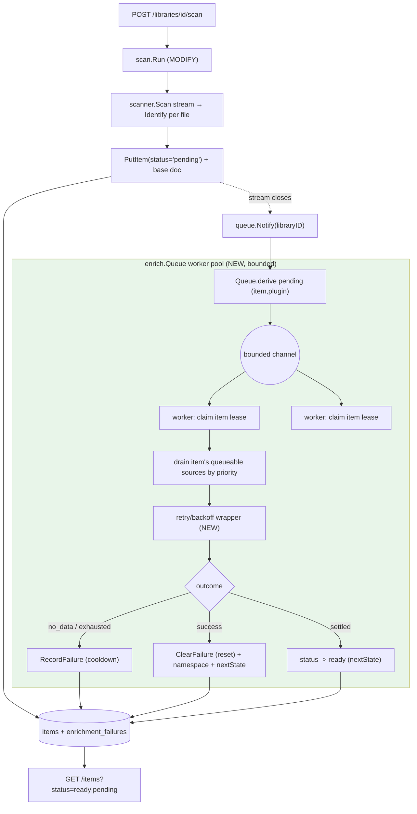

# Implementation Plan — async-enrichment (Phase B1)

> Architecture + File Map + dependency-ordered Step Outline + Foundational Setup +
> decision log (6 open questions resolved + right-sizing verdict). Builds
> ADDITIVELY on shipped Phase A (`main` @ `6507277`): refactors `internal/enrich`'s
> dispatch from **serial-inline** to the **arch §4.4 async derived-queue**, and
> migrates `scan` to enqueue-and-return. **B1 scope only; B2 (image) / B3 (TMDB)
> outlined.**

## Architecture overview

Phase A shipped a serial-inline enricher: `scan.persist` calls `enrich.Enrich`
per item and blocks (`scan/run.go:147`). This plan replaces the DISPATCH with
the **arch §4.4 async derived-queue** — no separate queue/lease table, no
external broker, single-binary, single-instance MVP. The per-item chain work
(`enrichDoc` + `runSource` + `nextState` + provenance) is REUSED; only the
scheduling around it is new.

**Three load-bearing ideas (all arch §4.4):**
1. **Derived pending set** — a `(item, plugin)` task is pending iff the source is
   applicable + enabled + `AuthMode != "CLIENT"` (D-Q1) + its namespace is absent
   from the document + not in `enrichment_failures` cooldown. No queue table;
   `items` + document namespaces + the ledger ARE the queue.
2. **Per-item lease + bounded worker pool** — an in-memory `item_id → lease` map
   (at most ONE per item); a bounded channel + goroutine pool drains it.
   Parallelize ACROSS items, SERIALIZE WITHIN an item (priority order via the
   existing `orderedSources`, `enrich.go:111`). Leases expire lazily.
3. **Loop-safety via the `enrichment_failures` ledger** (table already exists,
   `open.go:98`) — written ONLY on terminal failure (`exhausted` after
   `MaxAttempts` backoff, or `no_data`); derivation skips cooldown pairs;
   reset-on-success deletes the row. Bounded, decaying cooldown (7d→14d→28d, cap 365d).



Per-item worker flow: claim lease → reconstruct base from the persisted document
(S7) → for each queueable source in priority order: retry/backoff (`runSource`)
→ on success apply namespace + provenance (existing `applyContribution`) +
`ClearFailure`; on terminal write `RecordFailure` → when all sources terminal,
advance item `enriched→ready` via `nextState` → `PutItem` the advanced status +
document. A cancelled context is the only hard failure (`enrich.go:190`); a
crashing plugin is a failed RPC (Phase A isolation holds).

## Stack Patterns Applied

| Concern | Pattern | Source | Existing convention (extend) |
|---|---|---|---|
| Work queue | derived set + bounded channel + worker pool (no broker, no queue table) | arch §4.4 (`architecture.md:1007-1058`); Q13 DECIDED | new `internal/enrich/queue.go` (mirrors Go idiom: `<-chan` + `for range` workers, like `scan`'s stream drain `run.go:117`) |
| Mutual exclusion | in-memory lease map, lazy expiry | arch §4.4 (`:1015-1020`) | new `internal/enrich/lease.go` (mutex-guarded map; mirrors `plugin.Manager.mu` `manager.go:79`) |
| Loop-safety | durable terminal-failure ledger + cooldown + reset-on-success | arch §4.4 (`:1031-1047`); §9.1 (`:1456`) | `enrichment_failures` table EXISTS (`open.go:98`); add store methods (mirror `PutItem` upsert `items.go:51`) |
| Retry/backoff | exponential backoff, capped attempts | arch §4.4 schedule (`:1033-1039`); Q11 (no cgroups) | `plugin.exponentialBackoff` (`lifecycle.go`, restart loop) — reuse the backoff idiom |
| Lifecycle state | pure table `nextState` (extend, don't rewrite) | arch §0 #1; Phase A `state.go:74` | add `ready`/`stale` as data rows (the map-miss = illegal transition pattern) |
| Config knobs | env → struct with §4.4 zero-value defaults | arch §4.4 defaults | mirror `cmd/mellifera` env reads (base-scanner/tv-parser paths, `main.go:43-49`) |
| Crash isolation | go-plugin subprocess, stateless | arch §0 #2, §4.2 | `plugin.Manager` monitor restarts (`lifecycle.go:46,172`) — unchanged |

## File Map

### `internal/enrich` (MODIFY + CREATE — the async substrate; 3→7 exported)
| Path | Role | Key symbols |
|---|---|---|
| `internal/enrich/state.go` `[MODIFY]` | add `ready`,`stale` literals + transitions; exercise `retry` | — (signature unchanged) |
| `internal/enrich/enrich.go` `[MODIFY]` | factor a worker-facing per-item driver returning per-source terminal outcomes; keep `Enrich` preserved | `Enrich` (preserved) |
| `internal/enrich/queue.go` `[NEW]` | derived-queue dispatcher + worker pool + dispatch loop + Start/Stop/Notify/Stats | `Queue`,`QueueConfig`,`Stats`,`NewQueue` (+4 → 7) |
| `internal/enrich/lease.go` `[NEW]` | in-memory per-item lease map + lazy expiry | — (unexported `lease`,`leaseMap`) |
| `internal/enrich/retry.go` `[NEW]` | per-source retry/backoff wrapper around `runSource` | — (unexported) |
| `internal/enrich/doc.go` `[MODIFY]` | document +4 exported + async model + INV-downward (still no api/scan import) | — |

### `internal/store` (CREATE — ledger methods; table already exists; 4→5 exported)
| Path | Role | Key symbols |
|---|---|---|
| `internal/store/ledger.go` `[NEW]` | `RecordFailure`/`ClearFailure`/`ListFailures` on existing `enrichment_failures` table | `FailureRow` (+1 → 5) |
| `internal/store/doc.go` `[MODIFY]` | document ledger methods | — |

### `internal/scan` (MODIFY — enqueue, don't enrich inline)
| Path | Role | Key symbols (3, unchanged) |
|---|---|---|
| `internal/scan/run.go` `[MODIFY]` | `persist`: drop inline enrich, `PutItem(status='pending')`, persist base for reconstruction; after drain → `queue.Notify` | — (Deps gains a `Notify` field, not a symbol) |
| `internal/scan/doc.go` `[MODIFY]` | document the async handoff | — |

### `cmd/mellifera` (MODIFY — wire + run the pool)
| Path | Role | Key symbols (0 — package main) |
|---|---|---|
| `cmd/mellifera/main.go` `[MODIFY]` | construct `enrich.NewQueue`, `Start(ctx)`, pass `Notify` into scan, `Stop()` on shutdown; env knobs | — |

### `internal/api` (NO change — verify only)
| Path | Role |
|---|---|
| `internal/api/handlers.go` `[no_seam]` | `?status=` already passes any value (`handlers.go:126`); `ready`/`pending` list automatically. AC-3. |

### Tests (NEW)
| Path | Covers |
|---|---|
| `internal/enrich/queue_test.go` | derivation, lease no-double + lazy expiry, retry→ledger, restart re-derive (in-process fakes via `metadataResolver` seam, R8) |
| `internal/store/ledger_test.go` | `RecordFailure`/`ClearFailure`/`ListFailures` + cooldown skip |
| `internal/enrich/enrich_test.go` `[MODIFY]` | `nextState` table for `ready`/`stale`/`retry` (extend existing table test) |
| `integration_async_test.go` `[NEW]` | AC-1 golden: scan→pending→drain→ready + provenance + lease + failing-source→ledger |

## Step Outline (dependency-ordered; ≤15 gate — 10 steps)

1. **MODIFY `internal/enrich/state.go`** — add `statusReady`,`statusStale` literals; add transitions `enriched→ready` (ev `settled`), `*→stale` + `stale→pending` (ev `stale`/`rehydrate`); confirm `failed→pending` (`retry`, `:65`) is exercised by the queue. `nextState` table extended (map-miss = illegal). → consumed by 5. (AC-states) [S2]
2. **CREATE `internal/store/ledger.go`** — `FailureRow`; `RecordFailure` (parameterized `INSERT…ON CONFLICT(item_id,plugin_id) DO UPDATE`, mirror `PutItem` `items.go:51`); `ClearFailure` (`DELETE`); `ListFailures` (`SELECT`). No DDL (table at `open.go:98`). → consumed by 5. (AC-ledger) [S1]
3. **CREATE `internal/enrich/retry.go`** — `runSourceRetryable(ctx, resolve, src, mod, base, cfg) (sourceResult, terminal status, attempts)`: loop `runSource` (`chain.go:49`) with exponential backoff up to `cfg.MaxAttempts`; classify terminal (`no_data` vs `exhausted`) for the ledger; success short-circuits. → consumed by 5. (AC-ledger) [S3]
4. **CREATE `internal/enrich/lease.go`** — `leaseMap` (mutex-guarded `map[string]*lease`); `acquire(itemID, owner, ttl) bool`, `renew`, `expired(itemID, now) bool` (lazy); invariant at-most-one-per-item. → consumed by 5. (AC-lease) [S4]
5. **CREATE `internal/enrich/queue.go` + MODIFY `internal/enrich/enrich.go`** — `Queue`/`QueueConfig`/`Stats`/`NewQueue`; `Start` (derive pending + launch `Workers` goroutines over a bounded channel), `Stop`, `Notify(libraryID)`, `Stats`. Dispatch loop: derive `(item,plugin)` (status set + `AuthMode!=CLIENT` + namespace absent + ledger cooldown), `leaseMap.acquire`, reconstruct base from document (S7), drain sources by priority via `runSourceRetryable`, apply namespace+provenance (existing `applyContribution`), `ClearFailure` on success / `RecordFailure` on terminal, advance status (`nextState` → `ready` when settled), `PutItem`. Factor the per-item driver in `enrich.go` (keep `Enrich` preserved for sync/tests). → consumed by 6,7. (AC-1, AC-lease, AC-ledger, AC-states) [S4,S7,S8]
6. **MODIFY `internal/enrich/doc.go`** — document +4 exported symbols (3→7, under 8) + the async model + INV-downward (enrich still imports neither `api` nor `scan`). (AC-2) [—]
7. **MODIFY `internal/scan/run.go`** — `persist`: remove the inline `enrich(...)` call (`run.go:147`); `PutItem` with `status='pending'`; persist the base identify (so the worker reconstructs `IdentifyResult`, S7); after the stream drain loop closes, call the injected `Notify(libraryID)` (new `Deps` field / seam, mirror `enricher` `run.go:74`). Re-scan change → `stale→pending`. → consumed by 8. (AC-async, AC-1) [S5]
8. **MODIFY `cmd/mellifera/main.go`** — construct `q := enrich.NewQueue(enrich.Deps{Store,Modules,Plugins}, cfg)`; `q.Start(ctx)`; thread `q.Notify` into `scan.Deps`; `q.Stop()` in the shutdown block (`main.go:127-129`); read env (`MELLIFERA_ENRICH_WORKERS`, retry/cooldown overrides) with §4.4 defaults. (AC-async, AC-1) [S6]
9. **VERIFY `internal/api/handlers.go`** — NO edit; confirm `?status=ready|pending|stale` lists via the unchanged passthrough (`handlers.go:126`→`QueryItems`). Add an assertion in integration test. (AC-1, AC-states) [S9]
10. **CREATE tests** — `queue_test.go` (derivation/lease/retry/restart), `ledger_test.go`, extend `enrich_test.go` (`nextState` ready/stale/retry table), `integration_async_test.go` (AC-1 golden binary: TV fixture → scan returns with items `pending` → pool drains → `status='ready'` + `sources.tv-parser` + `_provenance`; + a failing-source→ledger case + a lease no-double case). `check.sh` requires a co-located test per exported symbol (`Queue`/`Stats`/`NewQueue`/`FailureRow`). (AC-1, AC-2, AC-lease, AC-ledger, AC-states) [S-integration]

## Foundational Setup (not in Step Outline — own no behavioral AC, no seam)

| Item | Why (consuming step/AC) | Emits |
|---|---|---|
| `enrichment_failures` table | Step 2 needs it — **already created in Phase A** (`open.go:98`); NO migration. | precondition (fold→step 2) |
| `items.status` column + index | Steps 5,7 read/write status — **already migrated** (`open.go:72,161-199`). | precondition |
| `MELLIFERA_ENRICH_WORKERS` + retry/cooldown env vars | Step 8 reads pool size + `QueueConfig` overrides (§4.4 defaults). | fold→step 8 |
| `go.mod` | **NO new deps** (stdlib `context`/`sync`/`time` only; no broker, no EXIF lib in B1). | none |
| `Makefile` | **NO new plugin binary** (B1 reuses tv-parser). No build-target change. | none |
| `stale` change-detection basis | Step 7 emits `stale` on re-scan change — minimal basis = compare refreshed base vs stored document; full mtime/size detection is a **refine (R-stale)**, surfaced at plan-review. | fold→step 7 |

## Decision log (6 open questions + right-sizing)

### Q1 Async model — FOLLOW arch §4.4 verbatim (CONFIRMED)
Derived queue (NOT a separate work table): pending = `items` + namespaces + ledger. Per-item leases: in-memory `item_id→lease`, lazy expiry, **one per item** (serialize-within-item, parallelize-across-items). Bounded in-process goroutine pool. `POST /scan` returns immediately after persist (items `pending`) — enrichment is async. Single-instance MVP (leases in-memory; multi-instance = Phase 2, Q24). Evidence: `architecture.md:1007-1058`; Q13 DECIDED → §4.4.

### Q2 Serial→async boundary — discovery+identify SYNC, enrichment ASYNC (CONFIRMED)
Sync: library/module/scanner resolve + `Scan` stream + `Identify` + assemble base doc + `PutItem`. Async: the metadata_source chain. Backward-compat: `scan.Result` shape unchanged (`run.go:36-43`); `enrich.Enrich` preserved (worker-internal + sync-testable). The one user-visible change — scan no longer blocks on enrichment — is the feature's purpose (AC-async). Evidence: `scan/run.go:141-159`.

### Q3 Image discovery — DEFERRED to B2 (CONFIRMED)
B1 uses only the existing TV path. Image extensions are absent from `base-scanner/walk.go:25-38` (video-only `mediaMime`); adding them + an image-discovery path is B2. The core is already media-type-agnostic (INV2, `scan/doc.go:26`).

### Q4 Image EXIF enricher — DEFERRED to B2; pure-Go, no CGO (CONFIRMED)
A pure-Go EXIF lib (e.g. `dsoprea/go-exif` or `rwcarlsen/goexif`) is B2. **No EXIF dependency exists in `go.mod` today** (verified); B1 adds none. Fields (dimensions, make/model, date-taken, orientation, Unicode-safe) are B2.

### Q5 External TMDB enricher — DEFERRED to B3 (CONFIRMED)
Real HTTP in `BuildRequest→Convert`, `AuthContext{SERVER,server_secrets}` injection (`metadata.proto:348`; `enrich/chain.go:66` passes empty today), `required_secrets` (`plugin.proto:72`, unused), rate-limit + cache + soft-fail — all B3. B1 has zero external HTTP.

### Q6 Concurrency + isolation — bounded pool; shared stateless subprocess; crash-isolated (CONFIRMED)
`Workers` goroutines (default 4) over one bounded channel. The plugin subprocess is **stateless** (arch §4.2) — multiple workers call `Manager.MetadataSource(...)` concurrently over gRPC (one cached client per plugin, `manager.go:215-231`); no per-worker subprocess. A crashing enricher = a failed RPC; the worker soft-fails/requeues that source; `plugin.Manager` monitor restarts the subprocess (`lifecycle.go:46,172`). Phase A go-plugin isolation holds unchanged.

### D-Q1 Queueable-source rule — `AuthMode != "CLIENT"` (refines §4.4; SURFACED)
§4.4 (`architecture.md:1011`) says queueable iff `auth_mode==SERVER`. But tv-parser (the primary enricher) has **empty** `AuthMode` (local parser, no fetch — `registry.go:60-63`). The objective mandates "async queue for EVERY enrichment." **Decision: queueable iff `AuthMode != "CLIENT"`** (empty/local + SERVER are server-runnable; only CLIENT needs user credentials → Mode B). Justified by the seeded config + objective. **Flagged P1 for plan-review confirmation** (it refines the literal arch wording).

### D-Q2 Per-item base for the worker — RECONSTRUCT from document, no re-probe (CONFIRMED)
The worker drives `Match(item *IdentifyResult)`. Phase A had it in-memory in `persist`; the persisted `Item.Document` carries `parsed`+`ffprobe` (`run.go:221-239`). **Decision: scan persists the base identify; the worker reconstructs a minimal `IdentifyResult`** (Parsed from `doc["parsed"]`, MediaType from the item row) — no re-probe. Sufficient for tv-parser `Match` (`parser.go:38`). B3 may re-Identify if a source needs richer base. Evidence: S7.

### Right-sizing verdict — PHASED; this plan = Phase B1 (CONFIRMED; `feature_too_large: true`)
The full enhanced objective (async queue + image + EXIF + TMDB + AuthContext + retry + states) **cannot fit one pass**: it would add an async runtime + a new media type + a new plugin + a new dep + external HTTP + secret plumbing, exceeding the 15-step / 8-AC / symbol gates. The objective explicitly authorizes phasing.

- **Phase B1 (THIS plan) — async substrate:** derived queue + worker pool + per-item leases + in-memory retry/backoff + `enrichment_failures` ledger (loop-safety) + serial→async migration + `failed→pending` retry + `ready`/`stale` states. Proves the async path end-to-end with the **existing tv-parser** — no new plugin, no external HTTP, no new dep. **Shippable standalone:** a fresh scan returns with items `pending`, workers drain them to `ready` with full provenance, leases prevent double-processing, a failing source retries then ledger-exhausts, restart resumes. (10 steps, 7 ACs — both under gate.)
- **Phase B2 (outlined) — image media type + EXIF enricher:** image extensions in `base-scanner/walk.go` `mediaMime`; a pure-Go EXIF `metadata_source` plugin (`plugins/image-enricher/`); "image" module config. **Consumes the B1 queue unchanged** (a local source, `AuthMode` empty → queued).
- **Phase B3 (outlined) — external TMDB + AuthContext/secrets:** real HTTP in BuildRequest→Convert; `required_secrets` at handshake; `AuthContext{SERVER}` injection; rate-limit + response cache + soft-fail. Fills the seeded `tmdb` SERVER slot (`registry.go:70-73`). **Consumes the B1 queue unchanged** (a SERVER source → queued per D-Q1).

## Estimates (calibrated against shipped code)

| Step | Target | Basis (shipped analog) | Estimate |
|---|---|---|---|
| 1 | `state.go` ready/stale | existing table fn (`state.go:51-67`) — add rows | XS |
| 2 | `store/ledger.go` | `PutItem` upsert pattern (`items.go:42-71`) — 3 methods | S |
| 3 | `retry.go` | `plugin.exponentialBackoff` idiom; wraps `runSource` | S-M |
| 4 | `lease.go` | mutex-map (mirror `Manager.mu` `manager.go:79`) | S |
| 5 | `queue.go` + enrich driver | the core new logic — derivation + pool + dispatch + lease + ledger glue (~300-400 lines; **watch <500 — split lease/retry are already separate files**) | M-L |
| 6 | `doc.go` | document symbols | XS |
| 7 | `scan/run.go` migrate | `persist`/drain edits (`run.go:117-159`) | S-M |
| 8 | `cmd` wiring | `main.go:92-104` pattern (~20 lines) | XS |
| 9 | api verify | no edit; test assertion | XS |
| 10 | tests | queue/ledger/state + integration golden | M |

Total ~6-9 dev-days for B1; the load-bearing work is step 5 (`queue.go`). File-length budget (<500 fail): `queue.go` is the one to watch — derivation/dispatch/worker are split across `queue.go`+`lease.go`+`retry.go` to stay under 500. Symbol budget: enrich 3→7 (under 8), store 4→5 (under 8) — both green.

## Mermaid — sequence (one item through the async queue)

```mermaid
sequenceDiagram
    participant API as api (POST /scan)
    participant Scan as internal/scan
    participant Q as enrich.Queue
    participant W as worker (pool)
    participant TV as tv-parser (subprocess)
    participant Store as internal/store
    API->>Scan: Run(ctx, libraryID)
    Scan->>Store: PutItem(status='pending') per file
    Scan->>Q: Notify(libraryID)
    Scan-->>API: Result{discovered,persisted} (NOT blocked on enrich)
    Q->>Q: derive pending (item,plugin)
    Q->>W: dispatch item (lease acquired)
    W->>Store: load item + reconstruct base
    loop each queueable source by priority
        W->>W: runSourceRetryable (backoff ≤MaxAttempts)
        W->>TV: Match→BuildRequest→Convert→Merge
        alt success
            W->>Store: ClearFailure (reset) + PutItem(namespace+prov, status)
        else terminal (exhausted/no_data)
            W->>Store: RecordFailure (cooldown)
        end
    end
    W->>Store: PutItem(status='ready') when settled
    Note over W,Store: lease released lazily; restart re-derives pending, skips cooldown
```
