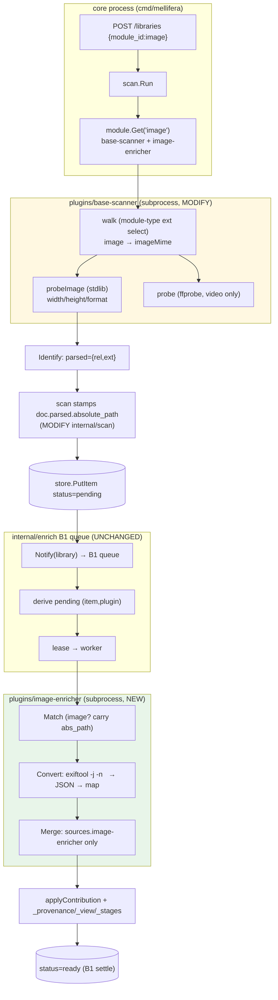

# Implementation Plan — image-enrichment (Phase B2)

> Architecture + File Map + dependency-ordered Step Outline + Foundational Setup +
> decision log (5 open questions resolved + right-sizing). Builds ADDITIVELY on
> shipped Phase A + B1 (`main` @ `e2a7562`): no proto/api/queue/sdk edits (AC-3);
> image items consume the B1 async queue UNCHANGED. **B2 scope only; B3 (external
> enrichers / HEIC) outlined.** Mirrors `docs/async-enrichment/implementation_plan.md`.

## Architecture overview

B2 adds an **image media type** and an **EXIF enricher (system `exiftool` subprocess)** by reusing two
shipped seams unchanged and extending three additive ones:

1. **Discovery (extend `plugins/base-scanner`).** The walk becomes module-type-aware:
   an `image` module → image extensions (jpg/jpeg/png/webp); else → the existing
   video set. For images, base info (dimensions/format) is gathered at discovery via
   the Go stdlib (`image.DecodeConfig`) into the opaque probe field — ffprobe stays
   the video probe. Module-type gating (not a union filter) avoids discovering TV
   cover-art as junk.
2. **The file-location channel (extend `internal/scan`).** The B1 chain passes an
   EMPTY document to the enricher's Merge (`chain.go:79`) and reconstructs the base
   from `doc["parsed"]` only (`chain.go:115-122`). So scan stamps the reconstructed
   absolute path (`filepath.Join(lib.RootPath, rel)`) into `doc["parsed"]` — the one
   channel through which the enricher can open the file. Additive; tv-parser ignores it.
3. **The enricher (NEW `plugins/image-enricher`).** A `metadata_source` subprocess
   mirroring `plugins/tv-parser`: Match applies iff image (carries `absolute_path`);
   Convert runs the **system `exiftool`** binary via `os/exec` arg-slice
   (`exiftool -j -n <selected tags> <absPath>` — the SAME pattern as base-scanner's
   `ffprobe`), parses the JSON, and returns ≥ `{width,height,format}` for any image
   exiftool can read (so a valid image settles via clean success, not a spurious
   `no_data`); Merge writes `sources.image-enricher` only. **No new Go dependency** —
   exiftool is a runtime dep like ffmpeg/ffprobe; a missing exiftool soft-fails (empty
   namespace → B1 `no_data` → settle). exiftool reads HEIC/RAW natively, so HEIC is in
   scope for B2.

The B1 async queue, store, API, protos, and SDK are **untouched** — image items are
indistinguishable from TV items to the worker (same state machine, same settle).



## Stack Patterns Applied

| Concern | Pattern | Source | Existing convention (extend) |
|---|---|---|---|
| metadata_source plugin | subprocess serving `metadata.v1.MetadataSource` + `plugin.v1.Plugin` on one gRPC server | arch §2.2, §3.3; `pkg/sdk/metadata.go:23-55` | `plugins/tv-parser/{main,parser,pluginsvc,doc}.go` (mirror verbatim) |
| image base info at discovery | stdlib `image.DecodeConfig` (pure-Go); opaque probe field | `scanner.pb.go:113-119` (ffprobe_json opaque); open-questions no-CGO | `plugins/base-scanner/ffprobe.go:29-53` (`probe` soft-fail signature) |
| EXIF tags | external `exiftool` subprocess via `os/exec` arg-slice (NEVER shell) | golang-security; user plan-review direction (D-2) | `plugins/base-scanner/ffprobe.go:29-53` (`probe` — the identical exec/soft-fail pattern) |
| file location to enricher | reconstructed abs path in free-form `Parsed` | `scanner.pb.go:108-109,267-272`; `chain.go:115-122` | `internal/scan/run.go:334-352` (assembleBaseDoc) |
| module config | config-entity module seed (`INSERT OR IGNORE`) | arch §2.4; `internal/module/doc.go` INV1/INV2 | `internal/module/registry.go:44-81,125-160` (tv seed) |
| plugin loading | flat `mgr.Load/Start/Stop` constructor calls | ai-architecture §2.5; `cmd/mellifera/main.go:79-91` | tv-parser Load/Start/Stop block |
| async enrichment | B1 queue: derive pending → lease → retry → ledger → settle | arch §4.4; `internal/enrich/*` | UNCHANGED (consumed, not modified) |

## File Map

### plugins/image-enricher (CREATE — EXIF metadata_source subprocess; package main, ~0 exported)
| Path | Role | Key symbols |
|---|---|---|
| `main.go` `[NEW]` | subprocess entrypoint; cookie pair + `sdk.Serve(MetadataSourcePlugin + pluginSvcPlugin)` | `pluginID="image-enricher"` |
| `pluginsvc.go` `[NEW]` | domain Plugin service (Handshake/Health/Shutdown); advertises ONE `metadata_source` capability | verbatim mirror of tv-parser |
| `enricher.go` `[NEW]` | `sdk.MetadataSource` impl: Match/BuildRequest/Convert/Merge + provenanceHints | `enricherImpl` |
| `exiftool.go` `[NEW]` | `runExiftool(ctx, absPath)` — `exec.Command("exiftool","-j","-n",<tags>,absPath)` arg-slice, bounded timeout, JSON parse, soft-fail (mirrors `probe`/`ffprobe.go:29-53`) | `runExiftool` |
| `doc.go` `[NEW]` | package doc (responsibility, public API, invariants) | — |

### plugins/base-scanner (MODIFY — image discovery; package main, ~0 exported)
| Path | Role | Key symbols |
|---|---|---|
| `image.go` `[NEW]` | `imageMime` map (jpg/jpeg/png/webp/**heic/heif**) + `probeImage` (stdlib `image.DecodeConfig`, soft-fail; HEIC/RAW base-info soft-fails — stdlib has no decoder) | `probeImage`, `imageMime`, `isImage` |
| `walk.go` `[MODIFY]` | thread `moduleType`; select extension map; `toDiscovered` branches image→`probeImage`/video→`probe`; `isMedia`/`mimeType` use selected map | `walk`, `toDiscovered` |
| `scanner.go` `[MODIFY]` | `Scan` forwards `req.GetModuleType()` to `walk` | `Scan` |

### internal/scan (MODIFY — absolute-path stamp; 3 exported unchanged)
| Path | Role | Key symbols |
|---|---|---|
| `run.go` `[MODIFY]` | thread `lib.RootPath` → `persist` → `assembleBaseDoc`; stamp `absolute_path` into `doc["parsed"]` | `assembleBaseDoc`, `persist`, `runScan` |

### internal/module (MODIFY — image module seed; 7→7 exported)
| Path | Role | Key symbols |
|---|---|---|
| `registry.go` `[MODIFY]` | `imageConfigJSON` const + second `INSERT OR IGNORE` seed in `Open` | `Open`, `imageConfigJSON` |

### cmd/mellifera (MODIFY — load image-enricher; package main)
| Path | Role | Key symbols |
|---|---|---|
| `main.go` `[MODIFY]` | `mgr.Load/Start/Stop("image-enricher")`; `config.imageEnricherPath` (`MELLIFERA_IMAGE_ENRICHER`) | `main`, `config`, `loadConfig` |

### Build / deps
| Path | Role | Key symbols |
|---|---|---|
| `go.mod` / `go.sum` `[NO CHANGE]` | exiftool is a system runtime dep (like ffmpeg/ffprobe), NOT a Go module — `go.mod` is untouched | — |
| `Makefile` `[MODIFY]` | `build-plugin` adds `bin/image-enricher`; documents `exiftool` as a runtime dep alongside ffmpeg/ffprobe (install hint) | `build-plugin` |
| operator runbook (conventions.md) `[MODIFY]` | runtime-deps list gains `exiftool` (`brew install exiftool` / `apt install libimage-exiftool-perl`) | — |

### Tests (NEW)
| Path | Covers |
|---|---|
| `plugins/image-enricher/*_test.go` | Match applicability (image vs non-image), Convert EXIF on jpg/png/webp fixtures (with + without EXIF, Unicode model), Merge namespace isolation, provenance hints |
| `plugins/base-scanner/*_test.go` | image discovery (module-type gating: image exts only for image module; no ffprobe for images; dimensions via stdlib), soft-fail on corrupt image |
| `internal/module/registry_test.go` `[EXTEND]` | the `image` module appears in `List` after `Open` |
| `internal/scan/*_test.go` `[EXTEND]` | `absolute_path` stamped into `doc["parsed"]` |
| `internal/api/router_test.go` `[EXTEND]` (golden e2e) | real subprocesses + real image fixtures → `status=ready` + `sources.image-enricher` + provenance; soft-fail + unicode cases |

## Step Outline (dependency-ordered; ≤15 gate — 11 steps)

1. **CREATE `plugins/image-enricher/{doc,pluginsvc,main}.go`** — subprocess skeleton: cookie pair (`MELLIFERA_MAGIC_COOKIE`/`mellifera-plugin-v1`), `Handshake` advertises ONE `metadata_source` capability (`mellifera.metadata.v1.MetadataSource`), `sdk.Serve(MetadataSourcePlugin + pluginSvcPlugin)`. Verbatim mirror of `plugins/tv-parser`. → emits the loadable binary (consumed by step 9). (AC-1) [S3,S6]
2. **CREATE `plugins/image-enricher/exiftool.go`** — `runExiftool(ctx, absPath) (tags, warning)`: `exec.CommandContext(ctx,"exiftool","-j","-n","-ImageWidth","-ImageHeight","-FileType","-Make","-Model","-DateTimeOriginal","-Orientation","-GPSLatitude","-GPSLongitude", absPath)` — arg-slice ONLY (NEVER shell; mirrors `ffprobe.go:33-43`), bounded timeout; parse JSON array `[0]` → map; `exec.LookPath("exiftool")` + non-zero/timeout/non-JSON → empty map + warning (soft-fail, AC-6). → consumed by step 3. (AC-1, AC-softfail, AC-unicode) [S3]
3. **CREATE `plugins/image-enricher/enricher.go`** — `enricherImpl` satisfying `sdk.MetadataSource`: `Match` applies iff `module_type=="image"` or image extension, carries `absolute_path` in `Query` (no I/O); `BuildRequest` nop; `Convert` calls `runExiftool(Query.absolute_path)`, maps tags → `Metadata` (`width/height/format` always when exiftool succeeds; + `make/model/date_taken/orientation/gps_lat/gps_lon` when present) + per-field provenance hints, returns EMPTY metadata + warning if exiftool missing/fails (soft → B1 `no_data`); `Merge` writes `sources.image-enricher` only + View bindings. → consumed by step 1's `main`. (AC-1, AC-image, AC-softfail, AC-unicode) [S3]
4. **CREATE `plugins/base-scanner/image.go`** — `imageMime` (jpg/jpeg/png/webp/**heic/heif**→MIME) + `isImage(path)` + `probeImage(ctx, absPath) (data, warning, err)` via stdlib `image.DecodeConfig`, soft-fail signature mirroring `probe` (`ffprobe.go:29-53`); returns `{"width","height","format"}` JSON (HEIC/RAW → soft-fail: stdlib has no decoder; exiftool supplies full data at enrichment). → consumed by step 5. (AC-image, AC-softfail) [S2]
5. **MODIFY `plugins/base-scanner/walk.go`** — `walk(ctx, root, moduleType, opts)`; select extension map (`moduleType=="image"`→`imageMime`, else existing video `mediaMime`); `isMedia`/`mimeType` key off the selected map; `toDiscovered` branches image→`probeImage`, video→`probe`. (AC-image, AC-3) [S1,S2]
6. **MODIFY `plugins/base-scanner/scanner.go`** — `Scan` forwards `req.GetModuleType()` into `walk`. → consumed by step 5. (AC-image) [S1]
7. **MODIFY `internal/scan/run.go`** — thread `lib.RootPath` (`run.go:116`) → `persist` → `assembleBaseDoc`; stamp `absolute_path = filepath.Join(root, rel)` into `doc["parsed"]` for all items. (AC-1, AC-image) [S4]
8. **MODIFY `internal/module/registry.go`** — add `imageConfigJSON` (binds `base-scanner` + `image-enricher` priority 1, `media_type:"image"`, no auth_mode) + a second `INSERT OR IGNORE` seed `ExecContext` in `Open` (`"image","image",imageConfigJSON,1,1,…`). (AC-1, AC-image) [S5]
9. **MODIFY `cmd/mellifera/main.go`** — add `mgr.Load("image-enricher", cfg.imageEnricherPath, []sdk.Capability{{Type:"metadata_source",ID:"default",ProtoService:metadataService}})` + `Start` (mirror tv-parser block `main.go:88-91`); `config.imageEnricherPath = envOr("MELLIFERA_IMAGE_ENRICHER","bin/image-enricher")`; `mgr.Stop(shutdownCtx,"image-enricher")` in shutdown order. (AC-1) [S6]
10. **MODIFY `Makefile` + operator runbook** — `build-plugin` adds `CGO_ENABLED=0 go build -o bin/image-enricher ./plugins/image-enricher`; document `exiftool` as a runtime dep alongside ffmpeg/ffprobe (`brew install exiftool` / `apt install libimage-exiftool-perl`) in conventions.md runtime-deps. (AC-2) [S7]
11. **VERIFY tests** — unit tests (steps 2-8) + golden e2e (`internal/api/router_test.go`): real subprocesses + real image fixtures (jpg/png/webp/**HEIC**) → items `status=ready` with `sources.image-enricher` (+ `_provenance`/`_view`/`_stages`); soft-fail (no-EXIF / **exiftool-missing** / truncated) + Cyrillic cases. (AC-1, AC-2, AC-3, AC-image, AC-queue, AC-softfail, AC-unicode) [all]

## Foundational Setup (not in Step Outline — own no behavioral AC, no seam)

| Item | Why (consuming step/AC) | Emits |
|---|---|---|
| DB migration | none — `internal/store` is media-type-agnostic; image data lives in the opaque document; generated columns deferred (cannot be added idempotently, `open.go:30-33`) | none |
| Proto regeneration | none — no `.proto` edit; image-enricher implements the EXISTING `metadata.v1.MetadataSource` (AC-3) | none |
| Config file | none — the image module is a DB seed row (step 8), not a file; the one env var (`MELLIFERA_IMAGE_ENRICHER`) is wired in step 9 | fold→step 9 |
| CI | none beyond the `Makefile` `build-plugin` target (step 10); the `check.sh`/`golangci` gate is unchanged — exiftool is a runtime dep, not a build dep | fold→step 10 |
| Go module dep | **none** — EXIF is read via the system `exiftool` binary (`os/exec`), not a Go library; `go.mod` is untouched | none |
| Runtime dep | `exiftool` (system-installed, like ffmpeg/ffprobe) — documented in the Makefile + operator runbook (step 10); a missing exiftool is a per-source soft-fail, not a startup failure | step 10 |

## Decision log (5 open questions resolved + right-sizing)

### D-1 Image discovery — module-type-gated extension selection + stdlib base info (CONFIRMED)
Extend base-scanner's walk to select the extension set by `ScanRequest.module_type`:
`"image"` → image extensions (jpg/jpeg/png/webp/**heic/heif**); otherwise → the existing
video set. Base image info (dimensions/format) is gathered at discovery via the Go stdlib
(`image.DecodeConfig` with `image/jpeg`/`image/png`/`image/webp`, all pure-Go). A
UNION filter is rejected: the tv module excludes `*.jpg` (`registry.go:54`) but
base-scanner does not yet enforce `exclude_patterns`, so a union would discover TV
cover-art as junk items. Module-type selection is sanctioned by `scanner.proto`
("Module type … Guides the scanner's parsing heuristics"); plugins may be media-aware,
the core may not (INV2). HEIC/HEIF ARE in scope: exiftool reads them natively, so
base-scanner discovers them by extension and its stdlib base-info read soft-fails for
HEIC (stdlib has no decoder) — exiftool supplies full data at enrichment. RAW
(cr2/nef/arw/dng) is cheap to add (exiftool reads them); held back to keep the
extension set bounded.

### D-2 EXIF tool — system `exiftool` subprocess via `os/exec` (CONFIRMED — user plan-review direction)
The image-enricher invokes the **system-installed `exiftool`** binary
(`exec.CommandContext(ctx, "exiftool", "-j", "-n", <selected tags>, absPath)` —
arg-slice ONLY, NEVER a shell) and parses its JSON output — the SAME pattern Mellifera
already uses for `ffprobe` (`plugins/base-scanner/ffprobe.go:29-53`). This replaces the
earlier pure-Go `github.com/bep/imagemeta` choice. Rationale (user direction): exiftool
is the field-standard EXIF reader (all EXIF/IPTC/XMP, camera makernotes, HEIC, RAW),
so it drops the HEIC-deferral and broadens coverage for free; it adds **NO Go module
dependency** (it is a runtime dep like ffmpeg/ffprobe, not CGO — the `CGO_ENABLED=0`
binary still builds, AC-2). Trade-off vs the pure-Go lib: a new system runtime
dependency (operators install `exiftool`) + subprocess-per-item cost — accepted because
it matches the established ffprobe pattern and Mellifera already requires ffmpeg/ffprobe.
**Soft-fail:** `exec.LookPath("exiftool")` on each use; if missing/non-zero/timeout/
non-JSON, `Convert` returns empty metadata + a warning → B1 `no_data` terminal →
30-day cooldown → settle (AC-6, mirrors ffprobe). **Output bounding:** tags are
explicitly selected (`-ImageWidth -ImageHeight -FileType -Make -Model -DateTimeOriginal
-Orientation -GPSLatitude -GPSLongitude`) so output is small and predictable (no
makernote megabytes); the set is one-line-extensible.

### D-3 EXIF fields — basics + GPS, Unicode-safe (CONFIRMED)
Fields: `width`, `height`, `format` (always, when exiftool succeeds on a valid image)
+ `make`, `model`, `date_taken`, `orientation`, `gps_lat`, `gps_lon` (when present).
GPS is INCLUDED (lat/lon): Mellifera is a local personal media server, so the user's
own photo GPS is their data, not a privacy leak; it is standard photo EXIF.
Unicode-safe: exiftool outputs UTF-8 JSON; camera model strings (incl. non-ASCII) are
carried verbatim; filenames are UTF-8 throughout and the extension filter lowercases
ASCII extensions only (mirrors `tvparse.go` ASCII-only regex classes).

### D-4 Image module config — mirror tv-module seed; pure EXIF, NO filename fallback (CONFIRMED)
An `image` module seed (config row, not code) binding `base-scanner` (scanner) +
`image-enricher` (priority 1, local, no `auth_mode`), mirroring `tvConfigJSON`. Image
metadata is PURELY EXIF-based — NO filename-date/camera fallback: images have no
reliable filename convention analogous to TV's `SxxExx`, so guessing would be noise.
A no-EXIF image keeps base info only and still settles (AC-softfail).

### D-5 ffprobe vs stdlib for base image info — stdlib (CONFIRMED)
Stdlib `image.DecodeConfig` for dimensions/format (pure-Go; header-only, cheap;
keeps ffprobe as the video-only probe). ffprobe is NOT used for images — that would
add an external-binary dependency to the image path and muddy base-scanner's role.

### D-6 (SURFACED) The file-location channel — `absolute_path` in `parsed`
Not an open question from the user, but a load-bearing design decision: because the
B1 chain passes an EMPTY document to Merge (`chain.go:79`) and reconstructs the base
from `doc["parsed"]` only (`chain.go:115-122`), the only way the image-enricher can
open the file is for scan to stamp the reconstructed absolute path into `parsed`
(the `DiscoveredFile.RelativePath` comment explicitly says "Absolute path is
reconstructed by the core"). SURFACED for plan-review visibility; alternatives
(base-scanner embeds EXIF bytes; changing reconstructBase; embedding in `doc["ffprobe"]`)
were rejected as wrong-layer or B1-touching.

### Right-sizing verdict — single pass; this plan = Phase B2 (CONFIRMED; feature_too_large: false)
- **Phase B2 (THIS plan):** image discovery (incl. HEIC) + stdlib base info; the
  image-enricher plugin (EXIF via the system `exiftool` subprocess — NO new Go dep);
  the `image` module seed; the absolute-path document stamp. Reuses the B1 async queue
  + the tv-parser pattern + the ffprobe exec/soft-fail pattern. **11 steps (< 15 gate),
  7 ACs (< 8 gate)**, every new package ≤8 exported symbols (the image-enricher is
  package main with ~0; module stays at 7). One pass — no internal phasing needed. The
  exiftool redirection REMOVES a step (no `go.mod` dep) and REMOVES a risk (no
  pure-Go-lib purity/`ShouldHandleTag` concerns) while ADDING coverage (HEIC) — net
  simpler.
- **Phase B3 (outlined, NOT built):** external image enrichers (auth_mode + real
  fetch); RAW discovery (cr2/nef/arw/dng — one-line extension-set add); image generated
  columns. Consumes the B1 queue + this image type unchanged.

## Estimates (calibrated against shipped code)

| Step | Target | Basis (shipped analog) | Estimate |
|---|---|---|---|
| 1 image-enricher skeleton | `plugins/tv-parser/{main,pluginsvc,doc}.go` (copy + rename) | S |
| 2 exiftool.go | `plugins/base-scanner/ffprobe.go` `probe` (exec + JSON + soft-fail) | S |
| 3 enricher.go | `plugins/tv-parser/parser.go` (Match/Convert/Merge) | S-M |
| 4 base-scanner image.go | `ffprobe.go` (probe soft-fail signature) | S |
| 5 walk.go | `walk.go:50-123` (add moduleType + branch) | S |
| 6 scanner.go | one-line forward (`scanner.go:47`) | XS |
| 7 scan run.go | `run.go:334-352` (assembleBaseDoc) | S |
| 8 module registry.go | `registry.go:44-81,125-160` (tv seed) | S |
| 9 cmd main.go | `main.go:88-91` (tv-parser block) | XS |
| 10 Makefile + runbook | `Makefile:33-40` (+ runtime-dep note) | XS |
| 11 tests | tv-parser + base-scanner + router tests | M |

~3-4 dev-days total. Watch: file length (golangci funlen 60); `enricher.go` Convert
must stay under 60 lines (factor exiftool exec/parse into `exiftool.go`); symbol budget
(module stays 7; image-enricher package main ~0). No file approaches 300 lines.

## Mermaid — sequence (one image item through the B2 pipeline)

```mermaid
sequenceDiagram
  participant Client
  participant API as internal/api
  participant Scan as internal/scan
  participant BS as base-scanner (subprocess)
  participant Store as internal/store
  participant Q as B1 queue (UNCHANGED)
  participant W as B1 worker
  participant IE as image-enricher (subprocess)
  Client->>API: POST /libraries {module_id:"image"}
  API->>Store: CreateLibrary("image", root)
  Client->>API: POST /libraries/{id}/scan
  API->>Scan: Run(libraryID)
  Scan->>BS: Scan(library_path, module_type="image")
  loop each file
    BS->>BS: module-type ext select (image exts only)
    alt image ext
      BS->>BS: probeImage (stdlib) → {w,h,format}
    else (non-image skipped)
    end
    BS-->>Scan: DiscoveredFile
    Scan->>BS: Identify → parsed={rel,ext}
    Scan->>Scan: stamp doc.parsed.absolute_path
    Scan->>Store: PutItem(status="pending")
  end
  Scan-->>API: Result (non-blocking; AC-queue)
  API-->>Client: 200 {discovered, persisted}
  Scan->>Q: Notify(libraryID)
  Q->>Q: derive pending (item,image-enricher)
  Q->>W: lease(item, image-enricher)
  W->>IE: Match(item) — image? carry absolute_path
  IE-->>W: Applies=true, Query
  W->>IE: Convert(Query)
  IE->>IE: exiftool -j -n <tags> <file> → JSON → map (soft-fail if missing)
  IE-->>W: Metadata (≥ {w,h,format} + EXIF)
  W->>IE: Merge → sources.image-enricher only
  IE-->>W: Document + View
  W->>W: validateNamespace + applyContribution + _provenance/_view/_stages
  W->>Store: persist(status)
  W->>W: allSourcesTerminal → settle
  Store-->>W: status="ready"
  Client->>API: GET /libraries/{id}/items?status=ready
  API-->>Client: items w/ sources.image-enricher
```
