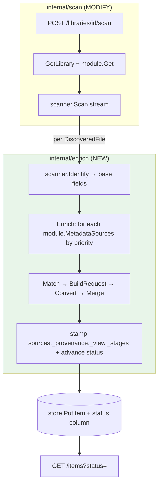
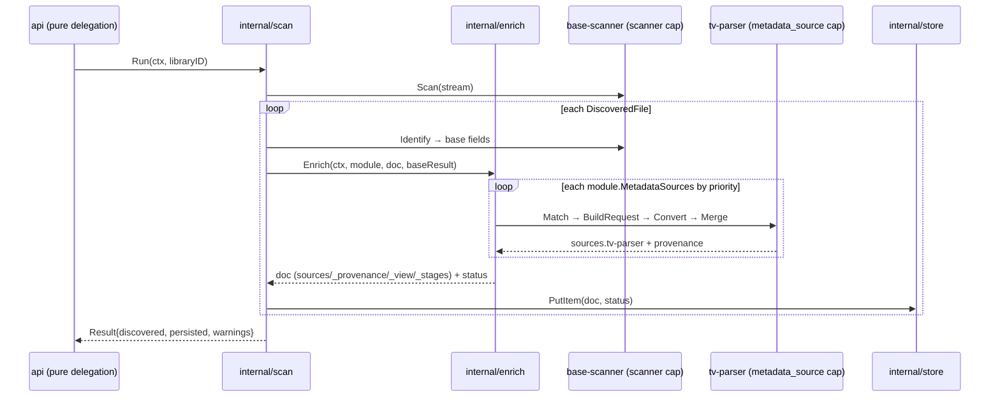

# Implementation Plan — plugin-pipeline (Phase A)

> Architecture + File Map + dependency-ordered Step Outline + Foundational Setup +
> decision log (6 open questions resolved + right-sizing). Builds ADDITIVELY on
> shipped `scan-library` (commit `7bcc6c9`). Phase A scope only; B/C outlined.

## Architecture overview

This feature realizes the `enrich` engine that `scan-library` and `architecture.md`
**deferred** (`architecture.md:1534`). scan-library ships a **single-plugin** scan
(discovery + identify + persist). plugin-pipeline generalizes the post-discovery
path into a **config-driven enrichment chain** with per-plugin provenance and a
per-Item lifecycle state.

**The key reconciliation (see decision D-1 below):** the user's mental model is
"3 plugin categories (parser/enricher/post-action)." The *authoritative*
architecture defines **capabilities** (`scanner`, `metadata_source`) and the
enrichment chain is the already-generated `metadata.v1.MetadataSource`
4-RPC service (Match→BuildRequest→Convert→Merge). Phase A maps the user's
categories onto existing capabilities rather than inventing new ones (which would
blow the symbol budget and duplicate `metadata_source`):
- **"Parser/discovery"** → `scanner` capability (base-scanner = discovery + media-type-agnostic base identify) + the tv-parser as the **first metadata_source** in the chain.
- **"Enricher"** → `metadata_source` capability (tv-parser is a local enricher; TMDB/Kinopoisk are external enrichers — Phase B).
- **"Post-action"** → **deferred** (no architecture contract exists; needs design work — Phase C/future).

Per-file flow: `api` (pure delegation, `ai-arch §3`) calls `scan.Run` (the ONE
domain call). `scan` resolves the module + scanner, streams `DiscoveredFile`s,
calls `Identify`, then — NEW — calls `enrich.Enrich` per item, which drives the
configured `metadata_source` chain in priority order (D8 serial, D14 no-hybrid),
mutates the document (lossless `sources.<plugin>` + `_provenance` + recomputable
`_view` + `_stages` trail), advances lifecycle `status`, and `scan` persists via
`store.PutItem`. A failing source soft-fails (AC-6); the scan continues.

## Stack Patterns Applied

| Concern | Pattern | Source | Existing convention (extend) |
|---|---|---|---|
| Plugin transport | go-plugin gRPC subprocess, typed accessor per capability | arch §2; D1 | `plugin.Manager.Scanner` (`manager.go:175`) → extend with `MetadataSource` |
| Enrichment pipeline | Match→BuildRequest→Convert→Merge (already-designed 4-RPC chain) | arch §2.1.3 (`:284-303`); `metadata.proto:12-31` | new `internal/enrich` (the deferred package, `architecture.md:1534`) |
| Document model | dynamic JSON, lossless per-source namespaces + recomputable view | arch §3.1 (`:772-839`); D3 | store generated columns already project `$._view.*`/`$.identifiers.*` (`open.go:72-75`) |
| Provenance | per-field `_provenance.<field>` (`common.v1.Provenance`) | arch §2.1.1; common.proto | (new write path; store opaque to body) |
| Config-driven selection | module `metadata_sources[].priority` drives the chain | arch §2.4 (`:746,754-762`); D8 | `module.ScannerBinding` (`registry.go:94`); seeded TV config already carries the slot (`registry.go:56-73`) |
| Auth (Phase B) | `required_secrets` (handshake) + `AuthContext` (BuildRequest) | arch §2.1.1, §6 | proto exists (`common.proto:52`, `plugin.proto` CapabilityDeclaration.required_secrets) |
| Lifecycle state | core-managed `status` column + per-stage `_stages` doc map (V5 hybrid) | mid-planning req; arch §0 #1 | `items` core-managed fields (`file_id`,`created_at`) — status is analogous |

## File Map

### Protos (NO edits — additive import only)
| Path | Package | Role | Key symbols |
|---|---|---|---|
| `proto/mellifera/metadata/v1/*.proto` | `metadatav1` | enrichment 4-RPC chain (EXISTS, generated) | `MetadataSource`, `Match*`,`BuildRequest*`,`Convert*`,`Merge*` |
| `proto/mellifera/common/v1/common.proto` | `commonv1` | `Provenance`,`AuthContext`,`MediaDocument` (EXISTS) | (none new) |

### `pkg/sdk` (MODIFY — add file)
| Path | Role | Key symbols (≤3) |
|---|---|---|
| `pkg/sdk/metadata.go` `[NEW]` | metadata_source capability client interface + dual-side go-plugin adapter | `MetadataSource`, `MetadataSourcePlugin` |
| `pkg/sdk/doc.go` `[MODIFY]` | document the +2 symbols (5→7) | — |

### `internal/plugin` (MODIFY)
| Path | Role | Key symbols |
|---|---|---|
| `internal/plugin/manager.go` `[MODIFY]` | typed `MetadataSource` accessor (mirrors `Scanner`) | `Manager.MetadataSource` (+1 → 10 WARN) |
| `internal/plugin/doc.go` `[MODIFY]` | document the accessor | — |

### `internal/enrich` (NEW)
| Path | Role | Key symbols (≤8) |
|---|---|---|
| `internal/enrich/doc.go` `[NEW]` | contract: the inline serial enrichment orchestrator | — |
| `internal/enrich/enrich.go` `[NEW]` | `Enrich`/`Deps`/`Result` + unexported 4-RPC dispatch, state-transition fn, namespace enforcement, provenance stamping | `Enrich`,`Deps`,`Result` (3) |

### `internal/module` (MODIFY)
| Path | Role | Key symbols |
|---|---|---|
| `internal/module/registry.go` `[MODIFY]` | model `metadata_sources` slot; `Module.MetadataSources`; `MetadataSourceBinding` | `MetadataSourceBinding` (+1 → 7) |
| `internal/module/doc.go` `[MODIFY]` | document the binding type | — |

### `internal/store` (MODIFY)
| Path | Role | Key symbols (11, unchanged count) |
|---|---|---|
| `internal/store/open.go` `[MODIFY]` | `items.status` column + `items_status` index (idempotent migration) | — (no new symbol) |
| `internal/store/items.go` `[MODIFY]` | `Item.Status`; `PutItem` writes status; `QueryItems(ctx,libID,status,limit,offset)`; `scanItem` reads status | — (signature MODIFY, not new symbol) |
| `internal/store/doc.go` `[MODIFY]` | document status column + QueryItems filter | — |

### `internal/scan` (MODIFY)
| Path | Role | Key symbols (3, unchanged) |
|---|---|---|
| `internal/scan/run.go` `[MODIFY]` | integrate enrich (identify→enrich→assemble doc+status→PutItem); enrich injected as a seam | — (Deps gains an enrich field, not a symbol) |
| `internal/scan/doc.go` `[MODIFY]` | document the enrich step | — |

### `internal/api` (MODIFY)
| Path | Role | Key symbols (3, unchanged) |
|---|---|---|
| `internal/api/handlers.go` `[MODIFY]` | `itemDTO.status`; `?status=` filter → `QueryItems` | — |
| `internal/api/router.go` `[MODIFY]` | route the optional query param | — |

### `plugins/base-scanner` (MODIFY)
| Path | Role | Key symbols (0 — package main) |
|---|---|---|
| `plugins/base-scanner/scanner.go` `[MODIFY]` | remove `parseTV` call; Identify returns base fields | — |
| `plugins/base-scanner/tvparse.go` `[DELETE→MOVE]` | moved verbatim to tv-parser | — |

### `plugins/tv-parser` (NEW — package main)
| Path | Role | Key symbols (0 — package main) |
|---|---|---|
| `plugins/tv-parser/main.go` `[NEW]` | `sdk.Serve` wiring | — |
| `plugins/tv-parser/parser.go` `[NEW]` | `MetadataSource` impl (Match/BuildRequest/Convert/Merge) | — |
| `plugins/tv-parser/pluginsvc.go` `[NEW]` | `plugin.v1` handshake declaring `metadata_source` capability | — |
| `plugins/tv-parser/tvparse.go` `[NEW]` | verbatim move from base-scanner | — |

### `cmd/mellifera` (MODIFY)
| Path | Role | Key symbols (0 — package main) |
|---|---|---|
| `cmd/mellifera/main.go` `[MODIFY]` | wire `enrich.Deps` into scan; Load+Start tv-parser; `MELLIFERA_TV_PARSER` env | — |

### Tests (NEW)
| Path | Covers |
|---|---|
| `internal/enrich/enrich_test.go` | `Enrich`/`Deps`/`Result` table tests (state transitions, soft-fail, namespace enforcement) |
| `pkg/sdk/metadata_test.go` | `MetadataSource` round-trip (in-process fake via `sdk.Serve`) |
| `internal/plugin/manager_test.go` `[MODIFY]` | `MetadataSource` accessor |
| `internal/store/items_test.go` `[MODIFY]` | status column + QueryItems filter |
| `plugins/tv-parser/parser_test.go` | the 4 RPCs (table-driven parse cases incl. Cyrillic) |
| `integration_pipeline_test.go` `[NEW]` | AC-1 golden e2e (discovery→tv-parser→provenance→state) |

## Step Outline (dependency-ordered; ≤15 gate — 11 steps)

1. **CREATE `pkg/sdk/metadata.go`** — `MetadataSource` interface + `MetadataSourcePlugin` dual-side adapter (mirror `scanner.go:35-63`); import `metadatav1`. → emits the capability client consumed by steps 2,3. (AC-2, AC-3) [S9]
2. **MODIFY `internal/plugin/manager.go`** — add `Manager.MetadataSource(pluginID,capID) (sdk.MetadataSource,error)` (mirror `Scanner` at `:175`); dispense the metadata_source gRPC client. → consumed by step 3. (AC-2) [S2]
3. **CREATE `internal/enrich`** — `doc.go` + `enrich.go`: `Enrich`/`Deps`/`Result`; unexported `runChain` (Match→BuildRequest→Convert→Merge, fetch stubbed returning empty `raw_response`); pure `nextState(current,event)` transition fn; namespace enforcement (reject+revert on foreign `sources.<other>` write, arch §3.3); stamp `_provenance`/`_view`/`_stages`; advance status. → consumed by step 6. (AC-4, AC-5, AC-6, AC-7) [S2,S3,S4,S5]
4. **MODIFY `internal/module/registry.go`** — `MetadataSourceBinding` type; `Module.MetadataSources`; `parseModule` decodes the `metadata_sources` slot (currently dropped, `:162`). → consumed by step 3 (reads bindings) + step 6. (AC-4) [S4]
5. **MODIFY `internal/store`** — `open.go`: idempotent `items.status TEXT NOT NULL DEFAULT 'new'` + `items_status` index migration; `items.go`: `Item.Status`, `PutItem` writes status, `QueryItems(ctx,libID,status,limit,offset)`, `scanItem`/SELECT read status. → consumed by steps 6,10. (AC-3, AC-7) [S1,S7,S11]
6. **MODIFY `internal/scan/run.go`** — in `persist`/`newItem`/`assembleDocument`: after `Identify`, call `enrich.Enrich(...)`; assemble `sources`/`_provenance`/`_view`/`_stages`; set `Item.Status`; `PutItem`. enrich injected via an unexported seam (mirror `scannerResolver` at `run.go:60`) for testability. → consumed by step 9 (wired). (AC-1, AC-5, AC-6, AC-7) [S6,S7]
7. **MODIFY `plugins/base-scanner/scanner.go`** — remove the `parseTV(...)` call (`:47`); `Identify` returns media-type-agnostic base fields only (file_id, media_type, base parsed: stem/extension). → `tvparse.go` becomes dead here (moved in step 8). (AC-1) [S8]
8. **CREATE `plugins/tv-parser/`** — `main.go` (`sdk.Serve`), `pluginsvc.go` (handshake declaring `metadata_source` capability, mirror `base-scanner/pluginsvc.go:51-63`), `parser.go` (`MetadataSource` impl: Match=SxxExx check, BuildRequest=empty spec, Convert=parse, Merge=write `sources.tv-parser`+provenance), `tvparse.go` (verbatim move from base-scanner). → consumed by step 9 (loaded). (AC-1, AC-5) [S3]
9. **MODIFY `cmd/mellifera/main.go`** — construct `enrich.Deps`; inject enrich into `scan.Deps`/the scan closure (`:80-87`); `mgr.Load("tv-parser", cfg.tvParserPath, caps)` + `mgr.Start` (mirror `:75-78`); read `MELLIFERA_TV_PARSER` env (default `bin/tv-parser`). (AC-1) [S10]
10. **MODIFY `internal/api`** — `handlers.go`: `itemDTO.status`; parse optional `?status=` → `QueryItems(ctx,libID,status,limit,offset)`; `router.go`: no new route (param on existing `GET /items`). (AC-7) [S11]
11. **CREATE tests** — table tests for each new/modified exported symbol (`enrich.Enrich`, `sdk.MetadataSource`, `plugin.MetadataSource`, `module.MetadataSourceBinding`, `store` status/QueryItems) + `integration_pipeline_test.go` (AC-1 golden: TV fixture → provenance + `status=enriched` + base-scanner emits no TV fields) + base-scanner extraction test. `check.sh` requires a co-located test per exported symbol. (AC-1, AC-2, AC-6, AC-7) [S-integration]

## Foundational Setup (not in Step Outline — own no behavioral AC, no seam)

| Item | Why (consuming step/AC) | Emits |
|---|---|---|
| `metadata.v1`/`common.v1` already generated | Step 1,3 import them — NO protoc run needed (verify they compile when imported) | precondition (fold→step 1) |
| `MELLIFERA_TV_PARSER` env var | Step 9 loads the tv-parser binary path (default `bin/tv-parser`) | fold→step 9 |
| `Makefile` `build-plugin` target | Step 8 adds a second plugin binary; generalize `build-plugin` to build both base-scanner + tv-parser (or add `build-tv-parser`) | fold→step 8/9 |
| `go.mod` | NO new deps (metadatav1/commonv1/go-plugin/grpc already present) | none |
| `items.status` backfill of pre-existing rows | Existing scan-library items get the DEFAULT `'new'`; (optional) one-time backfill to `'parsed'` since they were identified — **surface at plan-review** | fold→step 5 |

## Decision log (6 open questions + right-sizing)

### D-1 Category model — MAP user's 3 categories onto existing capabilities (CONFIRMED)
The user's "parser/enricher/post-action" taxonomy is NOT in the architecture;
the authoritative taxonomy is **capabilities** (`scanner`, `metadata_source`) and
the enrichment chain is the **already-generated** `metadata.v1.MetadataSource`
4-RPC service. Creating 3 new category services would: (a) add 3 typed accessors
to `internal/plugin` (9→12 = **FAIL** the symbol budget); (b) add 3 adapters to
`pkg/sdk` (5→8, at limit); (c) **duplicate** `metadata_source`. So Phase A MAPS:
parser/discovery → `scanner` (base-scanner) + tv-parser-as-first-`metadata_source`;
enricher → `metadata_source`; post-action → **deferred** (no contract). This
satisfies the user's INTENT (categorized plugins, ordered stages, config-driven,
provenance, media-type-agnostic core) with ZERO new proto services. **This is the
#1 reconciliation to confirm at plan-review.** Alternatives rejected: 3 new
services (budget fail + duplication); generic category-field service (forbidden
generic `Call`/reflect, `internal/plugin/doc.go:14-19`).

### D-2 Pipeline model — fixed sequential stages, NOT a DAG (CONFIRMED)
DECISION: the chain runs in **fixed stage order** (discovery → identify →
metadata_source chain in module `priority` order), serial within an item (D8),
no hybrid mode (D14). A configurable DAG adds topological-sort/cycle-detection
complexity the MVP does not need. DAG = named revisit trigger (Q-new), not now.
Evidence: D8 "serial enrichment in priority order for MVP"; arch §2.4
(`:746,754-762`).

### D-3 Proto service shapes — ADDITIVE, reuse existing (CONFIRMED)
DECISION: **no proto edits for Phase A.** `metadata.v1` + `common.v1` already
exist (generated, committed). `scanner.v1`/`plugin.v1` UNCHANGED on the wire
(AC-3, deprecate-don't-delete). Phase A only begins importing the generated
packages. This is maximally additive and keeps `.pb.go` (exempt from symbol
budget) untouched.

### D-4 Provenance schema — the architecture's designed schema, document-JSON (CONFIRMED)
DECISION: implement arch §3.1 verbatim — `sources.<plugin_id>` (lossless),
`_provenance.<field_path>` (`common.v1.Provenance`), `_view.<field>` (recomputable;
store already projects `$._view.title.value` via generated columns, `open.go:72`).
Plus the V5-hybrid `_stages[]` progress map (mid-planning requirement). **No store
symbol change** — provenance/progress is document JSON (`Item.Document` is opaque
to store). Critical given `internal/store` is at 11 WARN. Per arch §0 #4 / D3.

### D-5 parseTV extraction boundary — base-scanner=discovery+base; tv-parser=metadata_source (CONFIRMED)
DECISION: `parseTV` (+ 4 regexes + helpers) moves **verbatim** to
`plugins/tv-parser` (a `metadata_source` capability plugin). base-scanner keeps
`Scan` (walk+ffprobe+withinRoot) + `Identify` returning media-type-agnostic base
fields only. The single call site (`scanner.go:47`) is removed. The wire shape
`scanner.v1.IdentifyResult` is unchanged (just fewer `parsed` keys — additive).
`DiscoveredFile`/`IdentifyResult` need NO proto change. Evidence: clean extraction
— `parseTV(string)→(Struct,float64,string)`, one call site, zero I/O deps.

### D-6 Default plugin bundling — separate subprocess, dev-mode filesystem load (CONFIRMED)
DECISION: tv-parser is a **separate subprocess binary** (`plugins/tv-parser/`),
loaded via filesystem path in dev mode (same as base-scanner:
`MELLIFERA_TV_PARSER` env, `mgr.Load`+`mgr.Start`). `go:embed` first-run
extraction stays **deferred** (D11/Q20). Preserves crash isolation (arch §0 #2),
matches the shipped pattern, no new loading mechanism.

### D-7 External enricher auth — reuse AuthContext/required_secrets (CONFIRMED, Phase B)
DECISION: external enrichers (TMDB/Kinopoisk) declare `required_secrets` at
handshake (`plugin.v1.CapabilityDeclaration.required_secrets`); the orchestrator
injects `AuthContext{mode:SERVER, server_secrets:{api_key:…}}` at `BuildRequest`
(arch §6). Secret values from module/env config. **Phase B** implements the real
fetch; Phase A's orchestrator carries the `AuthContext` field in `BuildRequest`
(the stub passes an empty `AuthContext`). The mechanism is designed now.

### D-8 Lifecycle state — V5 hybrid, additive status column + _stages map (CONFIRMED)
DECISION (mid-planning requirement): a queryable `status` enum column
(`new/pending/parsed/enriched/failed/deleted`) — core-managed, indexed, filterable
— PLUS a per-stage `_stages[]` progress map in the document (per-plugin
ran/when/result/error + `advanced_to`). Orchestrator advances state via a pure
transition fn; store owns the column. Storage variant = **V5 hybrid
(recommended)** over V1 (enum-only, no detail), V2 (enum+timestamps+last_error —
absorbed into `_stages`+`_error`), V3 (append-only event log — over-engineered for
MVP). **Additive**: `status` column DEFAULT 'new'; existing scan-library items
readable. Surface at plan-review: the state set, V5 choice, backfill of existing
rows. See `acceptance.md` AC-7 + state machine.

### Right-sizing verdict — PHASED; this plan = Phase A (CONFIRMED)
The full feature (3 categories + orchestrator + provenance + external enrichers +
post-actions + async queue) **cannot fit one pass**: it would realize the ENTIRE
deferred enrich engine + §4.4 async queue + external fetch + a non-architected
post-action concept, exceeding the 15-step / 8-AC / symbol-budget gates. The
objective explicitly authorizes phasing.

- **Phase A (THIS plan)**: parseTV extraction → tv-parser (metadata_source);
  `internal/enrich` inline serial orchestrator (4-RPC chain, fetch stubbed,
  namespace enforcement, provenance, state transitions); V5-hybrid lifecycle
  state; base-scanner media-type-agnostic; provenance/`_view`/`_stages` document
  schema; API status field/filter. **Shippable standalone**: a fresh install scans
  TV end-to-end with per-plugin provenance + lifecycle state, no external calls.
- **Phase B (outlined)**: external enricher (TMDB) — real HTTP fetch in
  `BuildRequest`→`Convert`, `AuthContext`/`required_secrets` injection, the §4.4
  async derived-queue + per-item leases + `enrichment_failures` ledger (loop-safety),
  `failed→pending` retry, `stale`/`ready` states.
- **Phase C / future (outlined)**: **post-action** capability — REQUIRES
  architecture design first (no contract exists today; closest analogs are the
  deferred `janitor` and core L2 reconciliation). Flagged as a design question;
  not built.

## Estimates (calibrated against shipped code)

| Step | Target | Basis (shipped analog) | Estimate |
|---|---|---|---|
| 1 | `pkg/sdk/metadata.go` | `scanner.go` is ~110 lines (interface+adapter) | S (½ day) |
| 2 | `plugin.MetadataSource` | `Manager.Scanner` ~30 lines (`manager.go:175-203`) | S |
| 3 | `internal/enrich` | `internal/scan/run.go` (~220 lines) is the analog; enrich adds the 4-RPC dispatch + state fn | M-L (the core new logic; ~300-400 lines split enrich.go + doc.go) |
| 4 | `module` bindings | `ScannerBinding` parse in `registry.go:162-183` (~20 lines) | S |
| 5 | `store` status | `open.go` migration + `items.go` field/SQL edits (~40 lines) | S |
| 6 | `scan` integrate | `run.go:116-212` persist/newItem/assembleDocument edits | S-M |
| 7 | base-scanner extract | delete one call (`scanner.go:47`) + drop tvparse.go | XS |
| 8 | tv-parser plugin | `base-scanner` total (~6 files) minus walk/ffprobe; tv-parser is parser+pluginsvc+main+tvparse | M |
| 9 | cmd wiring | `main.go:70-87` pattern (~15 lines added) | XS |
| 10 | api status | `handlers.go` DTO + filter (~20 lines) | XS |
| 11 | tests | table tests + integration (the acceptance gate) | M |

Total: ~7-10 dev-days for Phase A; the load-bearing work is step 3 (`internal/enrich`).
File-length budget (<500 fail): `internal/enrich/enrich.go` is the one to watch —
split dispatch / state-fn / namespace into separate unexported-helper files if it
approaches 300 (warn).

## Mermaid — sequence (one item through the pipeline)

