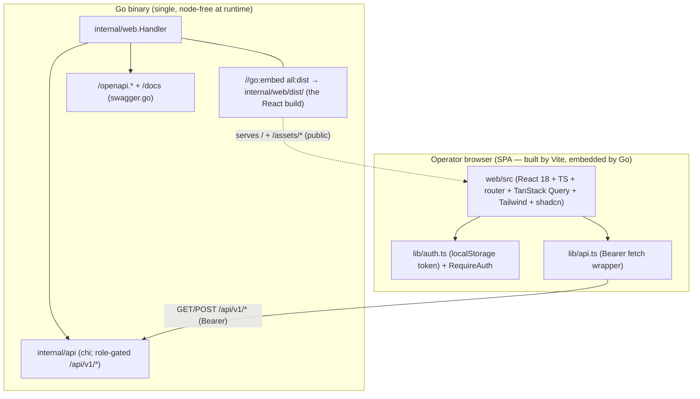

# Implementation Plan — web-ui Phase 2a (scaffold + auth + admin library-management)

> Scope: **Phase 2a only** (right-sized — see source_baseline §Sub-phasing verdict).
> Builds the visible React SPA shell + auth + the admin library-management panel,
> and proves the delivery (real React build served by Go, Go gate node-free).
> Phase 2b (browse + item detail + metadata) and 2c (polish) are outlined in
> §Out of Scope. The Go side is byte-identical except the regenerated
> `internal/web/dist/*` + two doc/build files.

## Right-sizing decision

Phase 2 is LARGE; the enhanced objective (`enhanced_objective.md:107-113`) authorizes sub-phasing. **This plan = Phase 2a.** 2a is a coherent, demoable vertical (scaffold + auth + admin library mgmt + delivery proven with a real React build) that 2b/2c stack on. Splitting here keeps the Step Outline under the 15-step gate and the acceptance under the 8-scenario gate without stubbing.

## Decisions on the 6 open questions (resolved; surfaced at plan-review)

1. **Component library → shadcn/ui.** Copy-in (Radix UI primitives + `class-variance-authority` + `tailwind-merge` + `clsx`), Tailwind-styled, tree-shakeable, small bundle, no runtime CSS-in-JS. Matches the confirmed Vite+TS+Tailwind stack. (MUI rejected — pulls emotion + a theme runtime, conflicts with Tailwind; plain Tailwind primitives rejected — too much hand-rolling for forms/tables/badges.) Lives under `web/src/components/ui/`.
2. **Token storage + auth flow → localStorage + token-entry screen.** localStorage (`mellifera.token`) so the operator enters the token once per browser (sessionStorage would force per-tab re-entry). NOT a cookie (no Go login endpoint exists — the admin token is a static env var; arch §11.5). XSS note documented + accepted for a 127.0.0.1-bound personal server (conventions §auth). Revisit at D18 (multi-user).
3. **Routing → `/login` (public) + `/admin` (libraries + status; `RequireAuth`) + `/` redirects to `/admin` in 2a (becomes `/browse` in 2b).** Protected routes via `<RequireAuth>` (presence-of-token = authenticated; Go enforces real authZ). 2b adds `/browse` + `/items/:id`.
4. **Metadata rendering → reusable component tree** (fixed shapes in contracts; **implemented in 2b**, not 2a): `<SourceCard>` (per `sources.<plugin>`), `<ProvenanceBadge>` (per field_path), `<ViewFields>` (`_view`), `<StagesProgress>` (`_stages`), a recursive `<JsonValue>` (no rounding; UTF-8/Cyrillic-safe). Precision preserved verbatim (arch §3.4/§11.2).
5. **API additions → ZERO new endpoints.** Audit confirms both panels' needs are already met by Phase 1 (`router.go:89-102`): browse uses `GET /items` + `GET /items/{id}`; admin uses `POST/GET /libraries` + `POST /libraries/{id}/scan` + `GET /admin/status`. No `DELETE`/`PUT` needed for MVP (arch §12 defers). api stays 7 symbols; INV1/INV2/INV5 preserved (AC-7).
6. **Phasing → SUB-PHASED.** 2a = this plan; 2b = browse + detail + metadata; 2c = polish (§Out of Scope).

## File Map

### MODIFY (Go side — doc/build only; no Go source changes)
| Path | Change | evidence |
|---|---|---|
| `internal/web/dist/*` | REPLACE placeholder bytes with the real Vite build (`index.html` + hashed `assets/*`); regenerated by `make web-build`, committed | `internal/web/web.go:20` (`//go:embed all:dist`); current placeholder `internal/web/dist/index.html` + `assets/app.js` |
| `Makefile` | uncomment + correct the `web-build` npm step (`cd internal/web` → `cd web`; outDir → `internal/web/dist/`) | `Makefile:56-61` |
| `web/README.md` | Phase-2a status note (real build landed) + resolved outDir + corrected Makefile cwd | `web/README.md:8-12,48-62,66-81` |

### CREATE (the React app under `web/` — npm project root per `web/README.md:66-81`)
| Path | Purpose |
|---|---|
| `web/package.json` | npm manifest: react/react-dom 18, react-router-dom, @tanstack/react-query, Tailwind, Radix (shadcn primitives), cva, tailwind-merge, clsx; dev: vite, @vitejs/plugin-react, typescript, @types/react(-dom), tailwindcss, postcss, autoprefixer, vitest, @testing-library/react, jsdom, eslint |
| `web/vite.config.ts` | react plugin; `build.outDir: "../internal/web/dist"`, `build.emptyOutDir: true`; `server.port: 5173`; `server.proxy`: `/api`, `/openapi.yaml`, `/openapi.json`, `/docs` → `http://127.0.0.1:8080` |
| `web/tsconfig.json` + `web/tsconfig.node.json` | strict TS; `jsx: react-jsx`; `paths` (`@/*` → `src/*`) |
| `web/tailwind.config.ts` + `web/postcss.config.js` | Tailwind + shadcn theme tokens (CSS vars for light/dark) |
| `web/index.html` | Vite entry: `<meta charset="utf-8">`, `
`, module script `src/main.tsx` (Cyrillic-safe per arch §11.1) |
| `web/src/main.tsx` | ReactDOM.createRoot; `<QueryClientProvider>` + `<BrowserRouter>` + `<App>` |
| `web/src/App.tsx` | `<Routes>`: `/login`, `/admin`, `/` → `/admin`; `<RequireAuth>` wrapper |
| `web/src/lib/api.ts` | typed DTOs (contracts §Wire types) + `apiRequest<T>` fetch wrapper (Bearer injection, 401 → clear + `/login`, canonical error parse) |
| `web/src/lib/auth.ts` | `useToken()` (localStorage `mellifera.token`), `getToken`/`setToken`/`clearToken` |
| `web/src/lib/queries.ts` | TanStack hooks: `useLibraries`, `useCreateLibrary`, `useScanLibrary`, `useAdminStatus` (invalidate `libraries` on mutate success) |
| `web/src/components/RequireAuth.tsx` | route guard (no token → `<Navigate to="/login">`) |
| `web/src/components/ui/*` | shadcn copy-in primitives used in 2a: `button`, `input`, `label`, `card`, `select`, `table`, `badge`, `alert` (group — one step) |
| `web/src/pages/Login.tsx` | token-entry form (sets token → redirect to `from`) |
| `web/src/pages/admin/Admin.tsx` | admin shell (tabs/sections: Libraries, Status) |
| `web/src/pages/admin/Libraries.tsx` | library table + add-library form (module tv/image, root_path, display_name; NFS-mount note) + scan trigger + scan result |
| `web/src/pages/admin/Status.tsx` | plugin health table + enrich stats block (refetch interval) |
| `web/src/styles/index.css` | Tailwind directives (`@tailwind base/components/utilities`) + shadcn CSS vars |
| `web/eslint.config.js` | flat ESLint config (TS + react-hooks) — dev-only |

## Step Outline (12 steps — under the 15-step gate)

> One line per atomic change. `(AC-N)` traces to acceptance. `->` marks a
> dependency produce. MODIFY files include caller/setup steps; CREATE files
> include export markers.

1. Scaffold Vite+TS+React: `web/package.json`, `web/vite.config.ts` (outDir → `../internal/web/dist`, `emptyOutDir`, dev proxy `/api`+`/openapi.*`+`/docs` → :8080, port 5173), `web/tsconfig*.json`, `web/index.html` (`<meta charset="utf-8">`), `web/postcss.config.js` `->` produces a type-checking, dev-server-capable app skeleton (AC-5, AC-6)
2. Tailwind + shadcn/ui setup: `web/tailwind.config.ts`, `web/src/styles/index.css` (Tailwind directives + shadcn CSS vars), copy-in `web/src/components/ui/{button,input,label,card,select,table,badge,alert}.tsx` (AC-2, AC-4, AC-6)
3. API client + TS types: `web/src/lib/api.ts` — DTO mirrors (`LibraryDTO`, `CreateLibraryRequest`, `ScanResponse`, `AdminStatus`/`PluginHealth`/`EnrichStats`, `ItemDTO`/`ItemDocument` for 2b) + `apiRequest<T>` (Bearer from `auth.ts`, 401 → clear + `/login`, canonical error parse; no rounding) (AC-1, AC-7)
4. Auth layer: `web/src/lib/auth.ts` (`useToken`, localStorage `mellifera.token`) + `web/src/components/RequireAuth.tsx` (no token → `<Navigate to="/login" state={{from}}>`); `->` consumed by App + api (AC-1)
5. TanStack Query wiring + admin hooks: `web/src/lib/queries.ts` (`useLibraries`, `useCreateLibrary` + invalidate `libraries`, `useScanLibrary`, `useAdminStatus`); `web/src/main.tsx` mounts `<QueryClientProvider>` + `<BrowserRouter>` (AC-2, AC-3, AC-4)
6. App routing: `web/src/App.tsx` — `/login` → `Login`, `/admin` → `Admin` under `<RequireAuth>`, `/` → `<Navigate to="/admin">` (2a; `/browse`+`/items/:id` reserved for 2b) (AC-1, AC-5)
7. Login page: `web/src/pages/Login.tsx` — token-entry form (sets token → redirect `from`) (AC-1)
8. Admin Libraries page (list + add): `web/src/pages/admin/Admin.tsx` shell + `Libraries.tsx` — `useLibraries` table + add-library form (`module_id` tv/image select, `root_path` w/ NFS-mount note, `display_name`) → `useCreateLibrary` → list invalidates + re-renders (AC-2)
9. Admin Libraries scan trigger: extend `Libraries.tsx` — per-row "Scan" → `useScanLibrary(id)` → render `scanResponse` `{discovered, persisted, warnings?}` inline (AC-3)
10. Admin Status page: `web/src/pages/admin/Status.tsx` — `useAdminStatus` (refetch interval) → plugin-health table (`id,state,restarts,checked_at`) + enrich-stats block (`pending,in_flight,done,failed`); 503 → "status unavailable" state (AC-4)
11. Build wiring: `Makefile` `web-build` — uncomment + correct to `cd web && npm ci && npm run build` (outDir → `internal/web/dist/`); `web/README.md` Phase-2a status (real build landed; resolved outDir; corrected cwd) (AC-5, AC-6)
12. Replace dist + verify gates: run `make web-build` → regenerates `internal/web/dist/{index.html,assets/*}` (placeholder overwritten); commit dist; `make build && make check && make test` node-free green; AC-5/AC-6/AC-7 verify probes pass (AC-5, AC-6, AC-7)

## Foundational Setup (dependency adds / config / scaffolding — own no AC, no seam)

| Item | why (consuming task/AC) | emits |
|---|---|---|
| npm dev toolchain (node v24 + npm 11 — already present per state.json `dev_toolchain`) | Steps 1-10 require `npm install` to type-check/build | fold→precondition (Step 1 runs `npm install`); no separate task |
| `web/package.json` dependency list (react 18, react-router-dom, @tanstack/react-query, Radix shadcn primitives, cva, tailwind-merge, clsx; dev: vite, typescript, tailwindcss, postcss, autoprefixer, vitest, @testing-library/react, jsdom, eslint) | the entire React app depends on these | emitted in Step 1 (CREATE package.json); `npm ci` is the install |
| `web/node_modules/` (gitignored) | dev-only; the built bundle is what ships | fold→precondition (gitignored, not committed) |
| `MELLIFERA_TOKEN_KEY` SPA localStorage key (`"mellifera.token"`) | auth (Step 4) | fold→precondition (a constant in `auth.ts`, not an env) |
| Apache-2.0 headers in `web/src/*` + `NOTICE` entries for bundled deps (Radix MIT, TanStack MIT, Tailwind MIT, Vite BSD-3) | arch §11.7 licensing (the SPA is Apache-2.0; bundled deps recorded) | fold→precondition (Step 1 header convention; conventions.md §licensing) |
| `make web-build` regen step (Step 11) | the committed `internal/web/dist/*` is a build INPUT — must be regenerable | emits the dist replacement (Step 12) |
| No new Go module deps | Go side unchanged — `go.mod`/`go.sum` byte-identical | fold→precondition (AC-6 additive) |

## Stack Patterns Applied

| Concern | Pattern | Source | Existing Convention |
|---|---|---|---|
| SPA delivery | embedded static assets via `go:embed`; built bundle committed; node dev-only | `internal/web/web.go:20` (Phase 1) | `make web-build` mirrors `proto` (`buf`) + `build-plugin` — dev/CI regen, not a Go gate dep (operator-runbook §2) |
| SPA↔API | same-origin `/api/v1/*`; Bearer header; no CORS | `internal/web/web.go:49`, `middleware.go:32-45` | Phase-1 contract (web/README.md §Dev workflow) |
| Auth | static admin token → `RoleAdmin`; presence-of-token SPA-side; Go enforces authZ | `middleware.go:32-45`, `router.go:89-102` | arch §11.5 (admin-token MVP; D18 swap point) |
| Data fetching | TanStack Query (cache + invalidation); mutations invalidate list queries | (React stack decision, Phase 1) | n/a (new stack) — extends the confirmed Phase-1 toolchain |
| Styling | Tailwind + shadcn/ui (copy-in Radix primitives) | (Component-lib decision Q1) | n/a (new stack) — Tailwind confirmed in Phase 1 |
| Precision/i18n | render JSON verbatim; UTF-8 end-to-end; no rounding | arch §3.4, §11.1, §11.2 | `itemDTO.Document` is `json.RawMessage` (handlers.go:136) — opaque, unmodified |
| Error surface | canonical `{error:{code,message,retryable}}` | arch §11.6; handlers.go:364-385 | Phase-1 error body (consumed, not redefined) |

## Architecture (Phase 2a — the SPA layer over the Phase-1 foundation)

Phase 2a adds the `Browser` box + the `EMBED` bytes (real React build). Everything in the `GoBinary` box is byte-identical to Phase 1 except `EMBED`'s contents.

## Estimates (calibrated to actual Phase-1 patterns)

| Step | Target | Effort | Basis |
|---|---|---|---|
| 1 scaffold | `web/{package.json,vite.config.ts,tsconfig*,index.html,postcss.config.js}` | M | new stack setup (config-heavy) |
| 2 tailwind+shadcn | `tailwind.config.ts`, `styles/index.css`, `components/ui/*` | S-M | shadcn copy-in is mechanical |
| 3 api client | `lib/api.ts` | S | DTOs mirror handlers.go; wrapper is small |
| 4 auth | `lib/auth.ts`, `RequireAuth.tsx` | S | localStorage + a guard component |
| 5 queries | `lib/queries.ts`, `main.tsx` | S | 4 hooks + providers |
| 6 routing | `App.tsx` | S | react-router table |
| 7 login | `Login.tsx` | S | one form |
| 8 libraries (list+add) | `Admin.tsx`, `Libraries.tsx` | M | table + form + invalidation |
| 9 scan trigger | extend `Libraries.tsx` | S | one mutation + result render |
| 10 status | `Status.tsx` | S-M | table + stats + refetch |
| 11 build wiring | `Makefile`, `web/README.md` | S | uncomment + correct + docs |
| 12 dist replace + verify | `internal/web/dist/*` + gate run | S | `make web-build` + `make build/check/test` |

No MODIFY Go source — estimates are JS-side + build/doc. If the Vite/shadcn setup runs >50% over (Step 1/2), the fallback is plain Tailwind primitives (drop shadcn) — flagged in architecture_review R3.

## Out of Scope (Phase 2b + 2c — outlined; separate plans)

### Phase 2b — client browse panel + item detail + metadata rendering
- **Browse list** (`/browse`): `GET /api/v1/items?library=&status=&limit=&offset=` → filterable item table (library + status filters; status set: `new`,`pending`,`enriched`,`failed`,`ready`,`stale` per `internal/enrich/state.go:12-19`). Pagination.
- **Item detail** (`/items/:id`): `GET /api/v1/items/{id}` → render the full §3.1 document (`contracts.md` §document shape):
  - `<SourceCard plugin_id namespace>` per `sources.<plugin>` (recursive JSON; lossless).
  - `<ProvenanceBadge field_path plugin_id confidence>` per `_provenance` entry.
  - `<ViewFields>` for `_view` (title/rating/poster/backdrop with `value`+`source`+`reason`).
  - `<StagesProgress>` for `_stages` (`{stage,plugin_id,status,advanced_to,started_at,finished_at,error?}` per `enrich.go:137-149`).
  - Tier-1 `identifiers` + core-managed fields.
  - Precision preserved (no `toFixed`/averaging); Cyrillic-safe (UTF-8 end-to-end).
- `/` redirect target flips from `/admin` → `/browse`.

### Phase 2c — polish
- Responsive layout (mobile-friendly admin + browse).
- Empty/loading/error states (canonical error rendering).
- Pagination controls; keyboard a11y (Radix primitives help).
- Dark mode (shadcn CSS vars already defined).
- Optional: a "recent items" widget on the admin dashboard (light browse preview).

### Deferred (not Phase 2)
- A real `client`-role resolver / user accounts (D18; arch §11.5).
- `DELETE`/`PUT /libraries`, module-editor UI, config-edit endpoints (arch §12).
- Streaming/playback/transcoding, Phase C (post-actions).
