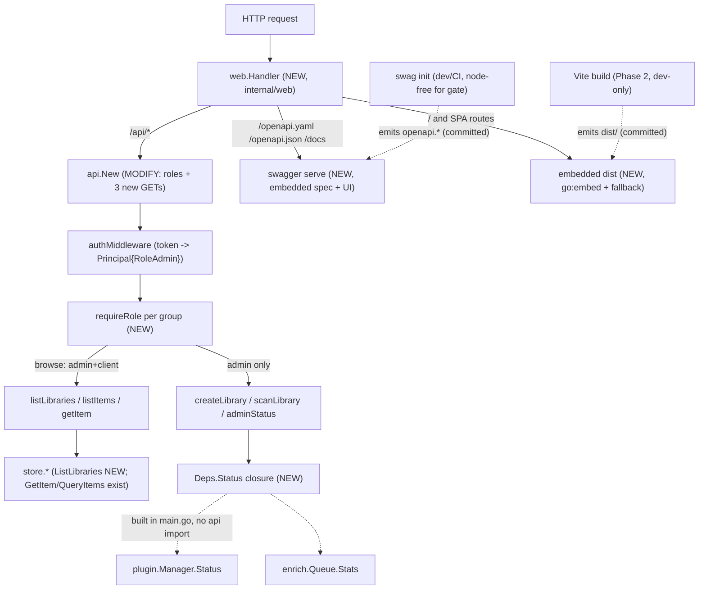

# Implementation Plan — web-ui (Phase 1: API + roles + Swagger + embed scaffold)

> Architecture + File Map + dependency-ordered Step Outline + Foundational Setup
> + decision log (6 open questions resolved) + right-sizing verdict. Builds
> ADDITIVELY on `main` @ `58a1130`. **Phase-1 scope only**: the Go-side
> foundation the UI depends on. The React app + admin/client panels are Phases
> 2-4 (outlined in §Later Phases).

## Architecture overview

Mellifera today serves a pure-delegation chi API (`internal/api`) as the sole
top-level handler (`cmd/mellifera/main.go:127`). Phase 1 layers a **delivery +
contract + auth** substrate around it — without altering any handler body or
any proto/sdk/scan/enrich code:

1. **Role-aware auth.** Evolve `Principal{Admin bool}` → `Principal{Role Role}`
   + `IsAdmin()` (arch §11.5 widening, arrived early). Split the single
   `adminMiddleware` into `authMiddleware` (resolves the admin token →
   `RoleAdmin`) + a per-route `requireRole(...)` gate. Browse routes accept
   admin+client; admin-action routes are admin-only. The `client` role is gated
   but **not minted** by any resolver yet (D18 Phase 2) — a test-only synthetic
   principal proves the gate.
2. **Swagger, code-generated.** `swaggo/swag` reads annotation comments on the
   chi handlers + a general-info block in `internal/api/doc.go` and emits
   `openapi.{json,yaml}` (to `internal/web/api/`, avoiding the design `docs/`).
   The spec is embedded + served at `/openapi.{yaml,json}`; Swagger UI (vendored
   static) at `/docs/`. Annotations are comments → INV1 (pure delegation) holds.
3. **API extensions (additive GETs).** `GET /libraries` (new `store.ListLibraries`),
   `GET /items/{id}` (first API caller of existing `store.GetItem`), and
   `GET /admin/status` (new `Deps.Status` closure over `plugin.Manager.Status`
   + `enrich.Queue.Stats`, built in `main.go` so `api` imports neither — INV2).
4. **Embedding scaffold.** New `internal/web` package exposes
   `Handler(apiHandler, opts)` composing `/api/*` → api router, `/openapi.*`+`/docs`
   → swagger, `/` → SPA (`go:embed dist`), with immutable cache for hashed
   assets + SPA fallback. A **committed placeholder `web/dist/index.html`** makes
   the embed compile and AC-6 verifiable now; the real React app replaces it in
   Phase 2.

### Right-sizing verdict: **PHASED** (Phase 1 scoped here)

LARGE feature (React SPA + Swagger + roles + library mgmt + 2 panels + API
extensions). A single pass exceeds the 15-step / 8-AC gates. Phasing authorized
by the enhanced objective. **Phase 1 = the Go-side foundation** (roles + swagger
codegen/serve + 3 API extensions + embedding scaffold + build-gate story): 12
steps, 7 ACs — within both gates. Phases 2-4 (React scaffold + admin panel;
browse UI; polish) are outlined in §Later Phases. `feature_too_large` is NOT
triggered (within gates); the phasing is the proactive remedy.

> **Plan-review decision point (surface to user):** this cut delivers a
> verifiable delivery mechanism + API + auth in Phase 1 but **no visible React
> UI** until Phase 2. Alternative: merge Phase 1+2 (deliver a minimal admin
> "add library" page in one pass) — but that pushes steps past the 15 cap and
> ACs to 9+. Recommend the foundation-first cut (de-risks `go:embed`/swag/roles
> before the React build); user may reorder at plan-review.

## File Map

**MODIFY (all verified to exist — G2):**
- `internal/store/libraries.go` — +`ListLibraries` (+ test in `store_test.go`).
- `internal/api/doc.go` — roles doc + swag general-info block + INV update (3→4 symbols).
- `internal/api/router.go` — `Role`, `Principal{Role}`, `IsAdmin()`; `authMiddleware`+`requireRole`; mount 3 new GETs + per-route gating.
- `internal/api/middleware.go` — resolver sets `Principal{Role:RoleAdmin}`; +`requireRole`.
- `internal/api/handlers.go` — swag annotations on existing + new handlers; +`listLibraries`/`getItem`/`adminStatus` + DTOs + `AdminStatus`; `Deps.Status` field (in router.go).
- `internal/api/router_test.go` + `middleware_test.go` — `.Admin`→`.IsAdmin()`; +role-gating tests; +new-route tests.
- `cmd/mellifera/main.go` — `web.Handler(api.New(deps), opts)`; `Deps.Status` closure over `mgr`+`enrichQueue`; `MELLIFERA_WEB_DEV`.
- `Makefile` — +`web-build` target (dev-only; not in build/check).
- `NOTICE` — record vendored Swagger UI (Apache-2.0).

**CREATE:**
- `internal/web/doc.go` — package contract (≤3 symbols, invariants).
- `internal/web/web.go` — `Handler`+`Options`, `//go:embed all:dist`, SPA fallback, cache headers.
- `internal/web/swagger.go` — `//go:embed openapi.yaml`, vendored `swagger-ui/`, serve `/openapi.*`+`/docs`.
- `internal/web/web_test.go` — embed/fallback/cache-header table tests.
- `internal/web/api/openapi.yaml` + `openapi.json` + `docs.go` — swag-generated (committed; regen via `make web-build`).
- `internal/web/dist/index.html` + `internal/web/dist/assets/app.js` — committed Phase-1 placeholder (real React build replaces in Phase 2).
- `internal/web/swagger-ui/` — vendored Swagger UI static (Apache-2.0).
- `integration_web_test.go` — black-box Phase-1 ACs (stdlib `net/http`).
- `web/README.md` — dev workflow (Vite :5173 proxy → Go :8080; `make web-build`).

**UNCHANGED (AC-7 additive — verify-probe `git diff 58a1130 --stat` empty):**
`proto/`, `pkg/sdk/`, `internal/scan/`, `internal/enrich/`, `internal/plugin/`, `internal/module/`, `go.mod`, `go.sum`.

## Stack Patterns Applied

| Concern | Pattern | Source | Existing convention (extend) |
|---|---|---|---|
| HTTP router | chi v5 sub-routers + per-group middleware | framework canonical | `internal/api/router.go:41` (`r.Route`) |
| AuthN/authZ | middleware resolves Principal (type, not bool); authZ at the route group | web-async archetype §Security | `internal/api/middleware.go:29` (`adminMiddleware`); arch §11.5 |
| Static embed | `go:embed` + `http.FileServer` + SPA fallback | Go canonical | first use (D11/Q20 plugin-embed documented, unbuilt — SPA is simpler) |
| API contract | code-generated OpenAPI from annotations | external-service/tool | new (swag) — chosen over huma (leaves chi) + kin-openapi (hand-coded, drifts) |
| Pure delegation | handler = parse→one call→write | mellifera-build INV1 | `internal/api/doc.go:24`; handlers annotations are comments only |
| Anti-corruption at api edge | func-field closure (not a type import) for plugin/enrich | DI/adapter (no single-impl interface) | `api.Deps.Scan` (`router.go:24`) is the precedent func-field |

## Foundational Setup (does NOT own an AC/seam — must not be silently dropped)

| Item | Why (consuming task/AC) | Emits |
|---|---|---|
| Install `swag` CLI (dev/CI only) | needed for T-swag codegen (AC-2) | task T-swag runs `swag init`; `make web-build` documents install (`go install github.com/swaggo/swag/cmd/swag@latest`) |
| Vendor Swagger UI static dist into `internal/web/swagger-ui/` | T-web-swagger embeds it (AC-2) | fold→precondition of T-web-swagger (one-time vendor step in that task) |
| Commit Phase-1 placeholder `web/dist/index.html` + `assets/app.js` | go:embed must compile + AC-6 cache-header probe | task T-placeholder-dist (emits the committed artifact) |
| Commit generated `internal/web/api/openapi.{yaml,json}` | T-web-swagger embeds it; Go gate stays node-free | fold→precondition of T-web-swagger (initial `swag init` run committed) |
| `NOTICE` update for Swagger UI (Apache-2.0) | license compliance (D12) | fold→T-web-swagger |
| Decide swag output dir = `internal/web/api/` (not `docs/`) | avoid clobbering design `docs/` | decision (this plan) — no task |

## Step Outline (dependency-ordered; one line per step; traces to AC)

1. `store.ListLibraries(ctx) ([]Library, error)` + table test in `store_test.go` (mirror `QueryItems` param-SQL pattern, `items.go:88`) — (AC-3) → consumed by step 4.
2. `internal/api`: add `Role` type + `Principal{Role}` + `IsAdmin()`/`Admin()` (deprecated) in `router.go`; update `doc.go` INV + symbol count (3→4) — (AC-1, AC-7) → consumed by steps 3,8.
3. `internal/api/middleware.go`: rename `adminMiddleware`→`authMiddleware` (sets `Principal{Role:RoleAdmin}`) + add `requireRole(roles ...Role)`; update `middleware_test.go` `.Admin`→`.IsAdmin()` — (AC-1) → consumed by step 5.
4. `internal/api/handlers.go`: `listLibraries` handler + `librariesResponse`/`libraryDTO` (convert `store.Library`, INV4); route mount `GET /libraries` — (AC-3) → depends on step 1.
5. `internal/api/router.go`: mount new + existing routes in two `requireRole` groups (browse: admin+client; admin: admin only) — (AC-1, AC-3, AC-4, AC-5) → depends on steps 2,3,4,6,7.
6. `internal/api/handlers.go`: `getItem` handler + `itemResponse` (reuse `itemDTO`); route `GET /items/{id}`; 404 on `sql.ErrNoRows` — (AC-4) → wires to existing `store.GetItem` (`items.go:74`).
7. `internal/api/router.go`+`handlers.go`: `Deps.Status func(ctx)(AdminStatus,error)` field + `adminStatus` handler + `statusResponse`/`AdminStatus`/`pluginHealthDTO`/`enrichStatsDTO`; route `GET /admin/status` (admin only); nil→503 — (AC-5) → depends on step 5.
8. `internal/api/handlers.go`+`doc.go`: add swag annotations (`@Router/@Summary/@Param/@Success/@Failure`) on all 6 handlers + general-info block in `doc.go` (comment-only; INV1 preserved) — (AC-2, AC-7) → depends on steps 4,6,7.
9. `internal/web/doc.go`+`web.go`: package contract + `Handler(apiHandler, Options)` + `//go:embed all:dist` + SPA fallback + cache headers (immutable `/assets/*`, `no-cache` index); nil apiHandler supported — (AC-6) → depends on step 13 (placeholder dist).
10. `internal/web/swagger.go`: `//go:embed openapi.yaml` + vendored `swagger-ui/` + serve `/openapi.{yaml,json}` + `/docs/` (public, no auth) — (AC-2) → depends on steps 8 (spec), 14 (UI vendor + spec commit).
11. `cmd/mellifera/main.go`: `web.Handler(api.New(deps), opts)` replaces the sole `srv.Handler`; build `Deps.Status` closure over `mgr.Status`+`enrichQueue.Stats` → `api.AdminStatus`; `MELLIFERA_WEB_DEV` → `Options.DevMode` — (AC-5, AC-6) → depends on steps 5,7,9,10.
12. `Makefile`: add `web-build` target (`swag init -o internal/web/api -g cmd/mellifera/main.go` + Phase-2 `npm run build` placeholder); comment: node dev-only, not in `build`/`check` — (AC-7) → depends on nothing (documentation/target).
13. `web/dist` placeholder: commit `internal/web/dist/index.html` + `internal/web/dist/assets/app.js` (Phase-1 hand-written shell) + `web/README.md` (dev workflow: Vite :5173 proxy `/api`,`/openapi`,`/docs`→:8080) — (AC-6) → input to step 9.
14. Initial `swag init` run: generate + commit `internal/web/api/{docs.go,openapi.json,openapi.yaml}` + vendor `swagger-ui/` + update `NOTICE` — (AC-2) → input to step 10.
15. `integration_web_test.go` (black-box): boot server, assert `/`,`/assets` cache, `/client/route` fallback, `/openapi.yaml` lists 6 routes, `/docs` 200, role-gating (admin OK both; synthetic client 200 browse / 403 admin), `GET /libraries`, `GET /items/{id}` full doc, `GET /admin/status`; plus `make build && make check` node-free probe — (AC-1..AC-7) → depends on all.

> 15 steps — at the gate. Each traces to ≥1 AC; every File Map entry has steps; ordering is dependency-correct (store/middleware/handlers → router grouping → web → compose → integration). No orphaned steps. (At-cap, not over: phasing applied — see right-sizing.)

## Decision log — 6 open questions resolved

1. **React toolchain → Vite + React 18 + TypeScript + react-router-dom + TanStack Query + Tailwind CSS.** Vite = fast + emits hashed cacheable assets (fits immutable cache); TanStack Query = REST cache; Tailwind = purged utility CSS (small bundle). shadcn/ui deferred to panel phases. **Dev-only (Phase 2+); not in Phase 1.**
2. **Embedding → new `internal/web` package, `//go:embed all:dist`.** Immutable cache for `/assets/*`, `no-cache` for `index.html`, SPA fallback for unknown non-api paths. Composed in `main.go` (keeps `api.New` focused). First real `go:embed`; simpler than the D11 plugin-embed (no extraction).
3. **Swagger lib → swaggo/swag.** Least friction with chi + pure-delegation (annotations are comments; huma would leave chi, kin-openapi is hand-coded and drifts). `swag init` at dev/CI time (node-free for the gate); output to `internal/web/api/` (not the design `docs/`). Embedded + served. **No `go.mod` change** (CLI tool like `protoc`).
4. **Roles design → `Principal{Role Role}` + `IsAdmin()`; `authMiddleware`+`requireRole`.** Admin token → `RoleAdmin` (MVP); `RoleClient` gated but unminted (Phase 2 resolver). Additive at system level; one field rename + one test reader (`middleware_test.go:55`). Grounds D18.
5. **API additions → `GET /libraries` (+`store.ListLibraries`), `GET /items/{id}` (first API caller of existing `GetItem`), `GET /admin/status` (via `Deps.Status` closure).** `itemDTO` already carries the full document, so no separate "metadata shape" is needed (open-question-5 answer). `DELETE`/`PUT /libraries` + `/admin/config` deferred.
6. **Dev workflow → Vite dev server :5173 with `vite.config.ts` `server.proxy` (`/api`,`/openapi.*`,`/docs` → `http://127.0.0.1:8080`).** Documented in `web/README.md` (Phase 2 wires it; Phase 1 documents the contract). Go server run via `make build` + `MELLIFERA_ADMIN_TOKEN=... ./mellifera`.

### Build-gate story (how the Go gate stays green with a JS toolchain)
- `node`/`npm`/`swag` are **dev/CI tools** (like `protoc`, `golangci-lint`) — never runtime, never in `go.mod`.
- The Go gate consumes **committed artifacts**: `internal/web/dist/*` (placeholder now, real React build in Phase 2) + `internal/web/api/openapi.*` (generated) + `internal/web/swagger-ui/*` (vendored). All embedded via `go:embed`.
- `make build` / `make check` / `make lint` / `make test` **never invoke node** → green on a node-less host (AC-7 verify probe).
- `make web-build` is the **dev-time regen** (runs `swag init` +, in Phase 2, `npm ci && npm run build`); a developer who touches the UI/annotations runs it and commits the regenerated artifacts. CI runs it in a **separate node-enabled job** (or relies on the committed artifacts); the Go CI job stays node-free.

## Later Phases (outlined — NOT in this plan's scope/steps/ACs)

- **Phase 2 (web-ui-spa-admin):** Vite + TS + react-router + TanStack Query + Tailwind scaffold under `web/`; the embedding wired to a real built `dist/` (replaces the placeholder); the admin library-management panel (add-library form: name/path/module-type, list, trigger scan, link to status). The `make web-build` `npm` step activates.
- **Phase 3 (web-ui-browse):** client browse UI — item list (filter library/status) + item-detail view rendering `sources.<plugin>`/`_view`/`_provenance`/`_stages` human-readable (precision-preserved). Mint a real `client` principal when a session system exists (D18 Phase 2).
- **Phase 4 (web-ui-polish):** admin panel polish (`DELETE`/`PUT /libraries`, `/admin/config`), i18n (Russian first-class), a11y, bundle-size audit.
- **Deferred (unchanged):** streaming/playback (Phase C), full multi-user accounts, go:embed first-run plugin extraction (D11/Q20).
