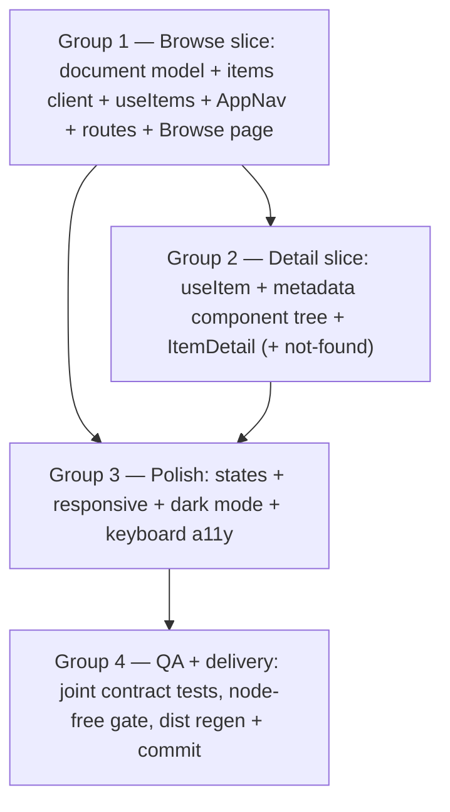

# Design: web-ui Phase 2b+2c — client browse, item detail, metadata rendering, polish

## Context

Phase 2a (baseline on this branch, uncommitted, reviewer verdict PROCEED) delivered: `web/` (Vite 5 + React 18 + TS strict + react-router v6 + TanStack Query v5 + Tailwind + shadcn copy-in), `lib/api.ts` (DTO mirrors + `apiRequest<T>` Bearer wrapper + `ApiError`), `lib/queries.ts` (4 hooks, keys `["libraries"]` / `["admin-status"]` / `["library-scan", id]`), `App.tsx` (`/login` public; `/admin/*` under `<RequireAuth>`; `/` → `/admin`), admin pages (Libraries / Status), and the regenerated committed `internal/web/dist/`. The Go side is byte-identical vs `47f276e` (api = 7 symbols, web = 2) and STAYS that way in this change.

The consumed endpoints pre-exist: `GET /api/v1/items` + `GET /api/v1/items/{id}` sit in the browse role group (admin+client read-only — `internal/api/router.go:92-95`). The §3.1 document shape the UI renders is fixed by `docs/web-ui-phase-2/contracts.md` (ItemDocument / SourceNamespace / ViewEntry / ProvenanceEntry / StageEntry; StageEntry transcribed from `internal/enrich/enrich.go:137-149`).

Probes in this change MUST run node-free (no `node_modules` assumed): they are structural greps over `web/src` / the committed dist plus `go build` (precedent: `docs/web-ui-phase-2/qa/qa_02_structural_build_gate_probes.md`). Probe CWD is the repo root.

## Goals / Non-Goals

Goals:
- Browse + item-detail surfaces over the existing read-only API, with the fidelity invariants (verbatim precision, namespace isolation, text-only rendering, UTF-8 passthrough) enforced in the rendering layer.
- The 2c polish layer: shared states, responsive layouts, persisted dark mode, keyboard accessibility.
- Delivery: committed dist carries the new routes; Go untouched; Go gate node-free.

Non-Goals:
- No new API endpoints, no Go source changes, no `go.mod` changes (the items endpoints pre-exist).
- No real client-role accounts / login endpoint (D18).
- No streaming/playback, no post-actions (Phase C), no library delete/rename.
- No server-side search/sort beyond the existing `library`/`status`/`limit`/`offset` params.

## Decisions

1. **Library-scoped browse (no "all libraries" query).** The wire requires an integer `library`: an absent param fails `strconv.ParseInt` → 400 (`internal/api/handlers.go:222-228`), `store.QueryItems` always filters `WHERE library_id = ?` (`internal/store/items.go:99-108`), and `integration_web_test.go:158` comments "library query param required". So the Browse page owns a library selector (default = first library from `useLibraries`) and every items query carries it. *Alternative rejected:* a Go change making `library` optional (all-libraries branch in `QueryItems`) — rejected because it breaks the byte-identical-Go posture for marginal value; per-library browsing matches the outline ("library + status filters"). The stale swag annotation (`@Param library query int false`) is a Go-doc drift to fix in a later Go-touching change (see Open Questions).
2. **Pure document model (`web/src/lib/document.ts`), no React imports.** TS mirrors of the §3.1 shape (types per `contracts.md`; `StageEntry` incl. `advanced_to` + optional `error` per `enrich.go:137-149`) plus read-only accessors that normalize records to arrays (`sourcesOf`, `viewEntries`, `provenanceEntries`, `stageEntries`). Unit-testable in Vitest; nothing mutates or rounds. *Alternative rejected:* inline optional-chaining in components — scatters the shape and drifts from the fixed contract.
3. **Metadata component tree, one component per document tier.** `<SourceCard pluginId namespace>` (recursive `<JsonValue>` inside — lossless, no rounding, text-only), `<ProvenanceBadge fieldPath entry>`, `<ViewFields entries>`, `<StagesProgress stages>`. Namespaces render as separate cards — never merged (arch §3.1 Tier 2). Components receive parsed document data as props; they never fetch.
4. **Root + wildcard redirect → `/browse`; shared `AppNav`.** `App.tsx` flips `/` and `*` `<Navigate>` to `/browse` (the 2a `INV-root-redirect-2a` comment anticipates this); `/browse` and `/items/:id` are individually wrapped in `<RequireAuth>` (preserves `INV-public-login-only`). `components/AppNav.tsx` (NavLink to `/browse` + `/admin`) is rendered by the Admin shell header and the browse pages' headers — one nav surface; the dark-mode toggle rides in it.
5. **Status filter set = enrich-owned lifecycle minus `deleted`.** Options: all (empty), `new`, `pending`, `parsed`, `enriched`, `failed`, `ready`, `stale` — the canonical literals owned by `internal/enrich/state.go:13-21`. `deleted` is not offered (browse shows the live library). Empty passes `""` → all statuses (INV-empty-all).
6. **Pagination: offset paging, page size 50** (the server default; server max 200 — `handlers.go` swag `@Param limit`). Browse keeps `limit`/`offset` in the `useItems` query key so pages are cached independently.
7. **Dark mode via Tailwind `darkMode: "class"`** (already the shadcn setup): `components/ThemeToggle.tsx` flips the `dark` class on `document.documentElement` and persists `"light"|"dark"` under localStorage key `mellifera.theme`; on boot the class is applied from the stored value. No new dependency.
8. **Probes are node-free structural anchors.** Greps over `web/src` (new files fail them when absent), the committed dist literal `/browse` (string literals survive Vite minification) for the delivery box, and `go build ./...` for the Go-untouched invariant. The only node-touching WORK is the dist-regen box (dev-time `make web-build`, mirrors 2a step 12); no probe invokes node/npm/swag.
9. **The optional "recent items" admin widget (2c outline, marked optional) is deferred** — it adds a spec surface for a nicety; it can ride a later change trivially (`useItems` with a small limit already exists after this change).

## Risks / Trade-offs

- [Probe greps are weaker than behavioral tests] → the qa group adds joint/integration depth; the reviewer confirms UNPROBEABLE scenarios; Vitest unit tests (dev-only) cover the document model and metadata components locally.
- [`make web-build` needs node on the apply host] → isolated in one box (4.2); node is a recorded dev tool (node v24 per `.project_context.json`); if absent the box correctly refuses to tick rather than silently skipping delivery.
- [Minified dist grep could miss a renamed route constant] → route paths are string literals; Vite does not rewrite string contents. `grep -qrs "/browse" internal/web/dist/assets` is stable.
- [Go test files are the only Go-side touch (qa box 4.1, additive)] → test-only additions keep api at 7 exported symbols and INV2 intact; `go build ./...` + the gate stay green and node-free.
- [`listItems` swag annotation drift (says `library` optional)] → documented here; no Go edit in this change (Decision 1).

## Migration Plan

Additive SPA work in DAG order; no data or API migration. Delivery = regenerate `internal/web/dist/` via `make web-build` and commit (mirrors committing regenerated `*.pb.go`). Rollback = revert the change's commits; the previous dist bytes re-embed unchanged (the embed directive is untouched).

## Open Questions

- **Swag annotation drift on `GET /items`** (`library` marked optional but is required): fix the annotation + regenerate OpenAPI in the next Go-touching change? (Default: yes, defer to that change — not this one, which keeps Go byte-identical.)
- **Confirm the deferred "recent items" admin widget stays out of this phase** (Decision 9). Default: deferred.

## Interfaces (cross-group)

Group 1 (browse slice) → Groups 2/3:

- `web/src/lib/document.ts` — `ItemDocument`, `SourceNamespace`, `ViewEntry`, `ProvenanceEntry`, `StageEntry` (shapes per `contracts.md`; `StageEntry` per `enrich.go:137-149`) + accessors `sourcesOf(doc)`, `viewEntries(doc)`, `provenanceEntries(doc)`, `stageEntries(doc)` (record → array, insertion order).
- `web/src/lib/api.ts` — `ItemDTO`, `ItemsResponse {items: ItemDTO[]}`, `ItemResponse {item: ItemDTO}` (field names verbatim per `internal/api/handlers.go:129-139`); `listItems(params: { library: number; status?: string; limit?: number; offset?: number }): Promise<ItemsResponse>`; `getItem(id: string): Promise<ItemResponse>`.
- `web/src/lib/queries.ts` — `useItems(params)` keyed `["items", params]`; `useItem(id)` keyed `["item", id]`.
- `web/src/components/AppNav.tsx` — NavLink pair (`/browse`, `/admin`); used by Admin shell + browse pages.

Group 2 (detail slice) → Group 3:

- `web/src/components/metadata/` — `<SourceCard pluginId: string namespace: SourceNamespace />`, `<JsonValue value: unknown />`, `<ProvenanceBadge fieldPath: string entry: ProvenanceEntry />`, `<ViewFields entries: Record<string, ViewEntry> />`, `<StagesProgress stages: StageEntry[] />`.
- `web/src/pages/browse/ItemDetail.tsx` — consumes `useItem(id)`; 404 → not-found state; other errors → canonical error state.

Group 3 (polish) → Group 4 (qa/delivery):

- `web/src/components/states.tsx` — `<LoadingState />`, `<EmptyState message: string />`, `<ErrorState error: ApiError />` (renders `error.code` + `error.message`; retry affordance when `error.retryable`).
- `web/src/components/ThemeToggle.tsx` — persisted key `mellifera.theme` (`"light"|"dark"`; absent → system preference); flips the `dark` class via `classList`.
- Delivery contract: all `web/src` changes land before the dist regen; `make web-build` (node, dev-time) → committed `internal/web/dist/`; the Go gate (`make build && make check && make test`) stays node-free.

## Task Group DAG

