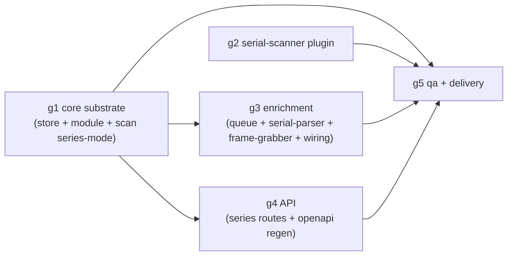

# Design: serials-library — directory-structured serial libraries

## Context

The user's real serial libraries (`/Volumes/kofe/ongoing`, `/Volumes/ojir/serials`) are
directory-structured: one subdirectory per serial (show), episode video files directly under
it, subtitle/voiceover sidecars in nested language folders (`Eng/`, `Rus/`, `SUB/`), and
depth-3-4 `OST/` soundtrack folders that are serial-level attachments, not episode media.
Observed facts the design must survive: noisy release-name directories with season markers
(`s01`, `S04`, `4th Season`, `S02`); the same show split into two cours directories (must
stay two serials); one stray top-level video (`The_Ribbon_Hero_[ONA]_…​.mkv`) plus
extensionless `smbdelete` junk at the root; `.srt` files linked to episodes by SxxExx;
`.ass` files with bare episode numbers only (`Seishun…​/SUB/Show - 01 (1080p) [C48E56C8].ass`);
sidecars optional per serial; Cyrillic+Latin mixed directory names
(`Необычный адвокат У Ён У Extraordinary Attorney Woo.2022.S01`) as first-class; 59 clean
SxxExx `.mkv` in the conventional library.

Mellifera's shipped model is filename-flat (`tv`, `image`): every media file under the root
is one item (`plugins/base-scanner/walk.go`), enrichment is a per-document plugin chain with
`sources.<plugin_id>` namespaces and core-stamped `_provenance`/`_view`/`_stages`
(`docs/architecture.md` §3), and the queue derives `(item, plugin)` tasks
(`internal/enrich/queue.go`). A directory has no document to hang show-level metadata on —
that is the core gap.

Constraints carried in: ADDITIVE posture (proto/`pkg/sdk` untouched —
`docs/architecture.md:86` keeps `image_provider` reserved), pure-Go/no-CGO, exported-symbol
budget (≤8 warn / >12 fail per package, `check.sh`), soft-fail per source
(`plugins/base-scanner/ffprobe.go:16`), core never branches on media-type literals
(module config is data — `internal/module/registry.go:27` `INSERT OR IGNORE`), idempotent
migrations with NO generated columns (the known B3b blocker, `docs/backlog.md`), manual
edits out of scope (B3 owns `_view` arbitration; `_user` is the reserved landing namespace,
`docs/architecture.md:837`).

## Goals

- A third library type, `serial`: depth-1 subdirectory = serial identity; direct video
  files = episodes; sidecars associated (episode-linked or serial-level, never silently
  dropped); default episode images from ffmpeg frame grabs.
- Serial-level metadata lives in a first-class **series document** with the identical
  namespace machinery, so per-plugin data can never overlap or contradict (namespace
  write invariant, architecture §3.3).
- Two-level enrichment through the UNCHANGED queue/ledger/lease machinery.
- Read-only series API in the browse group; scan flow and endpoints unchanged.
- `tv` and `image` behavior golden-unchanged; core stays media-type-agnostic.

## Non-Goals

- Manual edits / document write API — deferred (Decision D4).
- External metadata fetch (TMDB etc.) — that is B3; this change adds the serial-level
  landing documents it will fill.
- Auto-merge of cours directories, episode renaming/organizing (Phase C post-action
  territory), SPA work (browse UI already renders full documents).
- Subtitle extraction from containers, playback, or `internal/stream`.

## Decisions

### D1 — Series entity: new `series` table + serial-level §3.1 document (Q1)

**Chosen:** an idempotent `CREATE TABLE IF NOT EXISTS series` — `id`
(`ser_<library_id>_<hash16(relative_path)>`), `library_id`, `module_id`, `relative_path`,
`document` (the dynamic JSON with the same namespace machinery as items), `schema_version`,
`status` (same lifecycle literals), `created_at`, `updated_at`,
`UNIQUE(library_id, relative_path)` + index on `library_id`. Identity is
`(library_id, relative_path)` — the directory path within the library.

**Alternatives rejected:**
- *Derive the series at query time from episodes* — there is nowhere to put serial-level
  `sources.<plugin_id>` namespaces (architecture §3 Tier 2 hangs off a document); the
  user's "one serial's plugin data never overlaps" requirement needs a document per level.
- *Reuse `items` with a nullable parent column* — items are keyed/upserted by `file_id`
  (`internal/store/items.go` PutItem `ON CONFLICT(file_id)`); series have no file, and a
  discriminator column couples every existing item query.

**Rename/move:** a renamed directory is a NEW series identity; the old row is swept to
`deleted` by the post-drain sweep; no automatic metadata migration. This matches the item
model (file identity is path-derived) and keeps enrichment re-derivation honest — a
re-created identity re-enriches from scratch under the same namespace rules.

**No generated columns** — new table with plain columns only; the B3b blocker
(`docs/backlog.md`, `internal/store/open.go` single-run migration runner) is not touched.
Store additions: type `Series` + methods (PutSeries/GetSeries/QuerySeries/ListSeriesIDs/
QueryItemsBySeries) — methods do not count against the exported-symbol budget.

### D2 — Discovery: new `serial-scanner` plugin; base-scanner byte-untouched (Q2)

**Chosen:** a second scanner-capability plugin selected purely by module config
(`structure: "series-directories"` scanner option). Rules:

1. Depth-1 subdirectory containing ≥1 **directly-contained video file** → serial record,
   emitted as a `DiscoveredFile` **before** its episodes (FfprobeJson empty; the plugin's
   Identify stamps the serial-record marker — see Interfaces).
2. Direct video files → episodes, probed exactly like the shipped video walk (same
   `mediaMime` extension set, `plugins/base-scanner/walk.go:25`).
3. Video files deeper than the serial dir's direct children → **not** discovered; one
   per-serial scan warning.
4. Sidecar extensions (`srt ass ssa sub mka m4a mp3 flac aac ogg opus wav`) at any depth →
   classified, never probed, never items: episode-linked (SxxExx first — reuse the
   `seasonEpisodeRe` grammar, `plugins/tv-parser/tvparse.go:22`; bare-number fallback) or
   serial-level (no match → attached to the series record's facts). Language from the
   containing folder name (case-insensitive `Eng`/`Rus`/…) or a filename tag, else empty.
5. Extensionless files (no extension in either map) → excluded silently (no warning).
6. Loose top-level video file → **file-backed single-episode serial** (identity = the
   file's own relative path, backing fact `file`). Flippable knob; the alternative
   (reject with warning) would silently hide the user's `The_Ribbon_Hero` file.
7. Cours directories stay separate serials — identity is the path; no fuzzy matching.
8. Serial records persist during the same drain (same Scan stream, `PutItem`-style upsert);
   the scan response stays non-blocking.

**Alternative rejected:** teaching base-scanner a "directory mode" — it would branch the
shipped walker on structure and risk the golden tv/image behavior for zero reuse (the walk
shape, not the extension set, is what differs). The scanner binding is already a config
entity, so a second plugin is strictly additive.

### D3 — Frame grabs: `frame-grabber` as a `metadata_source` plugin (Q3)

**Chosen:** a third new plugin with the `metadata_source` capability, priority 2 after
`serial-parser` (priority 1). ffmpeg invoked via `os/exec` arg-slice (never shell),
`-ss min(seek, 10% duration)` (default seek 60s) → single JPEG at
`<MELLIFERA_DATA_DIR>/thumbs/<hash16(series_rel)>/<hash16(episode_rel)>.jpg`; the plugin
writes ONLY `sources.frame-grabber` (the thumbnail path — never a BLOB).

**Alternatives rejected:**
- *Wire the reserved `image_provider` capability* — `docs/architecture.md:86` keeps it
  future/reserved; wiring a new capability type means proto + SDK + core dispatch changes,
  breaking the additive posture this change promises.
- *Grab frames inside `serial-scanner`* — scan must stay fast and non-blocking; and
  scanner results carry no namespace/ledger/queue semantics, so a failed grab would be an
  unlogged one-off instead of a `no_data` cooldown.

Soft-fail is inherited, not rebuilt: missing ffmpeg / non-zero exit / timeout are
per-source warnings + empty namespace → the shipped `no_data` ledger cooldown; only a
cancelled context is hard. An enricher poster later outranks the default because
`frame-grabber` writes first (priority 2) and `_view` is last-writer until B3 ships real
arbitration — both namespaces stay stored losslessly (architecture §3 Tier 2).

### D4 — Manual edits: DEFERRED (Q4)

**Chosen:** out of scope, stated as an explicit scope line in the proposal for GATE 1.

**Reasoning (right-sized honestly):** the user's invariant is "one serial's/plugin's data
never overlaps or contradicts". Manual edits written today with last-writer `_view` would
be overwritten by the next plugin re-enrichment — shipping that would violate the very
invariant the change exists for. Real manual edits need (a) the `_user` namespace with
unconditional view precedence (`docs/architecture.md:837` — already reserved) and (b) the
arbitration rule B3 is designing for `_view`. The serial documents this change creates
carry the standard machinery, so the follow-up applies uniformly to items and series —
deferring costs nothing later. Deferred group: none appended; the qa group covers the
shipped scope.

### D5 — Two-level enrichment: same chain, same queue, `(row_id, plugin)` tasks (Q5)

**Chosen:** the queue derives tasks over BOTH stores under the identical predicates —
queueable source (`Enabled && AuthMode != "CLIENT"`, `internal/enrich/queue.go:352`),
namespace absent (`:357`), not in ledger cooldown (`:314`) — keyed by the row id, which
never collides (`itm_` vs `ser_` prefixes). The worker loads the item document, and on
`sql.ErrNoRows` loads the series document — no id-prefix sniffing (prefixes stay opaque).
The 4-RPC chain runs unchanged over whichever document; `serial-parser` self-selects at
Match per document type (series: dir-name cleanup + season extraction; episode: SxxExx —
`applies=false` = skipped stage, the `plugins/tv-parser/parser.go:41` precedent);
`frame-grabber` applies only to episode documents carrying a video absolute path. Series
settle to `ready` independently of episodes; leases are per row id, so a series and its
episodes never serialize against each other. Core stamps `_provenance`/`_view`/`_stages`
exactly as for items.

### D6 — API: three read-only series routes in the browse group (Q6)

**Chosen:** `GET /api/v1/series?library={id}` (integer required → else `400 bad_request`),
`GET /api/v1/series/{id}` (full serial-level document, opaque; unknown → `404 not_found`),
`GET /api/v1/series/{id}/episodes` (episode items, item wire shape) — mounted in the browse
role group (`internal/api/router.go:82-89`, admin+client read-only). Handlers are pure
delegation with unexported DTOs (the api package already sits at the warn threshold of the
check.sh exported-symbol budget). No write endpoints; scan endpoints unchanged. Gating per
the shipped matrix: browse = admin+client, admin group untouched.

## Risks / Trade-offs

- **Double emission cost** (serial record + episodes per directory): the serial record is
  one extra Identify, no ffprobe — bounded and small vs the episodes themselves.
- **Series sweep on partial scans** can delete rows for directories a cancelled stream
  never saw — mitigated by gating the sweep on a clean drain (the notify-after-clean-drain
  precedent, `internal/scan/run.go`), probe R6_S3.
- **Bare-number sidecar false positives** (an `OST` track numbered like an episode would
  associate to that episode): match basis is recorded in the facts; the SxxExx-first rule
  and `OST/` being episode-number-free in the observed libraries keep this acceptable.
- **ffmpeg as a new runtime dependency** joins ffprobe/exiftool as optional; absence is a
  `no_data` cooldown, never a scan failure (probe R9_S2).
- **Queue derivation doubles** (two stores): series counts are small (14-20 in the ground
  truth libraries); derivation is the same in-memory predicate scan.
- **`_view` last-writer** means a source writing after `frame-grabber` outranks it even if
  it is "worse" — accepted; B3 arbitration supersedes, and namespaces stay lossless.

## Migration Plan

Additive only: one `CREATE TABLE IF NOT EXISTS series` + one `CREATE INDEX IF NOT EXISTS`
in the `schemaSQL` list (`internal/store/open.go` precedent) — safe on existing databases,
no data migration, no ALTER on existing tables, no generated columns. Existing `tv`/`image`
libraries scan and enrich exactly as shipped (golden-tested, R12_S2). Rollback = stop using
the `serial` module; the table is inert.

## Interfaces (cross-group contract)

The contract the parallel groups build against (single source of truth for groups 1-4):

1. **Serial record marker** — the `serial-scanner` Identify output stamps, into the
   record's `parsed`: `serial_record: true` (bool), `dir_name_raw` (string), `backing`
   (`"directory"` | `"file"`), `series_relative_path` (identity path: the dir, or the
   file itself for file-backed), `series_sidecars` (array of
   `{relative_path, kind: "subtitle"|"audio", language, match_basis: null}`).
2. **Episode stamping** — an episode item's `parsed` gains `series_relative_path` (its
   containing serial dir, or its own path for file-backed) and `sidecars` (array of
   `{relative_path, kind, language, match_basis: "sxxexx"|"bare_number"}`).
3. **Structure knob** — scanner binding options carry `{"structure":
   "series-directories"}`; the plugin treats any other value as fatal config error.
4. **Series document key set** — `parsed` (the serial-record marker facts), `ffprobe`
   (`{}` for directory-backed; the probe JSON for file-backed episodes' serial record),
   plus core-managed `sources` / `_provenance` / `_view` / `_stages`.
5. **`ser_` id scheme** — `ser_<libraryID>_<sha16hex16(relative_path)>`; item ids remain
   `itm_<libraryID>_<file_id>`; prefixes are opaque to logic.
6. **QueryItemsBySeries semantics** — file-backed: `relative_path = series.relative_path`;
   directory-backed: `relative_path` starts with `series.relative_path + "/"` and contains
   no further `/` (SQL `substr(relative_path, 1, ?) = ?` + Go-side depth filter — no LIKE,
   no escaping hazards).
7. **Thumb path scheme** — `<MELLIFERA_DATA_DIR>/thumbs/<sha16(series_relative_path)>/<
   sha16(episode_relative_path)>.jpg`; `MELLIFERA_DATA_DIR` default `./data`
   (`cmd/mellifera/main.go:236`).
8. **Module seed** — `serial` config mirrors the `tv` seed shape
   (`internal/module/registry.go:44`): scanner binding `serial-scanner` with the structure
   option; metadata chain `serial-parser` (1) + `frame-grabber` (2).

## Task Group DAG

Group 2 depends on nothing (plugin + proto exist; the marker contract above is its
interface); groups 3 and 4 need the g1 substrate (series store + scan series-mode); g5 is
the joint e2e + close-out over everything. Max concurrency 2 — within the ≤3 cap.
