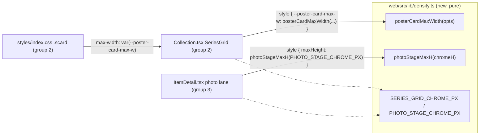

# Design

## Context

Live code (base 7fb8fde): the serial poster grid renders `.scard` cards — `web/src/styles/index.css` fixes `.scard-poster` at `aspect-ratio: 2 / 3` (line 430) and `.scard-title` at `font-size: 12.5px` (line 448); the grid is `grid-cols-2 gap-3 sm:grid-cols-3 lg:grid-cols-4` (`web/src/pages/collections/Collection.tsx:1489`). `.ptile footer` renders `font-size: 11px` (`styles/index.css:395`). Home opens `max-w-6xl` (`web/src/pages/home/Home.tsx:268`); the collection page opens `max-w-5xl` (`Collection.tsx:321`). The photo lane caps its lead image at `max-h-[80vh]` (`web/src/pages/browse/ItemDetail.tsx:1409`) with the identity block below it — the measured clip (bottom y=642 of 633) follows. The photo masonry (`styles/index.css:353`, `columns: 4 210px`) stays untouched. Motivation: proposal.md — Why.

## Goals / Non-Goals

Goals: the four scoped fixes as one additive slice; every new arithmetic unit-tested as a pure helper; default desktop rendering unchanged outside the fixes.
Non-Goals: NO TV-mode work — no `.tv` class, no remote keys, no UA detection, no overscan padding (Layers 7.2-7.4, a separate change); no masonry changes; no Home rail changes (16:9 rows already fit); no backend, no OpenAPI route changes; no new npm dependencies; no runtime JS behavior change beyond the two static style wirings.

## Decisions

### D1 — Clamp the card WIDTH from viewport height; a pure helper emits the CSS value
A grid card's height is `width * 3/2` (poster ratio) + card body. Bounding the card WIDTH from 100vh keeps the ratio intact — a `max-height` on the poster would only letterbox the `object-cover` fill, not reflow the row. `.scard` gains `max-width: var(--poster-card-max-w, none); margin-inline: auto;` and the SeriesGrid ul sets that custom property once from the pure helper; the viewport stays CSS (`100vh` inside the calc), so there are NO JS viewport reads, no resize listeners. Helper contract: `posterCardMaxWidth({chromeH, rows, cardBodyH, minCardW})` returns `min(100%, max(<minCardW>px, calc((100vh - <chromeH + rows*cardBodyH>px) / <rows*3/2>)))`, floored at 120px so extreme chrome values can never collapse a cell to zero width. Alternatives: (a) pure stylesheet calc — rejected: the chrome/row arithmetic would live untested in CSS; (b) JS row packing driven by `window.innerHeight` — rejected: a runtime behavior change, well beyond 7.1.

### D2 — THE CAP DECISION: unify the two BROWSE surfaces at 6xl; detail stays 5xl
Home (6xl) and the collection page (5xl) unify on `max-w-6xl`. Why not keep two caps: the split was unstated — the roadmap's exact complaint — and with D1 active the poster grid's effective width is height-bound on short viewports, so the wider cap cannot regress the rows-fit goal; it only reclaims the wasted 128px on wide panels. Why not unify everything at 5xl: it would narrow Home's landscape rails for nothing. ItemDetail keeps `max-w-5xl`: it is a reading surface (synopsis, footer groups), not a browse grid — outside the decision's two surfaces. One browse cap, one declared exception.

### D3 — The type floor is a scoped CSS edit, not a token system
`.scard-title` 12.5px -> 14px; `.ptile footer` 11px -> 14px (the roadmap's "same floor" for photo tile footers; the draft's "12px" predates the live value — 11px is what ships today at `styles/index.css:395`). Chips (10.5px), sidebar links (12.5/13px), and profile lines keep their sizes — a global minimum would rework every surface under cover of a density slice. Static 14px, not viewport-clamped: viewport-derived scaling is the 7.2 TV mode's job. Verified structurally (targeted greps on the two selectors) — there is no arithmetic to unit-test.

### D4 — The photo stage cap reuses the measured-chrome shape
`photoStageMaxH(chromeH)` returns `max(calc(100vh - <chromeH>px), 320px)`; HeroImage grows an optional `style` prop merged onto the img, the photo-lane usage passes `photoStageMaxH(PHOTO_STAGE_CHROME_PX)`, and the fixed `max-h-[80vh]` class is removed (one mechanism, one usage — the video lane never used it). The 320px floor covers the degenerate chrome >= viewport case. Chrome constants (`SERIES_GRID_CHROME_PX`, `PHOTO_STAGE_CHROME_PX`) carry the 2026-10-24 measurements (182px header + card bodies ~= 302px total; 136px above the stage) as PARAMETER values with derivation comments — apply/review re-checks them visually; the helper arithmetic is the tested contract.

## Interfaces

The custom-property name `--poster-card-max-w` and the two helper signatures are the cross-group contracts; groups 2 and 3 depend only on group 1's module. `density.ts` exports exactly 4 symbols (2 functions + 2 constants) — under the per-package bar; it imports nothing (pure module, no React, no api types).

## Risks / Trade-offs

- [Chrome constants drift from the live page (the post-#15 layout changed the header)] -> values are parameters with derivation comments; the reviewer re-checks them at the gate; a constant tweak never touches the tested arithmetic.
- [`margin-inline: auto` centering interacts with the li stretch] -> scoped to the serial grid's `.scard` inside the wired ul; the clamp only bites where the height bound is narrower than the column.
- [14px footer wraps long capture dates on narrow tiles] -> the footer renders a single date part; wrap is honest reflow, not clipping.
- [Custom-property inline style needs a type cast] -> one `as React.CSSProperties` at the wiring site, commented.

## Migration Plan

Pure SPA additive slice: land groups 1 -> 2 -> 3 in order, then the closure task regenerates `internal/web/dist` via `make web-build` (swag needs `$GOPATH/bin` on PATH) exactly like the previous change's closure task; `internal/web/api` must come out byte-identical (no routes touched). Rollback = revert the change; no data, no config, no routes.

## Open Questions

(none — the cap decision is settled as D2; the chrome constants are parameters, not decisions.)

## GATE 2 rulings + follow-up (2026-10-26)

GATE 2 passed with three flags, all ruled here; none blocks archive, one
spawned the follow-up that landed the same day.

- Flag 1 (rows @ ~540px, spec literalism) — SUPERSEDED by the tier redesign
  below: the two-row guarantee is now scoped to vh >= 662, and below it the
  grid targets ONE full row + header instead of degrading to the 120px floor.
  The spec scenario was reworded to the tiered contract.
- Flag 2 (photo stage identity below the fold @ 633px) — ACCEPTED as
  documented degradation (the identity block is one scroll away; no
  identity budget added to PHOTO_STAGE_CHROME_PX).
- Flag 3 (chrome double-count, conservative direction) — FIXED as proposed:
  SERIES_GRID_CHROME_PX 302 -> 182 (header only); the 2x60px card bodies ride
  the rows*cardBodyH leg alone. Test vectors re-pinned; the arithmetic is
  untouched.

Follow-up (live report at 1280x633, /collections/3: "cards without posters
look too narrow"): the shipped clamp bounded the CARD while the columns
stayed width-tiered (grid-cols-2/3/4), so at 633px-tall viewports the
two-row budget floored at 120px inside 267px tracks — a 120px card centered
in a 267px cell, ragged dead space on both sides (placeholder cards show it
worst). Flag 3 alone did not cure it: (633-302)/3 = 110 still floors. The
fix, in three moves:

1. Tiered budgets — the component emits BOTH tiers (--poster-track-w-1 =
   rows:1, --poster-track-w-2 = rows:2); an index.css height media query
   (min-height: 662px, pinned to SERIES_GRID_TWO_ROW_MIN_VH by a vitest
   fs-check) picks the active one. Below 662px the one-row tier keeps cards
   at real width (261px at 633px; 199px at a 540px TV) instead of the floor.
2. Tracks follow the budget — posterTrackColumns() emits
   `repeat(auto-fill, min(var(--poster-track-max), calc(50% - 6px)))`:
   fixed tracks at the budget, capped at half the container (phones keep two
   columns). Cards fill their tracks; the per-card clamp (.scard
   max-width + margin-inline) is deleted, so clamp-inside-track dead space
   cannot recur.
3. Chrome 182 (flag 3) — the double-count fix rides along.

Verified live at 633px: 4 tracks x 260.7px, all 65 cards 261px filling their
tracks, uniform 388px posters (2:3), first row bottom 635px (header 182 +
row + gap; the 12px row-gap stays absorbed in the measured chrome, as
before). 383 vitest green, tsc clean.
