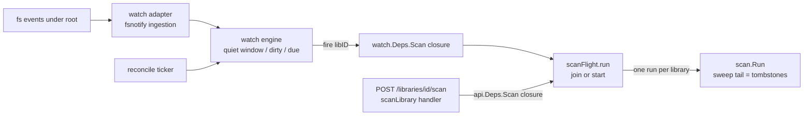

# Design

## Context

Today `scan.Run` (internal/scan/run.go:75) is invoked from exactly one
production site: the `api.Deps.Scan` closure (cmd/mellifera/main.go:403-405)
behind `POST /libraries/{id}/scan` (internal/api/handlers.go:1188 — pure
delegation, no concurrency guard; the `scan_jobs` table exists but is reserved
and unused by scan/api/cmd). The tombstone sweep + enrich handoff run only
inside `Run`'s confirmed-clean-drain branch (internal/scan/run.go:203-214), so
tombstones are scan-tail effects. Scan cost is real: the scanner plugin probes
EVERY media file on every walk (plugins/base-scanner/walk.go:102-129 — no
mtime skip), which grounds the reconcile default at 1h, not minutes. The
lifecycle precedents this design copies: the janitor registry
(cmd/mellifera/janitor.go — boot-run + per-task ticker + capacity-1 wake) and
the browse leaf (internal/browse — pure package, cmd-built `Deps` closures,
launched for the process lifetime beside serving). Deployment mounts are local
ext4, so fsnotify's inotify backend sees all host-side writes; fsnotify is not
currently a dependency.

See proposal.md — Why for the motivation; the spec delta for the behavior.

## Goals / Non-Goals

**Goals:**
- Change-triggered rescans per library with a debounce quiet window, through
  the existing `scan.Run` (no new scan entry point, no api/store/proto change).
- One scan per library at a time, shared across the watcher and the manual
  endpoint (join semantics).
- Periodic reconciliation walk as the missed-event safety net.
- Operator knobs in the house convention; disabled state restores today's
  behavior exactly.

**Non-Goals:**
- No boot scan of libraries at startup (startup cost: a full walk probes every
  file; today's server also never boot-scans).
- No new REST surface, no websocket/event push to the SPA, no per-file
  change classification (the scanner owns all media filtering).
- No DB-backed scan lease (the `scan_jobs` table stays reserved/untouched —
  the server is single-instance; the enrich queue's leases are the in-memory
  precedent).
- No watch-side media-extension filtering (a steady non-media writer merely
  slides the debounce deadline; the reconcile walk is the backstop).

## Decisions

### D1 — New pure-leaf package `internal/watch` (the browse precedent)

`internal/watch` imports NOTHING from mellifera: the library set and the scan
action arrive as cmd-built `Deps` closures, exactly like internal/browse
(browse-scale) and internal/recs. Dependency direction stays DOWN:
`cmd → watch` (wiring only); `api`, `scan`, `store` untouched — watch is a
sibling of scan consumed by main.go alone. Exported tier (5, inside the ≤8
budget): `Library` (ID + RootPath), `Deps` (Libraries + Scan closures),
`Config` (ReconcileInterval + Debounce), `Service`, `NewService`; the loop,
engine, and adapter are unexported (methods and package-internal types are
outside check.sh's count).

```go
type Library struct{ ID int64; RootPath string }
type Deps struct {
    Libraries func(ctx context.Context) ([]Library, error) // over st.ListLibraries(ctx, access.System())
    Scan      func(ctx context.Context, libraryID int64) error // over the shared single-flight
}
type Config struct{ ReconcileInterval, Debounce time.Duration }
func NewService(deps Deps, cfg Config) *Service
func (s *Service) Run(ctx context.Context) error // blocks; returns on ctx cancel
```

Alternative rejected: putting the loop in package main (a janitor-style cmd
file). The janitorTask shape is a periodic `fn(ctx)` — an event loop does not
fit it — and the house pattern for testable background logic is a pure-core
package with table-driven tests (browse, recs), not logic in main.

### D2 — `scan.Run` IS the reconciliation walk

The periodic walk triggers `scan.Run` per library; it does NOT diff the tree
watch-side. `Run` already reconciles idempotently (PutItem upsert by file_id —
the spec's Idempotent re-scan requirement) and its clean-drain tail is the
tombstone sweep + enrich handoff. A watch-side diff would fork half the
scanner's walk logic for no behavioral gain.

### D3 — Pure trigger engine + thin fsnotify adapter (deterministic tests)

The trigger policy is a pure state machine over an explicit `now` — per
library: `observe` (fs event: extend deadline, or mark dirty while running),
`dueFires` (quiet-window expiry), `completed` (ok/dirty → trailing re-arm) —
table-tested with synthetic times, no sleeps. The adapter (fsnotify ingestion,
recursive watch-set maintenance, the loop glue selecting on events / timers /
ctx) is thin. This is the TestUrgentLanePreferred lesson: timing decisions in
injected state, never in sleeps. Event handling: Create/Write/Remove/Rename
re-arm the window (Chmod ignored); a directory Create extends the watch set
(walk + Add), a directory Remove/Rename drops it; a watched dir that vanishes
takes its subtree watches with it; watcher errors log WARN and continue — the
reconcile walk is unaffected.

Dispatch law (pinned): the `Run` select loop NEVER awaits `Deps.Scan` inline —
every scan trigger dispatches its own goroutine (quiet-window fires and
reconcile-triggered scans alike), so the loop keeps observing events,
debouncing, and marking libraries dirty while a scan runs. The engine's
dirty-mid-run + `completed(ok)` re-arm mechanism depends on this: an in-loop
await would stall event ingestion for the scan's whole duration and converge
via post-completion event replay, not the specced dirty mechanism. Concurrency
stays bounded — the single-flight (D4) allows one scan per library at a time.

### D4 — Single-flight in cmd (`scanflight.go`), join semantics, shared re-route

The per-library single-flight is a small unexported type in
`cmd/mellifera/scanflight.go` (the janitor.go precedent for cmd-resident
types): an in-flight map of `(libraryID → run{done chan, result, err})`. A
trigger that finds a run in flight WAITS on it and returns its outcome;
otherwise it starts the run. `main.go` re-routes the EXISTING `api.Deps.Scan`
closure through `flight.run` AND builds `watch.Deps.Scan` over the same
`flight.run` — one seam, both directions join (manual joins automatic and
automatic joins manual), satisfying the spec's single-flight requirement
without touching `internal/api` or `internal/scan`.

Context discipline: a run executes under its STARTER's context. The watcher's
triggers use the process ctx, so an HTTP client disconnect can never kill a
watcher-started run; a manual caller that disconnects only abandons its WAIT.
A run that ends with an error (aborted/failed) re-arms the event path
(`completed(ok=false)` → trailing re-arm), so a manual-started run killed by a
disconnect converges again within one debounce. Both trigger paths reach
`flight.run` through dispatched goroutines — the watch loop never awaits a scan
inline (D3's dispatch law) — so a running scan never delays event ingestion,
debouncing, or the next reconcile tick.



Diagram decision: include (flow) — the join-through-one-flight relationship
between the two trigger sources is the cross-group interface prose keeps
muddling; everything else in this design is reconstructable from the text.

Alternatives rejected: a guard inside `scan.Run` (hidden package-global state,
shared across tests — flake-prone); a `scan_jobs`-table lease (DB round-trips
for a single-instance in-memory concern; enrich leases are the precedent).

### D5 — Knobs and lifecycle in the house convention

- `MELLIFERA_WATCH_INTERVAL` — reconcile cadence, default `1h`
  (`envDuration`, main.go:834). ≤ 0 disables the watcher ALONE — the janitor
  off-position law (art/browse tasks); no separate boolean knob (the
  convention's off position IS the interval law). 1h default because a walk
  probes every file (walk.go:102-129).
- `MELLIFERA_WATCH_DEBOUNCE` — quiet window, default `30s` (`envDuration`),
  floored at 1s (`max(1, v)` — the autoNextCountdownSeconds floor law,
  main.go:828): a zero window must never fire one scan per event burst.
- Unset/malformed → default + logged warning; startup never aborts
  (INV-env-defaults). Enablement is resolved in main: disabled → the watcher
  is never constructed, nothing launches; manual POST remains the only
  trigger (today's behavior byte-for-byte).
- Launch: beside the janitor — `go watcherSvc.Run(ctx)` after the boot
  sequence (main.go:667-668 region); a Run error logs WARN; serving never
  depends on it. No boot run (Non-Goal; pinned by the spec's lifecycle
  requirement).

### D6 — Watch-set refresh rides the reconcile tick

Each reconcile tick re-reads `Deps.Libraries` and diffs the watch set: new
roots get installed, deleted roots get dropped and stop triggering. No event
seam from library CRUD (that would need a new api→watch edge — a REST surface
by another name). Cost: a library created mid-run is auto-watched within one
interval (spec: new-library-becomes-watched); its FIRST scan after creation
still comes from the operator's existing create flow (manual POST today) —
documented in the runbook.

## Risks / Trade-offs

- [inotify watch exhaustion on very large trees (`max_user_watches`)] →
  `w.Errors` log WARN and the loop continues; the reconcile walk never
  depends on watches, so convergence degrades to the interval cadence, never
  to zero. Runbook troubleshooting row.
- [Transient unmount: a scan with the root absent tombstones everything] →
  the tombstone-lifecycle self-heal restores on the next scan after remount
  (a re-observed deleted file returns to ready with its namespaces carried).
  The hazard exists today via a manual scan on a dead mount; the watcher only
  automates the trigger. Accepted; noted in the runbook.
- [Event storms (bulk reorganization, rsync)] → the debounce quiet window +
  per-library single-flight + the fixed reconcile cadence cap the scan rate
  at one scan per library at any time; bursts coalesce into one trailing run.
- [Watch-set drift (missed dir Create/Remove under renames)] → the adapter
  re-walks a dir's subtree on Create and drops on Remove/Rename; residual
  drift costs only missed events — the reconcile walk covers.
- [Steady non-media writer slides the deadline forever] → the reconcile walk
  fires unconditionally every interval regardless of events (by design; no
  watch-side extension filter — Non-Goal).

## Interfaces

Cross-group contracts (the full signatures live here; groups 1 and 2 consume
them):

- `watch.Deps` / `watch.Config` / `NewService` / `Service.Run` — as declared
  in D1 (group 1 owns the package; group 2's main.go is the only consumer).
- `scanFlight` (cmd, unexported) — `run(ctx context.Context, libraryID int64,
  fn func(context.Context, int64) (scan.Result, error)) (scan.Result, error)`:
  join-or-start per library; waiters get the running run's recorded outcome.
  The api `Scan` closure and `watch.Deps.Scan` (adapting `(Result, error)` →
  `error`) both route through it (D4).
- fsnotify surface used (stable v1 API): `NewWatcher`, `Add`, `Remove`,
  `Events`, `Errors`, `Event.Op` (`Create`/`Write`/`Remove`/`Rename`).

## Open Questions

- Knob shape (converged, confirm at GATE 1): disable = `MELLIFERA_WATCH_INTERVAL
  ≤ 0` per the janitor off-position law, NOT a separate
  `MELLIFERA_WATCH_ENABLED` boolean. The task prompt named
  "enable/disable" as a knob candidate; the house convention already has the
  off position (art/browse tasks) and a boolean would be a third knob
  duplicating it. Recommendation: keep the two-knob surface as specified. A
  boolean could be added later without touching the spec.
